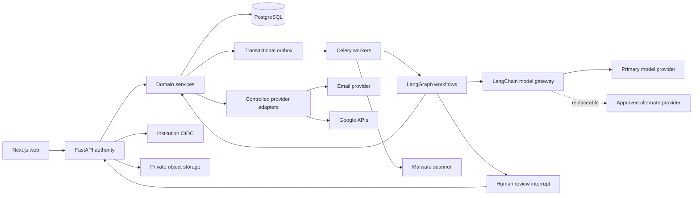

# PlacementOS AI Provider Integration and Production Transformation Plan

> Status: proposed post-P13 roadmap, prepared 4 November 2026. This document plans the transition from the current synthetic-demo baseline to a production-capable application using real model and provider APIs. It does not authorize provider spending, production deployment, real student data, or messages to real recipients.

## 1. Objective

Transform PlacementOS from release 0.13.0, which uses deterministic development fixtures for model-like behavior, into a real institution-onboarded recruitment operations platform with:

- real AI model calls through a provider-neutral LangChain boundary;
- durable, human-supervised LangGraph workflows;
- production OIDC identity, private storage, malware scanning, email and approved Google connectors;
- no sample institutions, users, students, companies, drives or decisions created in production;
- real institutional configuration and verified imports instead of hard-coded operational facts;
- observable, evaluated and cost-bounded AI behavior;
- fail-closed authorization, approval and deterministic eligibility boundaries; and
- repeatable deployment, backup, recovery, security and operational procedures.

“Full-fledged AI application” does not mean autonomous authority. Models may interpret, classify, explain and propose. They must not establish academic truth, decide eligibility, approve a consequential action, broaden an audience, send a message, write to a provider, or change production configuration.

## 2. Starting point

The existing application already provides the transaction, security and workflow foundation:

- FastAPI domain authority, Pydantic contracts, SQLAlchemy and Alembic;
- Next.js and a typed API client;
- PostgreSQL business records and row-level tenant scope;
- Redis/Celery transport with persisted jobs and transactional outboxes;
- LangGraph workflow state and PostgreSQL checkpoints;
- exact proposals, human approval and controlled execution;
- deterministic eligibility and document-readiness separation;
- versioned source evidence, interpretations, policies and decisions;
- private S3-compatible object boundaries;
- local connector contracts and deterministic acceptance tests; and
- synthetic scale, restore, accessibility and security evidence through P13.

The following components are not production integrations yet:

| Component | Current state | Required production transition |
| --- | --- | --- |
| JD interpretation | Deterministic regex fixture/manual entry | Real structured model adapter with evidence validation and manual fallback |
| Exception planning | Deterministic fixture/manual plan | Real proposal-only reasoning model with an operation allowlist |
| Identity | Development personas | Institution OIDC plus administered memberships and capabilities |
| Data | Synthetic fixtures and manually imported demo records | Empty production tenant plus verified institution imports and user onboarding |
| Malware scan | Development fixture | Isolated real scanning service |
| Email | Mailpit/local SMTP boundary | Approved transactional provider, verified sender and reconciliation |
| Object storage | Local S3-compatible service | Institution-approved private production object storage and key management |
| Google APIs | Fake-provider/local acceptance | Explicitly authorized OAuth and isolated live acceptance |
| Observability | Local structured operational projections | Production metrics, traces, alerting, redaction and incident ownership |

## 3. Non-negotiable authority boundaries

The transition must preserve `INV-01` through `INV-12` from `Agents.md`. In particular:

1. Eligibility remains deterministic. A model can extract a proposed threshold, but only an approved immutable policy can provide that threshold to the rules engine.
2. Missing or conflicting academic evidence remains `needs_review`; model confidence cannot convert it into a pass or rejection.
3. Every material extracted fact must cite a locator from the immutable source or an attributed human correction.
4. Model output is untrusted application data and never proof of approval.
5. A revision invalidates dependent suggestions, proposals and unsent work.
6. Institution and object authorization is checked by APIs, services, workers, exports and workflow resume commands.
7. Models receive no unrestricted SQL, shell, storage-administration, mail-send or calendar-write tool.
8. External actions remain immutable, approved, idempotent and reconciled.
9. Prompts, models, inputs, outputs, corrections and decisions are revisioned and attributable.
10. Student data sent to a model is minimized and governed by an approved provider policy.

## 4. Target architecture



### 4.1 LangChain responsibility

LangChain will provide the replaceable chat-model integration, provider-native structured output, prompt composition, model middleware and normalized usage metadata. All model responses must resolve into Pydantic domain suggestion schemas before entering a domain service. LangChain structured output supports predictable JSON/Pydantic results and provider-native or tool-based strategies; PlacementOS will prefer provider-native structured output where the approved provider supports it. See the [official LangChain structured-output documentation](https://docs.langchain.com/oss/python/langchain/structured-output).

### 4.2 LangGraph responsibility

LangGraph will coordinate typed, durable workflows that pause for review, resume after restarts and separate model nodes from side-effect nodes. Checkpoints contain identifiers, revisions and minimal workflow state, not provider secrets or unnecessary student documents. LangGraph persistence is designed for interruption and failure recovery, while interrupts persist state and wait for external input. See the official [LangGraph persistence](https://docs.langchain.com/oss/python/langgraph/persistence) and [interrupts](https://docs.langchain.com/oss/python/langgraph/interrupts) documentation.

### 4.3 Model-provider responsibility

The first implementation may use OpenAI, but application code must target a PlacementOS model gateway rather than the provider SDK directly. Model identifiers remain configuration selected through evaluation, not a permanent business rule. The OpenAI Responses API supports strict JSON-schema output; PlacementOS will use structured responses rather than parsing free-form JSON. See the official [OpenAI Structured Outputs documentation](https://developers.openai.com/api/docs/guides/structured-outputs?api-mode=responses).

## 5. Production data policy: no pre-seeded runtime data

Production must start with an empty business dataset. Automated test fixtures remain necessary for regression testing, but they must be technically unable to seed or authenticate against production.

Required controls:

- Development personas and `/auth/dev-login` remain unavailable in production.
- Fixture interpreter, fixture scanner, fake provider and fixture recovery planner fail production configuration validation.
- Production startup never creates institutions, memberships, students, companies, drives, policies or sample documents.
- A bootstrap command may create only the first institution-admin invitation after explicit operator input; it cannot create demo records.
- Institutions are created through an audited onboarding workflow.
- Users originate from OIDC claims and authorized membership provisioning.
- Students originate from an authorized verified import or approved institutional integration.
- Companies and drives originate from coordinator commands or explicitly selected provider sources.
- Every environment carries a visible data classification: `test_fixture`, `synthetic_demo`, `pilot` or `production`.
- Production database and buckets cannot be reused by test or demo jobs.
- Test data factories remain under test-only paths and are excluded from runtime images.

## 6. Phase sequence

### P14: Governance, provider selection and acceptance contracts

**Objective:** Decide the legal, operational and technical boundaries before transmitting any application data to a model.

Tasks:

- **P14-T01:** Select the initial model provider and one evaluated model identifier; record why it fits structured extraction, region, latency and cost requirements.
- **P14-T02:** Approve what data classes may be sent: public/synthetic JD text first, institution JDs later, and student data only if separately approved.
- **P14-T03:** Record provider retention, training-use, data-region, subprocessors and deletion decisions without claiming legal compliance.
- **P14-T04:** Assign AI service, security, privacy, cost and incident owners.
- **P14-T05:** Define measurable acceptance datasets and field-level quality metrics.
- **P14-T06:** Define failure behavior: timeout, rate limit, refusal, incomplete output, malformed schema, provider outage and budget exhaustion.
- **P14-T07:** Freeze model authority: proposal-only capabilities and explicitly prohibited tools/actions.

Exit gate:

- provider and model are chosen for a synthetic-data implementation;
- data policy and owners are recorded;
- evaluation fixtures and acceptance thresholds exist; and
- no API credential has entered source control, browser storage, logs or checkpoints.

### P15: Model gateway, secrets and LangChain foundation

**Objective:** Replace direct fixture selection with a real, testable provider-neutral model boundary.

Tasks:

- **P15-T01:** Add pinned compatible LangChain core and provider integration dependencies after verifying official compatibility with the existing Python and Pydantic versions.
- **P15-T02:** Define a `ModelGateway` protocol with typed operations such as `interpret_jd` and `propose_recovery_plan`; domain services must not import a provider SDK.
- **P15-T03:** Implement the initial LangChain provider adapter using structured Pydantic output and bounded async calls.
- **P15-T04:** Add modes `disabled`, `fixture` and `provider`; production permits only `disabled` or a fully configured approved provider.
- **P15-T05:** Add server-only secret configuration, model ID, provider name, data region, timeout, retry, request/token and monetary limits.
- **P15-T06:** Add separate development and production workload identities. For OpenAI, local development may use a project key; deployed workloads should use a project service account or supported workload identity, with credentials stored in a secret manager. See the official [OpenAI API key and service-account guidance](https://developers.openai.com/api/docs/guides/api-keys).
- **P15-T07:** Persist safe invocation metadata: institution, operation type, provider, model, prompt version, source/input hash, output hash, tokens, latency, result status, refusal/incomplete status and correlation ID.
- **P15-T08:** Never persist the API key, authorization header, raw secret, or unrestricted provider response in ordinary logs/checkpoints.
- **P15-T09:** Add bounded retry only for unambiguously safe transient failures; record each attempt and never multiply a consequential provider action.
- **P15-T10:** Implement a circuit breaker and manual fallback when the provider is unavailable or the institution budget is exhausted.

Suggested configuration contract:

```text
PLACEMENTOS_MODEL_INTERPRETER_MODE=provider
PLACEMENTOS_MODEL_PROVIDER_NAME=openai
PLACEMENTOS_MODEL_ID=<evaluated-and-pinned-model-id>
PLACEMENTOS_MODEL_API_KEY=<injected-secret-reference-or-value>
PLACEMENTOS_MODEL_DATA_REGION=<approved-region>
PLACEMENTOS_MODEL_TIMEOUT_SECONDS=30
PLACEMENTOS_MODEL_MAX_CALLS_PER_DRIVE=<approved-limit>
PLACEMENTOS_MODEL_MAX_INPUT_TOKENS_PER_DRIVE=<approved-limit>
PLACEMENTOS_MODEL_MONTHLY_BUDGET_MINOR_UNITS=<approved-limit>
```

The key is supplied through an ignored local environment file only for development and through a secret manager/workload identity in deployed environments. It is never requested through the PlacementOS UI.

Exit gate:

- a real model can be called with synthetic input through the gateway;
- structured output, refusal, timeout, rate-limit and invalid-response paths are tested;
- fixture/manual fallback remains available; and
- secret and usage scans pass.

### P16: Real AI-backed JD interpretation

**Objective:** Replace regex-only interpretation with grounded, reviewable model suggestions while preserving source evidence and deterministic policy compilation.

Graph nodes:

1. load authorized immutable extraction reference;
2. minimize and segment input under configured limits;
3. call the LangChain structured-output interpreter;
4. validate schema and evidence locators;
5. compare every excerpt with the immutable extracted text;
6. detect unresolved, contradictory or unsupported criteria;
7. persist a candidate interpretation revision;
8. interrupt for coordinator review and clarification;
9. persist attributed corrections; and
10. compile a policy proposal only after required clarifications are resolved.

Tasks:

- **P16-T01:** Define a strict `JDInterpretationCandidate` schema with nullable unknowns, evidence locators, confidence as review metadata, contradictions and clarification questions.
- **P16-T02:** Version prompts separately from application releases and bind each invocation to a prompt hash/version.
- **P16-T03:** Treat the source as untrusted data and explicitly isolate it from system instructions.
- **P16-T04:** Reject invented excerpts, unknown locators, unsupported fields and invalid branch/scale values.
- **P16-T05:** Preserve date-only deadlines as unresolved until a coordinator confirms time and timezone.
- **P16-T06:** Keep manual interpretation available when the provider is disabled, unavailable or institutionally prohibited.
- **P16-T07:** Add a coordinator comparison UI showing source text, model suggestion, evidence, ambiguity and correction history.
- **P16-T08:** Invalidate dependent pending proposals when a source, extraction, prompt contract or reviewed interpretation changes.

Evaluation suite:

- known normal and ambiguous JDs;
- conflicting thresholds and multiple attachments;
- branch aliases and CGPA-scale ambiguity;
- missing deadline time/timezone;
- prompt-injection instructions inside source text;
- malformed or encrypted documents;
- provider refusal, timeout, truncated output and rate limiting;
- field precision/recall, ambiguity recall, unsupported-fact rate, locator validity, correction rate, latency, token usage and cost.

Exit gate:

- the real model meets the approved synthetic/public evaluation thresholds;
- every accepted material fact has valid source evidence or a human correction;
- an invalid model response cannot create or approve a policy; and
- the deterministic eligibility suite remains unchanged and green.

### P17: LangGraph production workflow migration

**Objective:** Make the real model path durable, restart-safe, human-supervised and version-compatible.

Tasks:

- **P17-T01:** Define typed graph state containing only IDs, revision fingerprints, statuses and minimal results.
- **P17-T02:** Split model calls, persistence, human interrupts and side-effect execution into separate nodes.
- **P17-T03:** Use PostgreSQL checkpointers with backend-generated thread IDs; clients never supply arbitrary graph state.
- **P17-T04:** Resume only through an authenticated command that revalidates institution, object scope, capability and current revision.
- **P17-T05:** Add node retry policies for model/network failures without replaying completed business mutations.
- **P17-T06:** Add graph and state-schema versions plus an inventory/migration policy for waiting runs.
- **P17-T07:** Encrypt or omit sensitive checkpoint fields and validate that secrets/document bodies are absent.
- **P17-T08:** Add operational views for running, waiting, stale, failed, cancelled and incompatible workflows.
- **P17-T09:** Test API, worker, Redis and model-provider interruption at every persistence boundary.

Exit gate:

- a workflow pauses for review, survives API/worker restart and resumes exactly once;
- stale revisions cannot resume;
- incompatible graph versions fail visibly; and
- provider failure does not corrupt the drive or duplicate a side effect.

### P18: Real exception-resolution proposals

**Objective:** Replace the deterministic exception-planner fixture with bounded model reasoning while keeping deterministic impact analysis and controlled execution.

Tasks:

- **P18-T01:** Feed only minimized deterministic impact evidence and allowlisted operation definitions to the model.
- **P18-T02:** Require a strict `RecoveryPlanCandidate` schema with ordered steps, preconditions, expected effects, risks and human-review notes.
- **P18-T03:** Reject any operation not in the server-owned allowlist.
- **P18-T04:** Resolve all target IDs server-side; model-supplied IDs are references requiring authorization, not authority.
- **P18-T05:** Recompute the dependency fingerprint before approval and before every execution step.
- **P18-T06:** Require exact human approval for the immutable plan.
- **P18-T07:** Keep communication correction as a frozen draft only; it requires a separate communication proposal and approval before sending.
- **P18-T08:** Keep a typed manual-plan fallback and visibly distinguish model-proposed from human-authored plans.

Exit gate:

- the real model produces only valid proposal candidates on the synthetic exception suite;
- malicious or unsupported actions are rejected;
- partial execution is attributable and restart-safe; and
- no exception is automatically marked resolved.

### P19: Real identity, institutional data and external providers

**Objective:** Remove all demo-runtime dependencies and connect only explicitly configured production services.

#### Identity and onboarding

- Implement institution OIDC discovery, authorization-code flow, callback validation and backend sessions.
- Map claims to a pending or existing institution membership; never trust a role claim without institution-approved mapping.
- Provide audited admin workflows for invitations, capabilities, coordinator assignments, revocation and session termination.
- Remove persona controls from production builds.

#### Institutional data

- Provide a mapping-driven, preview/commit student import with immutable source fingerprints and revision conflict checks.
- Add optional institution SIS integration only after its API and authority are specified.
- Require verified institutional evidence before academic values are eligible for evaluation.
- Start every production tenant empty and guide authorized administrators through configuration and import.

#### Files and scanning

- Deploy private quarantine and accepted-object namespaces with encryption, versioning and short-lived authorized downloads.
- Integrate a real scanner in a network-restricted document worker.
- Keep files quarantined when scanning is unavailable or inconclusive.

#### Communications and Google connectors

- Configure an approved production email provider, verified sender, reply-to identity, recipient limits, webhook/receipt behavior and uncertain-send reconciliation.
- Complete P11 isolated live Gmail, Sheets and Calendar acceptance with a dedicated test account before any institution account.
- Store OAuth tokens encrypted server-side, request only feature-specific scopes and revalidate scope/connection revision before every write.
- Keep live sends and calendar writes disabled until the exact sandbox acceptance gate passes.

Exit gate:

- a newly created empty institution can onboard through real OIDC, configure policy, import verified records, ingest a real JD and complete a sandboxed drive;
- no development persona, fixture provider or sample record is available in production; and
- every external action is approved, attributable and reconciled.

### P20: Production infrastructure, privacy and observability

**Objective:** Operate the real application safely and reproducibly.

Tasks:

- **P20-T01:** Build immutable API, worker and web images from pinned lockfiles with dependency and image scanning.
- **P20-T02:** Use separate runtime, migration and workflow database roles; retain RLS and test each worker scope.
- **P20-T03:** Use a production secret manager or supported workload identity; rotate credentials and audit access.
- **P20-T04:** Deploy managed or operationally owned PostgreSQL, Redis, private object storage, scanner and email services according to approved objectives.
- **P20-T05:** Add OpenTelemetry-compatible traces/metrics and structured redacted logs for API, jobs, graphs, model calls and providers.
- **P20-T06:** Alert on model error/refusal rate, latency, cost, token cap, correction rate, outbox age, unknown sends, scan outages, queue depth and restore failures.
- **P20-T07:** Define retention/deletion across source files, extractions, model inputs/outputs, checkpoints, exports, logs and backups.
- **P20-T08:** Back up encrypted database/checkpoint/object data and reapply tombstones before restoring access.
- **P20-T09:** Add rate limiting, egress restrictions, CSP, CSRF/origin enforcement, vulnerability management and incident runbooks.
- **P20-T10:** Establish staging and production as separate accounts/projects, databases, buckets, OAuth clients, provider keys and sender identities.

Exit gate:

- clean-environment deployment and rollback are reproducible;
- operations can detect and diagnose failures without exposing private content;
- restore meets the approved RPO/RTO; and
- all real-data readiness checks pass with named owners.

### P21: Shadow mode, institutional acceptance and controlled launch

**Objective:** Prove real AI behavior and complete workflows before allowing it to influence a live drive.

Rollout stages:

1. **Synthetic provider acceptance:** real model API, synthetic/public JDs, no live connectors.
2. **Sandbox integration acceptance:** isolated OIDC/email/Google accounts and synthetic students.
3. **Authorized shadow mode:** model analyzes permitted pilot JDs while coordinators continue the existing manual path; suggestions cannot publish or execute.
4. **Reviewed-assistance pilot:** coordinators may adopt reviewed model suggestions into immutable policies and drafts.
5. **Limited institution pilot:** one configured institution and bounded cohort with live providers, support coverage and rollback.
6. **Measured expansion:** additional institutions or features only after quality, safety, cost and operational evidence.

Tasks:

- **P21-T01:** Compare model suggestions with coordinator-reviewed ground truth without silently adopting them.
- **P21-T02:** Record field-level correction and rejection reasons to improve prompts/evals, not to modify deterministic decisions.
- **P21-T03:** Perform security, privacy, authorization, prompt-injection and tenant-isolation review.
- **P21-T04:** Rehearse provider outage, key revocation, quota exhaustion, Redis outage, worker crash, database restore and rollback.
- **P21-T05:** Obtain explicit institution signoff for data use, permissions, academic configuration, sender, retention, owners and launch scope.
- **P21-T06:** Enable live features individually with kill switches and institution-specific configuration.
- **P21-T07:** Publish honest operational status: suggested, reviewed, approved, queued, provider accepted, delivered or uncertain.

Exit gate:

- acceptance evidence meets the agreed quality/safety/cost thresholds;
- live operation has named owners and rehearsed rollback;
- the institution signs off on the bounded pilot; and
- fixtures and demo data remain impossible in production.

## 7. Model invocation record

Each model call should produce a restricted metadata record similar to:

```text
institution_id
operation_kind
source_artifact_id or impact_analysis_id
source_revision and dependency_fingerprint
provider_name and connection_revision
model_id
prompt_name, prompt_version and prompt_hash
structured_schema_version
input_hash and output_hash
input/output token counts
latency and attempt count
status: completed | refused | incomplete | invalid | timed_out | rate_limited | failed
provider_request_id or trace reference, when safe
created_at and correlation_id
```

Raw private inputs/outputs are stored only when the approved policy requires them, in restricted evidence storage with retention and access controls. They do not belong in general logs, audit payloads or LangGraph checkpoints.

## 8. Evaluation and release gates

### 8.1 JD interpreter

- material-field precision and recall;
- contradiction and missing-field detection;
- valid locator/excerpt rate;
- unsupported-fact and invented-evidence rate;
- coordinator correction/rejection rate;
- prompt-injection resistance;
- refusal/incomplete response handling;
- latency, tokens and cost per document; and
- stable behavior for a pinned prompt/model/schema version.

### 8.2 Recovery planner

- allowlisted-operation compliance;
- dependency/precondition completeness;
- invalid target/reference rejection;
- manual fallback availability;
- stale-plan invalidation;
- no direct external effect; and
- human approval and cancellation behavior.

### 8.3 Production system

- cross-institution and cross-student negative tests;
- OIDC claim/membership/revocation tests;
- secret leakage scans across files, logs and checkpoints;
- provider timeout/rate-limit/unknown-outcome tests;
- graph restart/replay/version tests;
- outbox crash-boundary and idempotency tests;
- real scanner failure and quarantine tests;
- backup/object/tombstone restore drill;
- accessible coordinator/student journeys; and
- tenant-scoped load and cost measurement.

Acceptance thresholds must be approved before evaluation results are viewed. A phase is not complete because one demonstration succeeded.

## 9. Feature flags and rollback

Required kill switches:

```text
MODEL_INTERPRETER_MODE=disabled|fixture|provider
EXCEPTION_PLANNER_MODE=disabled|fixture|provider
LIVE_SEND_ENABLED=false|true
GOOGLE_CONNECTORS_ENABLED=false|true
REAL_DATA_ENABLED=false|true
```

Production never allows `fixture`. Disabling a model returns the workflow to attributed manual entry; it must not make sign-in, record access, deterministic eligibility or approved historical evidence unavailable. Disabling an external provider leaves durable work pending or marked for reconciliation rather than pretending it completed.

Rollback rules:

- application rollback must understand existing graph/checkpoint and schema versions;
- prompt or model rollback creates a new configured revision and does not rewrite invocation history;
- approved proposals remain bound to their original dependencies;
- provider writes are reconciled, never undone through blind replay; and
- database rollback cannot discard records written by a newer release.

## 10. Definition of production-ready PlacementOS

PlacementOS is production-ready only when all of the following are evidenced:

- production starts empty and has no persona/fixture/sample-data path;
- real OIDC establishes institution-scoped users and administered capabilities;
- real institutional data enters through verified, audited imports/integrations;
- real model calls use an approved provider, pinned model, strict schema, versioned prompt and bounded budget;
- model suggestions remain source-backed and human-reviewed;
- eligibility remains deterministic and reproducible;
- files use private storage and real quarantine scanning;
- communications/connectors use approved accounts and exact approvals;
- LangGraph pauses, resumes, retries and upgrades safely through PostgreSQL checkpoints;
- workers and APIs enforce RLS/service authorization;
- secrets are injected and rotated outside the repository;
- logs/traces/metrics are redacted and operationally owned;
- backup, restore, deletion and provider-outage procedures pass rehearsal;
- security, privacy and institutional configuration gates are signed off; and
- a bounded pilot meets its agreed quality, safety, performance and cost targets.

## 11. Recommended immediate implementation order

1. Approve P14 provider/data-policy decisions.
2. Implement P15 model gateway and secret-safe real API call.
3. Complete P16 real JD interpretation on synthetic/public documents.
4. Migrate that path into P17 durable LangGraph execution.
5. Add P18 real recovery proposals only after JD interpretation is evaluated.
6. Complete P19 production identity, verified data, scanner, email and connector acceptance.
7. Complete P20 staging/production operations and security gates.
8. Execute P21 shadow mode and limited institutional launch.

The first coding slice should be deliberately narrow: one real structured JD-interpretation call, one immutable synthetic source, one persisted invocation record, one coordinator review screen, and a manual fallback. Do not begin with a general-purpose autonomous agent or unrestricted tools.
