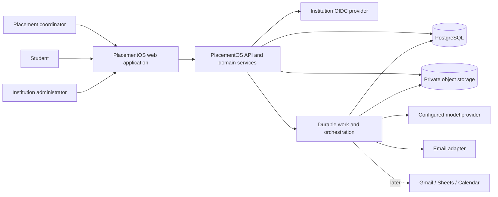
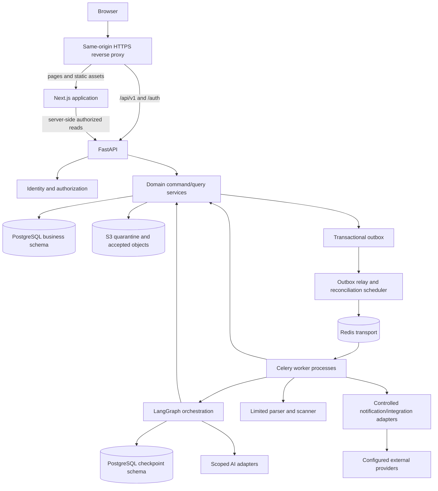
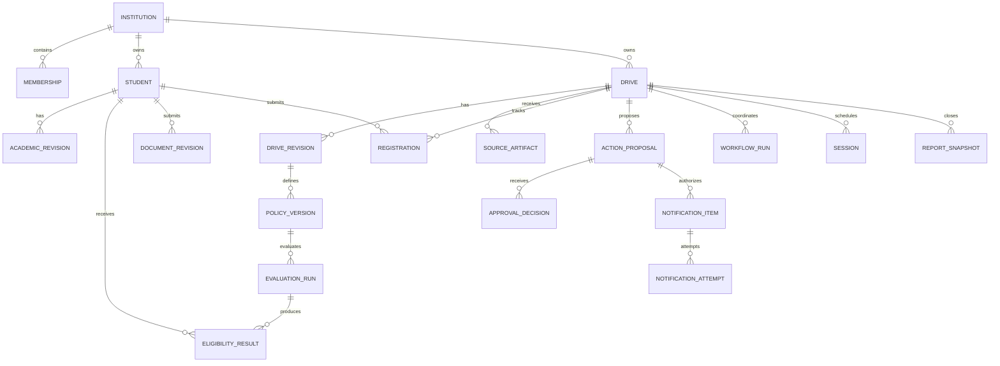
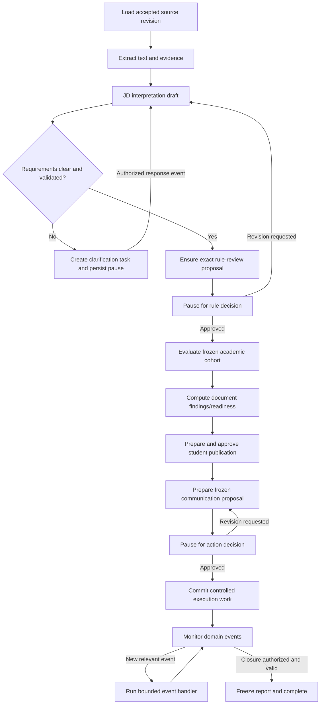
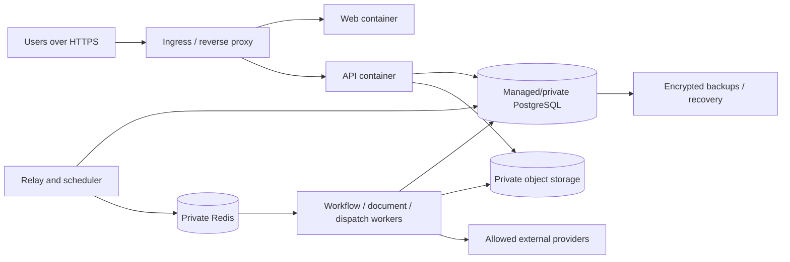

# PlacementOS: Architecture and Technical Reference

> Status: implementation baseline, updated 30 October 2026. This file is the canonical technical reference; implemented routes and schema currently extend through P06, while later sections remain target contracts.

## 1. Architectural intent

PlacementOS combines an ordinary transactional application with controlled AI interpretation and durable orchestration. The backend owns all business authority. AI components produce candidate facts and proposals. Deterministic services calculate eligibility, validate operational constraints, and execute approved commands. LangGraph coordinates these components and persists the position of long-running workflows.

The supplied architecture image establishes Next.js, FastAPI, LangGraph, specialized AI components, deterministic services, approval enforcement, PostgreSQL, object storage, and email/Sheets/Calendar integration boundaries. This document fills in the engineering choices required to make that architecture executable.

Read product semantics in [PROJ_SPECIFICATION.md](PROJ_SPECIFICATION.md), engineering instructions in [Agents.md](Agents.md), and implementation sequencing in [PLAN.md](PLAN.md). Requirement groups use the `FR-*` identifiers defined in the specification; the twelve `INV-*` invariants are defined in `Agents.md`.

### 1.1 Core decisions

| Decision | Baseline | Reason and consequence |
| --- | --- | --- |
| Application shape | Monorepo; modular FastAPI backend; separate worker processes | Simple development and shared transactions without premature microservices. |
| Frontend | Next.js App Router, React, TypeScript | Coordinator and student applications share typed contracts and components. |
| Backend authority | FastAPI domain services | A single implementation of permissions, rules, approvals, and state transitions. |
| Persistence | PostgreSQL business tables and separate LangGraph checkpoint schema | Relational integrity and durable orchestration, with clear ownership. |
| Background work | Celery with Redis transport and PostgreSQL job/outbox records | Queue delivery can be repeated; durable intent remains in the database. |
| AI | Provider-neutral adapter; scoped LangChain model calls | Replaceable models and deterministic fixture mode; no unrestricted agent toolbox. |
| Workflow | Python LangGraph with durable PostgreSQL checkpointer | Human pauses and resumable processing. |
| Files | Private S3-compatible object storage | Immutable file revisions, quarantine, scalable binary storage. |
| Identity | OIDC through a maintained Python client; backend-owned opaque sessions | Institutional SSO without exposing provider tokens to browser JavaScript. |
| Deployment | Containerized web, API, workers, relay/scheduler; managed data services when selected | Supports a local Compose environment and a modest pilot. |
| Integration timing | Local adapters first; live Google connectors later | Core product can be implemented and demonstrated independently. |

## 2. System context



Trust boundaries exist between the browser and backend; backend and institutional data; parser and uploaded files; orchestration and model output; and approved domain actions and external providers. An uploaded JD may contain arbitrary instructions. It cannot cross those boundaries to obtain execution authority.

## 3. Container and component design



Celery transports work; LangGraph coordinates workflow; domain services own business transitions. They are complementary. A graph node does not spawn an independent untracked agent process. A Celery task does not become the source of truth for a policy or approval.

### 3.1 Runtime processes

| Process | Responsibility | Must not own |
| --- | --- | --- |
| Web | Render screens, forms, role-aware navigation, API consumption | Eligibility authority, database writes, provider credentials. |
| API | Identity/session, authorization, validated commands, queries, job creation | Long-running parsing/model work in request handlers. |
| Workflow worker | Execute/resume graph runs and domain jobs | Arbitrary user impersonation or unrestricted SQL tools for models. |
| Document worker | Scan/parse/validate uploaded files under limits | General network access or shell execution from file contents. |
| Dispatch worker | Claim approved operations and call adapters | Generating new wording or expanding approved audiences. |
| Relay/scheduler | Publish durable work, reconcile stuck jobs, enqueue due checks | Independent business authorization or duplicate cron semantics. |

These can initially use one worker image with separate queue names and commands. Separate queues protect dispatch from long-running parsing. Use one elected/single scheduler instance at first; due-operation uniqueness must still protect against a second instance starting accidentally.

FastAPI supports in-process background tasks, while its documentation points to queue tools for heavier multi-process work. PlacementOS chooses durable queued work for critical processing and dispatch; ordinary ephemeral post-response helpers are not a substitute for that design. [FastAPI background tasks](https://fastapi.tiangolo.com/tutorial/background-tasks/).

## 4. Technology stack and version policy

| Layer | Selected baseline | Notes |
| --- | --- | --- |
| UI | Next.js, React, TypeScript | App Router; route groups for coordinator/student/admin. |
| UI styling | Tailwind CSS with accessible headless primitives | Shared form, dialog, table, status, and evidence components; choose one component convention. |
| Client data | TanStack Query for interactive server state | Server Components may perform authorized initial reads; avoid two independent caches for the same mutable screen. |
| Forms | React Hook Form and Zod | Client validation improves interaction; Pydantic remains the authoritative request validator. |
| API | FastAPI, Uvicorn, Pydantic | Versioned REST API, generated OpenAPI, typed DTOs. |
| Data access | SQLAlchemy and Alembic; psycopg driver | Explicit transactions and migration history. |
| Business database | Supported PostgreSQL release | JSONB for validated versioned payloads; relational columns/constraints for identity and relationships. |
| Queue | Celery and Redis | DB-backed intent/job state; Redis is not a durable business ledger. |
| Orchestration | LangGraph plus PostgreSQL checkpoint package | Persistent pause/resume; versioned graph state. |
| Model calls | LangChain structured-output adapter | Only narrow tasks; no general database/email tool binding. |
| PDF/DOCX | `pypdf`, `python-docx`, signature detection | Verify parser limits and behavior; OCR is an optional later adapter. |
| Malware scanning | ClamAV-compatible scanner adapter | Real scanner before pilot; fixture scanner visibly development-only. |
| Object SDK | boto3-compatible S3 adapter | Private quarantine and accepted namespaces/buckets. |
| Identity client | Maintained OIDC library, Authlib as initial candidate | Verify current compatible APIs during bootstrap; do not hand-roll the protocol. |
| Development mail | Mailpit | Sink plus recipient allowlist; distinguish from production delivery. |
| Python tooling | uv, Ruff, a single configured type checker, pytest | Locked Python environment. |
| JavaScript tooling | pnpm, ESLint, TypeScript, Vitest, Playwright | Locked JS environment; test the behavior appropriate to each layer. |
| Telemetry | Structured logs; OpenTelemetry-compatible tracing/metrics | Redaction and correlation are mandatory; a vendor service is optional. |
| Local infrastructure | Docker Compose / Linux containers | On Windows, use Docker Desktop/WSL for worker runtime. |

Do not interpret this table as a verified set of exact versions. During P01, choose a supported Node LTS and Python minor, verify the complete compatibility matrix, pin exact application dependencies and images, and commit lockfiles. Record runtime versions and commands in the repository. Prefer stable supported releases over preview features. The model identifier is configuration and must be recorded per call, not guessed from this planning document.

### 4.1 Deliberately excluded infrastructure

No vector database, Kubernetes, Kafka, service mesh, autonomous browser agent, or separate rules microservice is required for the initial product. Evidence can be retrieved by source ID/page/paragraph. PostgreSQL plus an outbox is sufficient for initial event-driven work. Add infrastructure only for a demonstrated requirement.

## 5. Repository layout

This structure was established in P01 and has since been extended through P06. The source inputs and four canonical reference documents remain preserved at the repository root; current implementation status is tracked in `PLAN.md`.

```text
PlacementOS/
  Agents.md
  PROJ_SPECIFICATION.md
  PLAN.md
  Architecture.md
  Description.txt
  Agents detail.png
  Workflow detail.png
  apps/
    web/
      src/app/
        (coordinator)/
        (student)/
        (admin)/
      src/components/
      src/features/
      src/lib/api/
      src/lib/auth/
      tests/
      package.json
  backend/
    src/placementos/
      main.py
      core/                 # settings, database, clock, security, errors
      api/v1/               # route registration and HTTP adapters
      identity/
      institutions/
      students/
      drives/
      sources/
      policies/
      eligibility/
      documents/
      registrations/
      approvals/
      notifications/
      scheduling/
      results/
      reporting/
      exceptions/
      workflows/
      integrations/
      audit/
      workers/
    migrations/
    tests/unit/
    tests/integration/
    tests/contract/
    tests/workflow/
    pyproject.toml
    uv.lock
    alembic.ini
  packages/
    api-client/              # generated TypeScript contracts/client
  infra/
    containers/
    compose/
  scripts/
  fixtures/                 # synthetic, checked-in data only
  docs/
    decisions/              # detailed ADRs if needed
    runbooks/
    developer-setup.md
  .env.example
  compose.yaml
  package.json
  pnpm-workspace.yaml
  pnpm-lock.yaml
```

Within a domain module, start with `models.py`, `schemas.py`, `service.py`, and focused helpers; add repositories/interfaces when they clarify real dependencies. Do not generate dozens of empty abstractions in advance. Domain services accept explicit actor/institution context, an injected clock, and a transaction/unit of work. Route handlers and task wrappers translate transport data and invoke these services.

## 6. Data ownership and storage boundaries

| Data | Authoritative store | Important rule |
| --- | --- | --- |
| Students, drives, policies, results | PostgreSQL business tables | Versioned, relationally constrained, institution-scoped. |
| Approval/proposal history | PostgreSQL business tables | Immutable proposal content and attributable decisions. |
| Work intent, jobs, attempts | PostgreSQL | Recoverable even if Redis loses queued messages. |
| Graph execution position | PostgreSQL checkpoint schema | References business revisions; not a replacement for them. |
| Original documents and extraction text | Private object storage; DB metadata | Accepted immutable object revision/version; no public bucket. |
| Sessions and OAuth connection metadata | PostgreSQL; encrypted secrets via managed keys | Session identifiers hashed; provider tokens never sent to browser. |
| Transport/cache | Redis | Disposable/reconstructible; no sole copy of approvals or jobs. |
| Generated exports | Private object storage, short retention | Snapshot metadata and authorized download. |
| Logs/traces | Operational logging system | Redacted metadata; sensitive evidence stays in restricted domain storage. |

Persist all instants as timezone-aware UTC (`timestamptz`), plus the intended IANA timezone where needed for display/business interpretation. Use exact `numeric`/Decimal academic values. Date-only values remain dates until an explicit cutoff instant is confirmed. IDs are UUIDs unless a provider requires a separately stored format.

## 7. Logical data model

The table inventory describes the target domain. Create tables when their phase needs them; do not implement every table in P01.

### 7.1 Identity, institution, and student data

| Entity | Core fields / relationships |
| --- | --- |
| `institutions` | ID, name, active configuration version, status. |
| `institution_config_versions` | Timezone, branch mapping, academic scale, capability policy, operational configuration; version and author. |
| `users` | Global identity reference; OIDC issuer/subject binding; display details. |
| `memberships` | Institution/user, role/capabilities, verified contact, status, revision. |
| `drive_assignments` | Institution, drive, coordinator membership, capabilities. |
| `auth_sessions` | Hashed random session token, user, expiry, revoked time, CSRF secret/reference, minimal authentication context. |
| `students` | Institution, stable institutional student number, membership link if claimed, current verified academic revision, profile revision. |
| `academic_record_revisions` | Student, normalized academic facts, verification status, source, verifier/time, revision, supersedes ID. |
| `academic_correction_requests` | Student-proposed facts and evidence, state, reviewer decision, resulting verified revision. |
| `student_imports` / `student_import_rows` | Original source reference, mapping/version, preview findings, row hashes, expected target revisions, commit results. |

An imported student may exist before first login. Claiming the profile requires a verified institutional identity/mapping, not merely knowing a roll number. A correction request does not overwrite a verified revision. Membership activation and academic verification are different concepts.

### 7.2 Recruitment sources, policies, and evaluation

| Entity | Core fields / relationships |
| --- | --- |
| `companies` | Institution-scoped company record and reviewed contact metadata. |
| `drives` | Institution/company, lifecycle, owner, current approved/published revision pointers, operational hold and reason, concurrency revision. |
| `drive_revisions` | Role, approved structured facts, dates, student-visible subset, document/process definitions, schema version, source references. |
| `source_artifacts` | Institution/drive, source kind, object key/version, hash, MIME, filename, scan/acceptance status, external-source identifiers. |
| `text_extractions` | Artifact/revision, parser version, method, text-object reference/hash, locator map, status. |
| `jd_extraction_revisions` | Candidate structured facts, model/prompt/schema metadata, validation findings, source hash. |
| `field_evidence` | Extraction/drive field path, source locator, excerpt reference, or attributed human correction. |
| `clarification_tasks` | Affected field, blocking flag, evidence conflict, owner, response/provenance, resolution. |
| `eligibility_policy_versions` | Drive/revision, typed rule payload, human summary, schema/engine compatibility, status, approval reference. |
| `evaluation_runs` | Policy, cohort fingerprint/revision, engine/config version, job state, completion counts. |
| `evaluation_cohort_members` | Evaluation/student, immutable academic revision and membership/roster reference used. |
| `eligibility_results` | Evaluation/student, outcome, predicate results, reason codes, facts snapshot reference, input fingerprint. |

### 7.3 Participation and documents

| Entity | Core fields / relationships |
| --- | --- |
| `drive_document_requirements` | Drive revision, document type, constraints, due stage/instant, filename rule. |
| `student_documents` | Student/type, current accepted revision pointer, ownership metadata. |
| `document_revisions` | Artifact/object version, submitted name, hash, upload session, scan state, supersedes reference. |
| `document_validation_runs` | Document revision plus drive requirement revision, validator version, findings, status. |
| `registrations` | Unique drive/student, state, submitted revision references, current hold reason, concurrency revision. |
| `registration_events` | Submitted/withdrawn/held/restored events with actor, reason, and policy/evaluation references. |

Readiness is normally computed from requirements and current validation runs; a cache may be materialized only with a complete dependency fingerprint. Reusing a resume across drives requires compatible requirements and an accepted immutable revision; it is not a blind pass based on the document type alone.

### 7.4 Approvals, messages, jobs, and workflow

| Entity | Core fields / relationships |
| --- | --- |
| `action_proposals` | Action type, immutable revision/payload, target, dependency map, canonical hash, state, requested-by, execution bounds. |
| `approval_decisions` | Proposal revision/hash, actor membership, decision/comment, permission context, time; append-only decision history. |
| `proposal_recipient_snapshots` | Proposal/recipient, address snapshot, inclusion reason, frozen merge values, rendered-content hash, dependency references. |
| `notification_batches` | Approved proposal reference, sender/adapter/connection version, overall state and counts. |
| `notification_items` | Unique batch/recipient/message-kind operation, exact render reference, status, claim lease, provider mapping. |
| `notification_attempts` | Item, attempt sequence, request correlation, start/end, outcome category, redacted provider response/message ID. |
| `domain_jobs` | Kind, scoped resource IDs, operation key, state, attempts, lease/heartbeat, error category. |
| `outbox_events` | Event/command envelope, payload reference, publish state, retry metadata, aggregate revision. |
| `processed_events` | Consumer/event ID uniqueness and processing result. |
| `workflow_runs` | Drive, thread UUID, graph/state version, status, current dependency references, pending proposal/case, last event. |
| `exception_cases` | Category, severity, affected resources, evidence references, owner, status. |
| `resolution_plan_versions` | Case, ordered proposed commands, expected revisions, approval requirements, outcome/step records. |

### 7.5 Scheduling, outcomes, integrations, audit

| Entity | Core fields / relationships |
| --- | --- |
| `recruitment_rounds` | Drive, ordered stage, prerequisite/outcome policy. |
| `sessions` / `session_revisions` | Round, current/published version, time interval, timezone, venue/link, capacity, panel, state. |
| `session_participants` | Session revision/student/registration, eligibility/readiness references, assignment state. |
| `attendance_records` | Session participant, state, recorder/time, correction history. |
| `round_result_revisions` | Student/round, employer outcome, source, recorded-by, supersedes reference, publication reference. |
| `report_snapshots` | Drive closure revision, dataset fingerprint, metrics/schema, generated artifact, report version. |
| `integration_connections` | Institution, provider, owner, scopes, encrypted secret reference, connection revision/status. |
| `provider_resource_mappings` | Local operation/resource, connection, external ID, external version/etag, sync fingerprint. |
| `audit_events` | Actor/action/resource, institution, timestamp, correlation/operation, revision references, restricted detail reference. |

### 7.6 Relationship sketch



### 7.7 Integrity and indexing requirements

- Institution-scoped entities include `institution_id`; foreign keys use composite scope where necessary so a row cannot reference another institution's drive/student.
- Uniqueness includes institution plus student number, institution plus membership user, drive plus student registration, proposal revision/decision guard, logical operation key, and consumer plus event ID.
- Do not store editable `eligible = true` flags on students or registrations. Current projections resolve to named evaluation results and freshness checks.
- Use optimistic `revision` values on mutable roots and `If-Match`/expected-revision contracts. Immutable approved payloads are insert-only until an authorized retention process applies.
- Index access patterns: institution/lifecycle/deadline, student/current revision, drive/evaluation/outcome, pending proposals, due outbox rows, job lease/status, notification state, and audit resource/time.
- Never rely on a JSON payload alone for cross-entity ownership or uniqueness. Validate JSON schema versions and enforce relational references explicitly.
- Append-only business history does not imply indefinite retention of personal data. A separate authorized retention/redaction process must cover sensitive historical payloads and derived copies.

## 8. Authentication and authorization

### 8.1 Same-origin browser model

Expose the web application and backend behind one public origin. Reverse proxy `/api/v1/*` and `/auth/*` to FastAPI; page/static routes go to Next.js. This avoids a default cross-origin credential model.

FastAPI owns the OIDC authorization-code flow with PKCE, state, nonce, registered redirect URIs, and validated issuer/audience. Use a maintained library. Map the verified issuer/subject to a user and existing/invited memberships; domain matching alone cannot create elevated access.

After sign-in, create an opaque cryptographically random session token. Store only its hash with expiry/revocation state. Set an `HttpOnly`, `Secure`, appropriately scoped `SameSite=Lax` cookie. Use a CSRF synchronizer token and trusted-origin checks on state-changing requests; never perform mutations through GET requests. Rotate sessions after authentication and privilege changes and bound idle/absolute lifetime.

Next.js performs presentation checks and authorized server-side reads. The API remains authoritative on every operation. Forward a browser session cookie only to the configured internal backend, not an arbitrary URL. Disable shared/static caching of personalized responses; apply `private`/`no-store` where appropriate. A protected layout alone is not a security boundary, consistent with Next.js guidance to validate authorization close to data access. [Next.js authentication guide](https://nextjs.org/docs/app/guides/authentication).

### 8.2 Scope resolution

1. Validate session and active user.
2. Resolve the requested institution against current active membership.
3. Validate capability and, where relevant, drive assignment.
4. Load the target with institution/object predicates.
5. Apply student ownership or resource-specific permission.
6. Revalidate at sensitive commands and external-action claim time.

Workers receive a service principal and persisted scoped job IDs. They rehydrate institution and target from database records and verify command-specific authority. They do not trust a queue payload's claimed institution or role.

### 8.3 PostgreSQL row-security defense

Apply institution-based row-security policies to scoped tables. Set the authenticated institutional context transaction-locally using trusted backend code; reset it correctly when pooling connections. Do not let client input set database session scope directly. Student ownership still needs explicit service checks and, where practical, additional row policies.

Use a non-owner runtime role without `BYPASSRLS`; separate migration/administrative roles. Policies must be exercised for API, worker, scheduled, export, and checkpoint-related access paths. PostgreSQL documents default-deny behavior when row security is enabled without a matching policy, and notes that owners/superusers can bypass ordinary policies. [PostgreSQL row security](https://www.postgresql.org/docs/current/ddl-rowsecurity.html).

LangGraph checkpoint tables need their own protected adapter/access path because their package-managed schema may not have application `institution_id` columns. Keep the checkpoint database role private to trusted workflow code, authorize a workflow-run lookup before accessing a thread, and test that arbitrary thread IDs cannot be supplied through public APIs. Do not claim generic table RLS automatically isolates package-managed checkpoints.

## 9. API conventions and contracts

### 9.1 Common behavior

- Prefix domain APIs with `/api/v1`.
- Use explicit commands for approval, publication, submission, cancellation, and resume instead of unrestricted status patches.
- Validate requests using Pydantic; generate OpenAPI and TypeScript contracts. Do not independently hand-maintain duplicate frontend interfaces for the same DTO.
- Use cursor pagination for growing lists, stable sort keys, bounded page size, and allowlisted filters.
- Use an `Idempotency-Key` for retryable commands that create logical operations. Persist the key with actor/institution/route and request hash; a changed payload using the same key returns conflict.
- For resource updates, require an expected revision/ETag. Return `409` for changed state and `412` for failed conditional headers where that contract is used consistently.
- Return `202 Accepted` and a persisted `job_id` for asynchronous operations; expose job status under scoped authorization.
- Use UTC ISO-8601 timestamps with offsets in APIs; include intended IANA timezone separately where required. Serialize decimals as strings.
- Do not include internal prompts, raw provider exceptions, private file keys, or other students' data in API responses.

### 9.2 Endpoint inventory

This is the representative contract inventory. Routes through P06 are implemented; later rows remain target contracts, with exact current paths generated in `packages/api-client/openapi.json`.

| Area | Representative endpoints | Important behavior |
| --- | --- | --- |
| Identity | `GET /auth/login`, `GET /auth/callback`, `POST /auth/logout`, `GET /api/v1/me` | OIDC callback validates protocol state; mutations use CSRF. |
| Students | `POST /student-imports`, `GET /student-imports/{id}/preview`, `POST /student-imports/{id}/commit` | Preview and commit separated; row revisions checked. |
| Corrections | `POST /students/me/academic-corrections`, `POST /academic-corrections/{id}/verify` | No direct student mutation of verified academics. |
| Drives | `POST /drives`, `GET /drives`, `GET /drives/{id}`, `POST /drives/{id}/revisions` | Scoped DTOs; immutable revision history. |
| Upload | `POST /uploads`, `POST /uploads/{id}/complete`, `GET /uploads/{id}` | Signed quarantine destination; server validation and immutable acceptance. |
| Sources | `POST /drives/{id}/sources`, `POST /sources/{id}/extract`, `GET /sources/{id}/extractions` | Bind accepted upload, queue parsing, evidence access. |
| Policy | `POST /drives/{id}/policies`, `POST /policies/{id}/submit-review` | Validate policy; create exact approval proposal. |
| Evaluation | `POST /drives/{id}/evaluations`, `GET /drives/{id}/evaluations`, `GET /evaluation-runs/{id}`, `GET /student/eligibility` | Freeze inputs; async deterministic run; scoped explanations. |
| Documents | `GET /drives/{id}/document-checklist`, `POST /students/me/documents`, `GET /documents/{id}/validations` | Own uploads and scoped findings. |
| Registration | `POST /drives/{id}/registrations`, `POST /registrations/{id}/withdraw` | Current eligibility and server-side cutoff. |
| Communications | `POST /drives/{id}/communication-drafts`, `POST /communication-drafts/{id}/freeze` | Freeze content and audience into a proposal. |
| Approvals | `GET /proposals`, `GET /proposals/{id}`, `POST /proposals/{id}/decisions` | Specific decision/hash/revision; never arbitrary graph state. |
| Dispatch | `GET /notification-batches/{id}`, `POST /notification-items/{id}/reconcile` | Unknown outcomes require evidence/review. |
| Workflow | `GET /workflow-runs/{id}`, `POST /workflow-runs/{id}/resume` | Resume references a persisted authorized decision/event. |
| Schedule | `POST /drives/{id}/sessions`, `POST /sessions/{id}/propose-publication` | Validate conflicts and freeze publication. |
| Results | `POST /rounds/{id}/result-revisions`, `POST /result-revisions/{id}/propose-publication` | Employer source and separate visibility decision. |
| Exceptions | `GET /exceptions`, `POST /exceptions/{id}/resolution-plans` | Structured plan; later agent can draft it. |
| Closure | `POST /drives/{id}/close`, `POST /drives/{id}/reopen`, `GET /drives/{id}/reports` | Preconditions, reason, snapshot, history. |
| Jobs/audit | `GET /jobs/{id}`, `GET /drives/{id}/audit` | Scoped polling and restricted detail. |

### 9.3 Error shape

```json
{
  "error": {
    "code": "PROPOSAL_STALE",
    "message": "The registration deadline changed. Review the updated proposal.",
    "correlation_id": "example-correlation-id",
    "details": {
      "resource_type": "action_proposal",
      "current_revision": 4,
      "changed_dependencies": ["drive_revision"]
    }
  }
}
```

Use `400/422` for malformed/domain-invalid input according to the API convention, `401` for missing/expired authentication, `403` for an authorized identity lacking capability, `404` where a resource is absent or hidden by scope, `409/412` for revision/state conflicts, `429` for limits, and `503` for an unavailable required dependency. Never let an error reveal a hidden student's identity.

## 10. Policy representation and evaluation engine

Use a restricted typed rule representation, not Python/JavaScript expressions or arbitrary SQL from a model. The initial engine supports conjunction of the four baseline predicates. Each criterion declares whether it is required or explicitly not required. Require at least one supported required academic predicate; an empty or entirely not-required policy is invalid. Unsupported company requirements block approval until modeled or resolved with source-backed clarification. New operators or criteria require schema validation, deterministic semantics, migration/version handling, and tests.

Illustrative approved payload, with fictional identifiers:

```json
{
  "schema_version": 1,
  "engine_contract": "eligibility-v1",
  "policy_version": 1,
  "branch": {
    "mode": "required",
    "operator": "in",
    "values": ["CSE", "IT"],
    "mapping_revision": "example-branch-map-v1"
  },
  "cgpa": {
    "mode": "required",
    "operator": "gte",
    "minimum": "7.50",
    "scale": "10.00"
  },
  "graduation_year": {
    "mode": "required",
    "operator": "in",
    "values": [2027]
  },
  "active_backlogs": {
    "mode": "required",
    "operator": "lte",
    "maximum": 0
  },
  "aggregation": "required_unknown_first_then_failure",
  "evidence_revision": "example-reviewed-drive-v1"
}
```

The engine takes `(approved_policy, verified_academic_revision, normalization_config, engine_version)` and returns immutable predicate findings plus an aggregate. It performs no network calls, model calls, random operations, or hidden database reads. A caller loads and authorizes inputs before invoking it.

Predicate findings include code, expected/actual normalized values, evidence status/revision, outcome, and explanation arguments. Stable reason codes include `BRANCH_NOT_ALLOWED`, `CGPA_BELOW_MINIMUM`, `GRADUATION_YEAR_NOT_ALLOWED`, `ACTIVE_BACKLOGS_EXCEED_LIMIT`, `REQUIRED_VALUE_MISSING`, `RECORD_UNVERIFIED`, `SCALE_UNSUPPORTED`, and `EVIDENCE_CONFLICT`. Localized prose can be rendered from these codes without changing the result.

Aggregation is deliberately conservative: any required unknown gives `needs_review`; otherwise any false gives `ineligible`; otherwise all required predicates true gives `eligible`. Invalid policy is an evaluation error, not a student result. Document readiness does not participate in academic eligibility.

### 10.1 Cohort snapshots and freshness

Create a frozen `evaluation_cohort_members` set with academic revision IDs in a transactionally consistent view. The evaluation worker can process chunks, but every chunk uses those frozen references. Do not read a student's newest record halfway through a run.

Persist a cohort fingerprint, policy revision, normalization version, engine version, and each result's input fingerprint. A newer academic revision, membership/cohort change, or policy revision can make the projection stale without deleting the historical run. Current registration/dispatch commands compare the relevant current dependencies. If exact incremental invalidation is not yet implemented, conservatively invalidate the affected drive evaluation; do not silently trust a potentially stale result.

## 11. Approval model and change invalidation

### 11.1 Immutable proposal envelope

Every consequential action is represented by a proposal with:

- Institution, drive/target, action type, schema version, proposal ID/revision, and creator.
- Exact structured payload; source/drive/policy/evaluation references relevant to the action.
- Dependency map with expected revisions, including roster/document/schedule data when the action uses them.
- Audience snapshot, sender identity, adapter/connection revision, frozen merge data and exact render hashes for communications.
- Earliest execution time, expiry, and any bounded batch constraints.
- Canonical payload/dependency hash, state, and decision/execution references.

Canonicalization must normalize timestamps and decimals and define stable ordering for unordered sets. Include schema version and institution context in the hashed envelope. A SHA-256 fingerprint detects a mismatch; it does not replace authorization, encryption, or a database constraint.

Approved content is never edited in place. A revision creates a new proposal and stales the prior unsent execution authorization. Decisions are append-only records; materialized current state is a projection maintained transactionally.

### 11.2 Dependency examples

| Action | Dependencies that must be captured |
| --- | --- |
| Approve policy | Drive/source/evidence revision, typed policy, normalization config, required clarification state. |
| Publish drive | Approved policy and exact student-visible drive revision, registration/document window. |
| Send invitation | Published drive revision, policy/evaluation/cohort, recipient contact revisions, sender connection, exact content. |
| Send missing-document reminder | Invitation dependencies as applicable plus requirement/current document findings and recipient snapshot. |
| Publish session | Session revision, capacity/conflicts, participant registrations, current eligibility/readiness and prerequisites. |
| Publish result | Exact result/source revision and intended student-visible audience. |
| Write calendar | Approved session and attendees, calendar/connection revision, notification options, provider mapping. |

Unrelated changes need not invalidate everything. A document replacement need not stale an invitation that does not depend on documents, but must stale a reminder about that document. Initially conservative broader invalidation is acceptable if explained in the UI.

### 11.3 Decision and execution boundary

Under a database transaction, lock the relevant mutable root/proposal, compare expected revisions and hash, verify current capability, persist the decision/audit, and create outbox work. Use a consistent lock order such as drive -> proposal -> operation to reduce deadlocks.

Before a dispatch worker claims each recipient operation, it locks/checks the same relevant roots, verifies freshness and current approval validity, and atomically marks the operation claimed with an attempt identity. This claim is the execution authorization boundary. Do not hold database locks during provider network calls.

After a claim, a concurrent cancellation or criterion change cannot guarantee prevention of an already in-flight network effect. Stop remaining unclaimed operations, show in-flight/unknown status, and reconcile. Do not claim that checking immediately before the call makes revocation atomic with an external provider. If stronger control is required later, use provider-supported scheduled/cancellable operations and document their guarantees.

## 12. Transactional work, notifications, and idempotency

### 12.1 Transactional outbox flow

```mermaid
sequenceDiagram
    participant U as Coordinator
    participant API as API service
    participant DB as PostgreSQL
    participant R as Outbox relay
    participant Q as Redis/Celery
    participant W as Dispatch worker
    participant E as Email provider
    U->>API: Approve exact proposal and expected revision
    API->>DB: Validate scope/freshness; commit decision, audit, intent, outbox
    API-->>U: Approved; execution pending
    R->>DB: Claim committed outbox work
    R->>Q: Publish operation ID
    R->>DB: Record publish observation
    Q->>W: Deliver operation ID, possibly more than once
    W->>DB: Revalidate; claim unique operation and attempt
    W->>E: Send frozen approved message
    E-->>W: Acceptance, rejection, or uncertain outcome
    W->>DB: Persist attempt outcome and progress
```

If relay publication succeeds but its database update fails, publication repeats; consumers deduplicate by durable operation key. If Redis loses data, a reconciliation scan re-enqueues committed pending work. Broker/result-backend task status is diagnostic, not authoritative.

### 12.2 Operation and attempt identities

Logical operation keys identify business intent, for example `(institution, approved_proposal_revision, recipient_snapshot, message_kind)`. A retry attempt has its own sequence/provider correlation under that operation. The database enforces logical uniqueness; a client-generated UUID alone does not prove uniqueness of business intent.

Use a provider's idempotency feature when available, but design for providers that do not support one. Celery supports redelivery and recommends idempotent task design; late acknowledgment does not solve business-level duplication by itself. Configure acknowledgment, worker-loss, timeout, visibility, and retry behavior deliberately and test the chosen settings. [Celery task behavior](https://docs.celeryq.dev/en/stable/userguide/tasks.html).

### 12.3 Failure classification

| Boundary/failure | Required handling |
| --- | --- |
| Domain transaction rolls back | No approved execution/outbox becomes visible. |
| Relay cannot reach broker | Retain pending outbox; retry with backoff and alert on age. |
| Duplicate queue delivery | Return existing operation state or continue only a safe persisted step. |
| Worker dies before provider attempt | Recover lease and retry if durable evidence proves no uncertain provider call began. |
| Worker dies after attempt start | Treat as potentially uncertain; reconcile rather than assuming no send occurred. |
| Known transient provider rejection | Retry boundedly when the provider guarantees nonacceptance. |
| Permanent address/auth/payload failure | Fail visibly; require correction/new authority where payload or sender changes. |
| Timeout/connection loss after possible acceptance | Mark `unknown`; use provider lookup or coordinator resolution before another send. |
| Provider acceptance | Record `provider_accepted`; do not fabricate delivery. |
| Verified delivery webhook | Verify/deduplicate event, then record delivered evidence. |

A lease expiry alone does not authorize resending an uncertain email. If reconciliation cannot determine the outcome, expose the uncertainty and require a deliberate approved replacement/resend decision. Exactly-once external delivery is not promised.

### 12.4 Scheduling future work

Store due reminders/deadlines as database rows and let a scheduler claim due work with uniqueness guards. Avoid parking a worker or relying on a long-lived in-memory timer. A due reminder first creates a draft/proposal with current inputs; it does not inherit unlimited approval from the initial announcement.

## 13. LangGraph design

### 13.1 State boundary

The minimum versioned graph state contains `institution_id`, `drive_id`, `workflow_run_id`, `graph_version`, `state_schema_version`, source/extraction/drive/policy/evaluation references, current step, pending proposal/clarification/case IDs, processed event reference, and structured error category.

Store large results in domain tables/objects and refer to them by ID. Never place provider tokens, signed URLs, full cohort data, raw student files, or unrestricted chat histories in checkpoint state. Restrict checkpoint access and retention as sensitive institutional data.

Each workflow run uses a stable opaque thread UUID mapped in `workflow_runs`. A drive may have several historical runs/revisions. A thread ID is a persistence identifier, not an authorization token.

### 13.2 Main workflow



Rejected proposals stop that proposed action; the coordinator may create a new revision deliberately. Cancellation/holds and failures are explicit routes from each active stage. The diagram simplifies those routes for readability; they must be implemented and tested.

### 13.3 Approval pause and resume

LangGraph persists thread checkpoints and supports interrupt/resume. Interrupting nodes can execute again when resumed, so PlacementOS uses idempotent proposal creation and separate approval/side-effect nodes. Compile production graphs with a durable checkpointer. Verify concrete APIs against the pinned version rather than copying changing streaming examples into the specification. [LangGraph persistence](https://docs.langchain.com/oss/python/langgraph/persistence), [LangGraph interrupts](https://docs.langchain.com/oss/python/langgraph/interrupts).

```mermaid
sequenceDiagram
    participant G as Graph worker
    participant D as Domain database
    participant P as Checkpointer
    participant C as Coordinator/API
    G->>D: Ensure proposal exists by deterministic operation key
    G->>P: Persist interrupt with proposal reference
    G-->>C: Waiting for a decision
    C->>D: Validate and persist exact decision plus resume outbox
    Note over G,C: Worker may restart; no human wait holds a process
    G->>D: Load authorized decision and current dependencies
    G->>P: Resume same thread with decision reference
    G->>D: Revalidate and continue idempotent domain command
```

The domain transaction and package-managed checkpoint transaction are not assumed to be atomic together. If a proposal commits before a crash but the checkpoint does not, replay finds the same proposal by operation key. If a decision commits before resume, the outbox retries resume. Reconciliation inspects domain state plus graph position and repairs the coordination gap without creating a new approval or side effect.

Never expose raw `Command`/checkpoint mutation through the public API. A client submits an authorized decision/event reference; trusted worker code loads and validates the canonical record. Do not catch framework interrupt control flow in broad exception handlers that turn it into an ordinary failure. Keep node order/state versions stable for waiting runs.

### 13.4 Monitoring and concurrency

Do not keep a worker in a loop while a drive is active. Monitoring is persisted state plus event-driven invocations. Each registration, document, schedule, or policy event is deduplicated and routed to a bounded handler/subgraph. Serialize the same run with a database lease/version guard and reject stale resumption.

After an initial processing graph reaches monitoring, a later event can trigger a distinct child operation with its own idempotency key. It must not traverse the original announcement branch again. Closure is a domain command with preconditions; the graph records its result.

## 14. AI adapter and evidence design

Use narrowly scoped calls with explicit input/output schemas and allowlisted retrieval functions. An LLM does not receive a generic SQL connection, unrestricted storage listing, Gmail client, calendar writer, shell, or notification dispatcher.

| Component | Read capability | Write capability |
| --- | --- | --- |
| JD interpreter | Current authorized source/extraction and locator map | New candidate extraction revision only. |
| Eligibility assistant, if used | Rule wording and limited discrepancy summary | Explanatory draft/review note only. |
| Document triage | Current deterministic findings and minimum authorized excerpt | Suggested category/review note only. |
| Communication drafter | Approved facts, template, intended audience type | Draft content only; audience computed by backend. |
| Exception planner, later | Scoped case, revision diffs, impact summaries | Structured recovery-plan proposal only. |

Validate output schema, source references, allowed field values, maximum lengths, and unsupported claims. Do not treat a model-generated confidence number as a calibrated probability. Keep the source text separate from instructions and disallow embedded content from changing tool permissions.

Field evidence includes artifact hash/revision, extraction revision, page/paragraph/character locator, exact supporting excerpt reference, and whether the field was source-derived or human-corrected. PDF page numbers are one-based in the UI; preserve any parser zero-based indices explicitly so there is no off-by-one evidence error.

Initial model-call budget is one call plus one repair attempt, configurable with hard per-job limits. Exhaustion creates a manual task. Cache keys include institution, source hash, parser/prompt/schema/model versions, and relevant configuration. Store accepted output once; approval and dispatch consume persisted revisions.

Evaluate JD extraction using synthetic/publicly permitted fixtures with labeled facts and ambiguities. Track evidence support, field correctness, missing-field handling, and coordinator correction rate. Avoid a single aggregate score that hides an incorrect eligibility threshold or deadline.

## 15. File upload, quarantine, and validation

### 15.1 Immutable acceptance pipeline

1. Authenticate/authorize the upload purpose and owner; persist an upload session.
2. Generate a random, purpose-scoped quarantine key and short-lived signed upload instructions. Apply provider-supported size/type conditions where possible.
3. After completion, inspect actual storage metadata, object size, file signature, and checksum. Client MIME/name/checksum declarations are only hints.
4. Bind the scan/parse job to an exact object version. If the storage service lacks versioning, copy accepted bytes to a fresh server-controlled final key that clients cannot overwrite.
5. Run malware scanning and bounded structural parsing in isolation. Limit CPU, memory, pages, decompression, recursion, and total extracted characters.
6. Persist findings against the immutable accepted version/hash. Only accepted versions become current document/source revisions.
7. Generate authorized short-lived download/preview URLs from accepted records; block quarantine preview and keep signed URLs out of logs.

S3 presigned upload URLs can be reused while valid and an upload to the same key can replace an existing object. Therefore a completed upload flag alone is insufficient: PlacementOS must pin object versions or promote validated bytes to a protected immutable key. [AWS presigned upload behavior](https://docs.aws.amazon.com/AmazonS3/latest/userguide/PresignedUrlUploadObject.html).

### 15.2 Validation levels

- **Security:** malware scan, safe parser/container behavior, format signature, resource limits. Security failure blocks ordinary access.
- **Operational structure:** presence, file size/format, PDF integrity, filename requirement, document type and drive compatibility.
- **Review assistance:** text-extraction difficulty, suggested category, possible mismatch, restricted duplicate findings.
- **Excluded claim:** authenticity of marksheets/IDs or employment suitability. Neither successful parsing nor AI classification proves authenticity.

Treat encrypted PDFs and macro-enabled/unsupported document types according to explicit policy; the baseline routes them to rejection or manual replacement rather than attempting passwords or executing macros. DOCX is a ZIP container: defend against decompression bombs and external relationships. Scanned PDF pages may be readable by a person even when text extraction is empty.

## 16. Scheduling and result architecture

Represent a round separately from its sessions and a session separately from student assignments. Validate half-open intervals, timezone conversion, capacity, venue, panel, and student conflicts under transaction/concurrency control. A client-only conflict check is insufficient when two coordinators publish concurrently.

For the initial pilot, use a serialized publication command per drive/resource with explicit conflict queries; add PostgreSQL exclusion constraints or a resource-calendar table if needed for robust cross-drive venue/panel conflicts. Document which resources share a calendar and enforce institution scope.

Publishing a session freezes its participant and schedule revision through the approval service. Student-facing schedule queries resolve only published assignments. Rescheduling makes a new version, revalidates constraints, and proposes correction communications. External Calendar writes are independent approved integration operations.

Results are employer-supplied facts with provenance and correction history. Their publication pointer is separate from the latest internal revision. Advancing a student to a later round uses the configured published prerequisite outcome, current registration, current eligibility, and document requirements. No agent infers rejection from attendance, email status, or absent data.

## 17. Event contracts and change propagation

Use versioned JSON envelopes containing event ID, event type/schema version, institution, aggregate type/ID/revision, actor/service reference, occurred-at instant, correlation/causation IDs, and a small payload or restricted payload reference. Never put whole student records in a transport event.

Typical events include `source.accepted`, `jd.reviewed`, `policy.approved`, `academic_revision.verified`, `evaluation.completed`, `document.validated`, `drive.published`, `registration.submitted`, `proposal.decided`, `notification.outcome_recorded`, `session.published`, `result.published`, and `drive.closed`.

Consumers deduplicate by event ID and enforce aggregate revision ordering/preconditions. Out-of-order events cannot overwrite newer projections. A stale event may be recorded as ignored with evidence rather than treated as an error requiring infinite retry.

### 17.1 Criteria-change propagation

```text
new source/correction
  -> proposed drive/policy revision
  -> authorized approval
  -> mark dependent evaluations/proposals stale
  -> stop unclaimed obsolete external work
  -> evaluate frozen current cohort under new policy
  -> compare old/new results
  -> preserve registrations and apply explicit holds
  -> create impact case and correction proposals
  -> approve and execute exact recovery actions
```

The MVP can perform these steps through explicit coordinator commands. The later exception agent drafts the plan; it does not acquire new execution authority.

## 18. Integration design

Define narrow adapters such as `ModelInterpreter`, `ObjectStore`, `MalwareScanner`, `MailTransport`, `MailboxReader`, `SpreadsheetGateway`, and `CalendarGateway`. Implement only the methods needed by a concrete use case. Persist provider request/response identifiers and normalize error categories without losing restricted diagnostic evidence.

### 18.1 Email

Start with a mail sink and a production transport selected for the institution. Store exact sender/reply-to identities and transport connection version in approval dependencies. Verify domain/sender setup as required by the chosen provider. A successful SMTP/provider response is acceptance, not inbox delivery.

### 18.2 Gmail

Separate mailbox reading from sending. Let the coordinator select a source message and attachments; persist immutable captured content. Request narrowly focused scopes for enabled features and verify current consent/verification requirements during P11. The Gmail scope documentation distinguishes sending from broader mailbox access. [Gmail authorization scopes](https://developers.google.com/workspace/gmail/api/auth/scopes).

### 18.3 Sheets

Use explicit source selection/range, schema mapping, preview, content/version fingerprint, and commit. Compare expected academic revisions before updating. Never silently merge authoritative data based on spreadsheet row order or display name. An export/write is a controlled operation with approved target/range/schema and exact snapshot.

### 18.4 Calendar

Store local-to-provider mappings and use stable provider-compatible event IDs where supported to help reconcile retries. Include notification options in the approved action: calendar insertion/update can send attendee emails. Approval of that exact calendar operation includes those disclosed invite effects; any separate PlacementOS email remains a separate communication proposal. [Google Calendar event creation](https://developers.google.com/workspace/calendar/api/guides/create-events).

External event edits become discrepancies requiring reconciliation. Do not silently replace the internal approved schedule with whatever the external calendar currently contains. Connection revocation or scope change stales affected pending actions and creates an operational case.

## 19. Security and privacy controls

| Threat | Required defense |
| --- | --- |
| Insecure direct object reference | Institution/object predicates, capabilities, row security, negative tests. |
| Cross-student document exposure | Owner-bound upload sessions, authorized immutable downloads, minimal DTOs. |
| Prompt injection in JD/email | Untrusted-data separation, no execution tools, schema/evidence validation, human review. |
| Malicious file | Quarantine, real scan, bounded parser isolation, safe preview/download. |
| CSRF/session theft | Opaque server-side sessions, secure cookies, CSRF/origin checks, expiry/revocation. |
| Stale approval/race | Revision fingerprints, transaction locks, per-operation claim boundary, visible in-flight limits. |
| Duplicate external effect | Durable operation uniqueness, attempt state, provider reconciliation. |
| Secret leakage | Encrypted token storage, secret manager/key rotation, redacted logs/checkpoints. |
| Spreadsheet formula injection | Safe CSV cell encoding for user-controlled values and tested export behavior. |
| Public caching of private responses | Private/no-store responses; no static generation or shared personalized cache. |
| Unbounded cost/denial of service | Upload/parse/model/job limits, rate limits, bounded retries, per-institution quotas. |

Keep application audit append-only to runtime users; restrict administrative access separately. Audit logs should primarily store identifiers, reason codes, revision references, and safe summaries. Full before/after private payloads, when needed, belong in restricted evidence storage with the same retention governance as source data.

Retention must cover originals, accepted revisions, extraction text, model inputs/outputs where retained, checkpoints, generated exports, notifications, logs, and backups. Deletion/anonymization is an authorized workflow that preserves necessary nonpersonal audit structure while removing applicable personal payloads. Do not assume a content hash is anonymous. Restore procedures must reapply deletion/tombstone records before exposing restored data, and backups must expire under the configured policy.

## 20. Observability and operations

Every API command, job, workflow run, proposal, and dispatch attempt carries correlation IDs. Use structured logs with safe error categories and resource references. Record duration/counters without logging source text, addresses in bulk, full messages, signed URLs, or tokens.

Required initial metrics include API latency/error rate, queue/outbox age, job runtime/retry/lease expiry, workflow wait duration, pending approval age, evaluation outcome counts, document scan/parse failures, model usage/repair failures, notification acceptance/failure/unknown counts, and database/object-store health.

Provide liveness separately from readiness. A model outage should degrade interpretation to manual entry rather than take down sign-in or student profile reads. Database unavailability makes stateful commands unavailable. Queue/transport outages leave durable work pending and visible rather than pretending execution succeeded.

Initial runbooks must cover stuck outbox/jobs, unknown email outcome, revoked integration, stale approval, workflow resume failure, parser/scanner failure, policy rollback via new revision, backup restoration, and drive cancellation. Alert on growing outbox age, repeated failures, uncertain sends, and scanner unavailability before a deadline.

## 21. Local and deployment topology

### 21.1 Development

Compose supplies PostgreSQL, Redis, S3-compatible storage, Mailpit, and a scanner when enabled. Web/API can run locally for fast reload; workers run in Linux containers/WSL. Seed only synthetic institutions/students. Bind internal services to local/private interfaces and keep credentials in ignored local environment files.

The intended root-level developer interface is:

```text
docker compose up -d postgres redis object-store mailpit
pnpm install
uv sync --project backend
uv run --project backend alembic -c backend/alembic.ini upgrade head
pnpm dev
uv run --project backend uvicorn placementos.main:app --reload
uv run --project backend celery -A placementos.workers.celery_app worker --loglevel=info
```

These commands were established in P01. Alembic's script path is relative to its config and the `backend/src` application is packaged so imports resolve. Root scripts explicitly select the web workspace. The verified current interface and Windows/WSL worker boundary are documented in `docs/developer-setup.md`; relay/scheduler and production scanner commands remain later-phase work.

### 21.2 Pilot deployment



Keep database, Redis, scanner, and internal API paths off the public internet. Use managed secrets or environment injection; never bake production keys into images. Use TLS, encrypted backups, separate runtime roles, health checks, and named operational ownership. Cloud vendor/region and paid services remain undecided; do not provision them merely because they appear here.

### 21.3 Migration and release safety

Use reviewed Alembic migrations and an explicit migration job. Prefer expand/migrate/contract changes when old and new workers can overlap. Pause new workflow starts during incompatible upgrades; preserve compatible workers or migrate checkpoint state deliberately. Rollback cannot unsend mail or erase a published external event; use compensating actions.

Test database restore plus object-store recovery and dependency reconciliation. Initial RPO/RTO objectives are in the product specification and require a measured restore drill. Backing up graph checkpoints without business records, or vice versa, is insufficient.

## 22. Verification strategy

| Layer | Essential evidence |
| --- | --- |
| Pure domain | Eligibility truth table, decimals, unknown precedence, readiness aggregation, interval logic. |
| Persistence | Constraints, migrations, isolation/row security, optimistic conflicts, snapshot consistency. |
| API/contract | OpenAPI/client compatibility, status/error shapes, pagination, CSRF, authorization. |
| AI adapter | Golden facts/evidence, invalid JSON/schema, unsupported claims, injection, timeout/manual fallback. |
| Storage/parser | Replay/overwrite, exact version binding, malware/scanner errors, corrupt/encrypted/bomb files, private access. |
| Approval | Fingerprints, concurrent decisions, stale dependencies, membership revocation, expiry. |
| Queue/dispatch | Duplicate publication/delivery, worker crash windows, unknown provider outcome, partial cancellation. |
| Graph | PostgreSQL pause/resume, restart, domain/checkpoint coordination gap, event ordering, graph-version compatibility. |
| UI | Coordinator and student journeys, keyboard access, clear status/evidence, stale/error recovery. |
| Operations | Restore drill, outbox reconciliation, live-sender isolation, realistic synthetic load. |

Use real PostgreSQL/Redis/object-storage test instances where semantics matter; an in-memory substitute cannot prove row security, transaction locks, object versioning, or durable checkpoints. Use deterministic provider fakes for failure boundaries and a local mail sink for end-to-end verification. Live-provider tests are intentional, isolated, and separately authorized.

## 23. Architectural decision register

| ADR | Decision | Status / revisit condition |
| --- | --- | --- |
| ADR-001 | Modular monolith plus independent workers | Accepted baseline; revisit only for demonstrated scaling/ownership needs. |
| ADR-002 | Deterministic versioned eligibility with unknown-first review | Accepted baseline from source; changing it requires product and engine versioning. |
| ADR-003 | Backend-owned OIDC session behind one origin | Accepted baseline; identity-provider details resolved before pilot. |
| ADR-004 | PostgreSQL business truth plus outbox; Redis transport | Accepted baseline; validate durability/reconciliation in P07/P10. |
| ADR-005 | LangGraph checkpoints separate from domain records | Accepted baseline; implement reconciliation rather than assuming shared transactions. |
| ADR-006 | Immutable proposal/dependency fingerprint for each action | Accepted baseline; self-review allowed in pilot, optional dual review later. |
| ADR-007 | Immutable accepted file versions after quarantine | Accepted baseline; object-store capabilities validated in P03. |
| ADR-008 | Template fallback and provider-neutral model adapter | Accepted baseline; provider choice depends on policy and fixture evaluation. |
| ADR-009 | Uploaded/pasted intake before live Google connectors | Accepted release boundary; extend in P11. |
| ADR-010 | Manual scheduling plus deterministic conflicts first | Accepted baseline; optimization deferred. |
| ADR-011 | Conservative stale invalidation before incremental optimization | Accepted baseline; optimize only after correctness and real usage evidence. |
| ADR-012 | Containerized pilot without Kubernetes | Proposed deployment baseline; select host/region and recovery support in P10. |

For a material change, document context, chosen option, rejected alternatives, consequences, migration implications, and acceptance evidence. Update this register and the affected requirement/plan task so future coding agents see one consistent system.

## 24. Official technical references

References were consulted for platform semantics on 28 October 2026. Implementation must verify the APIs for the versions pinned in P01. The broader application design above is a PlacementOS proposal rather than a claim that these frameworks supply the product's authorization or business guarantees automatically.

- [LangGraph persistence](https://docs.langchain.com/oss/python/langgraph/persistence) and [interrupts](https://docs.langchain.com/oss/python/langgraph/interrupts).
- [FastAPI background tasks](https://fastapi.tiangolo.com/tutorial/background-tasks/) and [Next.js authentication](https://nextjs.org/docs/app/guides/authentication).
- [PostgreSQL row-security policies](https://www.postgresql.org/docs/current/ddl-rowsecurity.html).
- [Celery tasks and acknowledgment behavior](https://docs.celeryq.dev/en/stable/userguide/tasks.html).
- [Amazon S3 presigned uploads](https://docs.aws.amazon.com/AmazonS3/latest/userguide/PresignedUrlUploadObject.html).
- [Gmail scopes](https://developers.google.com/workspace/gmail/api/auth/scopes) and [Google Calendar event creation](https://developers.google.com/workspace/calendar/api/guides/create-events).
