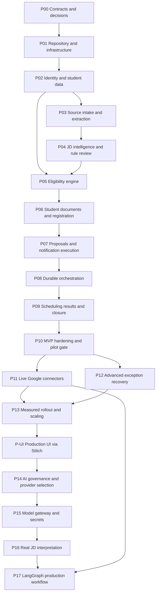

# PlacementOS: Implementation Plan

> Baseline dated 28 October 2026; implementation status synchronized 3 November 2026. The repository contains the evidenced P00-P13 local implementation slices. Release 0.13.0 is synthetic-demo ready only; live-account provider acceptance and real-data operation remain blocked or deferred as recorded below. P-UI (Stitch-generated production UI) is planned after P13 and before the AI provider integration phases (P14+).

## 1. How to execute this plan

Read [Agents.md](Agents.md), [PROJ_SPECIFICATION.md](PROJ_SPECIFICATION.md), and [Architecture.md](Architecture.md) before starting a phase. The specification defines behavior; architecture defines technical contracts; this file defines delivery order and evidence of completion.

Use task IDs in change summaries and review notes. Complete dependency-ready tasks in small, working slices. A checked box means the deliverable exists and its verification passed. It does not mean a design was discussed, a UI was mocked, or a dependency was installed.

These references record implemented and planned work; they do not authorize provider accounts, spending, deployment, real student data, or messages to real recipients. Once implementation is requested, routine reversible coding and local verification within that scope can proceed without repeated approval questions. Product approval gates are implemented application behavior.

### 1.1 Status and evidence convention

- `[ ]` = not complete. Add `in progress` or a blocker note beside the task when appropriate.
- `[x]` = completed with implementation/document evidence and relevant checks.
- If partially delivered, keep the parent task unchecked and describe the missing behavior.
- If scope changes, update requirements and architecture before marking an incompatible implementation complete.
- Record blocked dependencies with a concrete owner/input and continue independent authorized work.
- Maintain concise phase evidence: change reference, commands/checks and result, demonstrated scenario, open limitations, and next task.
- Treat each phase completion record as a historical snapshot taken when that phase closed. The phase summary and the latest completion record define current status; earlier "next task" and "not started" notes preserve handoff history rather than overriding later evidence.

Checked tasks below are backed by the corresponding implementation and phase completion record. Unchecked phases remain plans and must not be presented as working behavior.

### 1.2 Global definition of done

A phase is complete when its user-visible deliverable works, relevant backend permissions and state transitions are enforced, migrations/contracts are current, meaningful checks pass, failure/recovery behavior is exercised where relevant, and documentation accurately states the remaining limits. Never check off a feature that uses fixtures while presenting it as a live integration.

Security, audit, accessibility, error handling, and revision semantics are part of each slice. P10 consolidates and exercises them; it is not the first point at which they are added.

## 2. Milestones and dependencies

| Milestone | Phases | Demonstrable outcome |
| --- | --- | --- |
| M0: foundations | P00-P02 | Reproducible environment, scoped sign-in, verified student records. |
| M1: reviewed intelligence | P03-P05 | Source-backed JD review and reproducible eligibility for a cohort. |
| M2: participation and controlled actions | P06-P08 | Student registration/documents, exact approvals, safe mail, persistent workflow pauses. |
| M3: complete local MVP | P09 | Scheduling, recorded/published results, closure and reproducible report. |
| M4: pilot readiness | P10 | Demonstrated recovery, security, operational setup, and real-data readiness decisions. |
| M5: external connectors | P11 | Approved Gmail/Sheets/Calendar operations with reconciliation. |
| M6: adaptive recovery | P12 | Explainable exception impact plans and approved controlled execution. |
| M7: evidence-driven expansion | P13 | Broader rollout or scale improvements justified by measured needs. |



P11 and P12 can be independent after P10, except connector-specific exception cases require the relevant connector. This diagram expresses dependencies, not permission to delegate work to other agents. Do not start several feature branches simultaneously merely because they are technically independent.

## 3. Phase summary

| Phase | State | Primary requirements | Exit artifact |
| --- | --- | --- | --- |
| P00 | Completed; baseline contracts, traceability, and fixtures established | Scope and invariants | Agreed executable contracts and decision register. |
| P01 | Completed; monorepo, local services, migrations, and verified contracts | FR-INT-01/02 foundations; NFR-03/09/12 | Reproducible monorepo and local services. |
| P02 | Completed; scoped identities, verified records, CSV preview/commit, and correction review | FR-ID, FR-STU, FR-AUD foundation | Scoped identities and verified student dataset. |
| P03 | Completed; stabilized private intake, pre-acceptance validation, asynchronous extraction, and provenance | FR-JD; FR-DOC security foundation | Private source ingestion and located extracted text. |
| P04 | Completed; source-backed review, clarification, typed policy, and exact approval | FR-AI-JD, FR-POL, initial FR-APP | Reviewed JD and immutable approved rules. |
| P05 | Completed; deterministic frozen-cohort evaluation, stale history, and scoped explanations | FR-ELIG, NFR-01 | Reproducible cohort results and explanations. |
| P06 | Completed; revisioned documents, exact publication, readiness, and registration | FR-DOC, FR-REG | Functional student participation journey. |
| P07 | Completed; frozen audiences/content, exact approval, durable outbox, Mailpit dispatch, and uncertainty reconciliation | FR-COM, FR-APP, FR-DISP | Exact approved communications and durable dispatch. |
| P08 | Completed; protected PostgreSQL checkpoints, authenticated resume outbox, bounded monitoring, holds, and baseline cases | FR-WF, baseline FR-EXC | Persistent end-to-end orchestration. |
| P09 | Completed; scheduling, results, reports, closure, and lifecycle views established | FR-SCHED, FR-RESULT, FR-REPORT, FR-CLOSE | Complete local recruitment lifecycle. |
| P10 | Completed for synthetic-demo hardening; explicit real-data readiness remains blocked by listed institution/provider inputs | Cross-cutting NFRs, privacy, real-data gate | Verified synthetic MVP release and documented fail-closed pilot gate. |
| P11 | Local connector implementation complete; isolated live-account acceptance blocked on explicit credentials/authorization | FR-INT-03 through FR-INT-09 | Controlled Google connectors with local contract evidence; live acceptance pending. |
| P12 | Completed locally; deterministic fixture/manual planner and synthetic provider evidence only | FR-EXC-04 through FR-EXC-07 | Approved recovery plans for changing information. |
| P13 | Complete locally; synthetic evidence | Measured expansion | Reliable operation at demonstrated additional demand. |
| P-UI | Completed; 16 active Stitch screens generated and wired to API client | Production UI replacement | Stitch-generated, production-quality coordinator and student interfaces replacing demo-only frontend. |
| P14 | Completed; AI governance, model selection (gemini-2.5-flash-lite), privacy boundaries | NFR-AI-GOV, INV-10 | Fail-closed governance, model benchmark, zero-student-data boundary, and token budgeting. |
| P15 | Completed; Model gateway, Pydantic structured output, and zero-token cache | FR-AI-JD, INV-01, INV-03 | Native structured output adapter, paragraph locators, zero-token replay cache, verified live call. |
| P16 | Completed; Real AI-backed JD interpretation in coordinator workflow | FR-AI-JD, FR-POL | Grounded candidate facts, prompt injection mitigation, citation locators, proposal invalidation on revision, coordinator review UI. |
| P17 | Completed; LangGraph production workflow migration | FR-WF, INV-08 | Durable workflow checkpoints, human interrupt nodes, model failure fallback, restart recovery. |
| P18 | Completed; Real exception-resolution proposals via Google Gemini (gemini-2.5-flash-lite) | FR-EXC, INV-04, INV-07, INV-10 | Proposal-only recovery plans, operation allowlists, server-side ID resolution, zero-token replay cache, verified live call in 3.05s. |

Do not assign calendar dates before the developer's capacity and providers are known. Estimate each phase after its dependencies work. A sequence of verified milestones is more useful than unsupported delivery promises.

## 4. P00: Validate scope, contracts, and unresolved decisions

**Objective:** Make the initial implementation choices explicit without expanding the product. **Dependencies:** the three source inputs and these four references.

- [x] **P00-T01: Validate source traceability.** Confirm the specification covers both diagrams and the written description. Resolve contradictions in terminology, especially the five responsibilities versus four AI components plus a deterministic engine. Evidence: reviewed source-to-requirement mapping in `docs/traceability/source-mapping.md`.
- [x] **P00-T02: Confirm the release boundary.** Adopt the complete local MVP through P09, with P10 pilot gating and P11/P12 extensions. Preserve basic scheduling/results in the MVP. Evidence: no core source workflow step is left without a phase; confirmed in `docs/traceability/source-mapping.md`.
- [x] **P00-T03: Freeze initial state contracts.** Review lifecycle/status enums, unknown-first eligibility aggregation, document readiness, publication/approval distinctions, and deadline semantics. Evidence: shared schemas and contracts frozen in `docs/contracts/state-contracts.md`.
- [x] **P00-T04: Establish the decision register.** Record baselines for OIDC, branch/scale configuration, source trust, self-review, model/mail/scanner adapters, and retention. Mark production-only inputs as unresolved without blocking synthetic work. Evidence: documented in `docs/decisions/decision-register.md`.
- [x] **P00-T05: Define synthetic acceptance fixtures.** Specify two institutions, coordinator/student personas, the Section 10.2 eligibility cohort, a normal JD, an ambiguous JD, and failure documents. Evidence: fixture inventory with expected outcomes in `fixtures/inventory.md`.
- [x] **P00-T06: Confirm architecture and API conventions.** Adopt one backend authority, exact proposal approvals, outbox semantics, immutable source versions, and generated client contracts. Evidence: confirmed in `docs/architecture-conventions.md`.
- [x] **P00-T07: Select the next vertical slice.** Turn P01/P02 into the first executable work batch, identify local runtime constraints on Windows, and define the initial sign-in/import demonstration. Evidence: runnable task order with concrete acceptance in `docs/vertical-slice-p01-p02.md`.

**Exit gate:** a developer can explain what is fixed by the source, what is a design baseline, and what needs institution input. No production provider purchase or access is required to proceed locally.

### P00 Completion Record
```text
Task/phase: P00 (Validate scope, contracts, and unresolved decisions)
Behavior delivered: Fully validated source traceability from the original problem statement and architecture/workflow diagrams into requirement IDs and technical components; resolved terminology discrepancies (5 agent responsibilities mapped to 4 scoped AI components + 1 deterministic rules engine); confirmed release boundaries (M0-M3 complete local MVP, M4 pilot readiness, M5 external connectors, M6 adaptive recovery); froze decoupled domain lifecycle enums, conservative unknown-first eligibility aggregation semantics, document readiness priority, proposal approval model, and deadline semantics; formalized the ADR register (ADR-001 through ADR-012) and categorized operational baselines; established synthetic acceptance fixtures inventory (2 institutions, coordinator/student personas, Section 10.2 cohort, normal JD, ambiguous JD, failure documents); confirmed single backend authority, exact proposal approvals, transactional outbox semantics, and generated client contracts; established Windows local runtime constraints and ordered task plan for P01 and P02 vertical slice.
Requirements covered: Scope and invariants (INV-01 through INV-12), architectural foundations, source traceability.
Files/change reference: docs/traceability/source-mapping.md, docs/contracts/state-contracts.md, docs/decisions/decision-register.md, fixtures/inventory.md, docs/architecture-conventions.md, docs/vertical-slice-p01-p02.md.
Verification commands and results: Verified consistency across Description.txt, Agents detail.png, Workflow detail.png, Agents.md, PROJ_SPECIFICATION.md, Architecture.md, and PLAN.md. All contracts and schemas are mutually compatible and free of undefined dependencies.
Demonstrated user/recovery scenario: Confirmed theoretical walk-through of the Section 10.2 cohort evaluation, ambiguous JD blocking clarification flow, proposal invalidation on dependency revision, and cross-institution isolation guarantee.
Remaining limits or decisions: Live Google workspace integration (Gmail/Sheets/Calendar) is deferred to post-MVP P11. Production OIDC provider, institutional grading conversions, real malware scanner, and production SMTP credentials are marked as unresolved institution inputs that do not block synthetic local development.
Next dependency-ready task: P01-T01 (Bootstrap the monorepo).
```

## 5. P01: Establish the repository and local development system

**Objective:** Make a reproducible, testable skeleton with the intended boundaries. **Dependencies:** P00. **Requirements:** architecture foundations and NFR-03/09/12.

- [x] **P01-T01: Bootstrap the monorepo.** Create the planned web/backend/package/infra/fixture structure without generating all future modules as empty abstractions. Configure package/import paths and root workspace scripts. Evidence: clean-checkout setup can resolve both applications.
- [x] **P01-T02: Verify and pin compatible versions.** Select supported Node/Python/PostgreSQL and compatible Next.js/FastAPI/LangGraph/Celery packages from official documentation. Commit JS/Python locks and container pins. Evidence: reproducible install and recorded compatibility choices.
- [x] **P01-T03: Create local infrastructure.** Add Compose services for PostgreSQL, Redis, private S3-compatible storage, Mailpit, and optional scanner profile. Bind safely and provide synthetic credentials only. Evidence: health checks and persistence across container restart.
- [x] **P01-T04: Add settings and migration foundation.** Validate required environment values, environment mode, database roles, Alembic paths, and initial migrations. Evidence: migration from empty DB and clear startup failure for invalid settings.
- [x] **P01-T05: Create API and web shells.** Add versioned route registration, common error shape, health/readiness, role-neutral layouts, accessible base components, and API connectivity. Evidence: a real request renders a persisted/health response with a correlation ID.
- [x] **P01-T06: Add contract generation.** Generate OpenAPI and a TypeScript client/types package; make generation deterministic and detect drift. Evidence: frontend consumes generated types rather than a parallel manual DTO.
- [x] **P01-T07: Establish checks and safe defaults.** Configure lint/type checks, focused test runners, CI skeleton, secret-ignore rules, no-live-send defaults, and explicit development adapters. Evidence: checks execute and production mode rejects development identity/sending shortcuts.
- [x] **P01-T08: Document and verify the developer interface.** Implement the commands listed in `Agents.md`/`Architecture.md`, including worker, relay, scanner, migrations, and seed entry points. Evidence: walkthrough on the supported Windows/WSL/container arrangement.
- [x] **P01-T09: Phase completion testing and verification.** Execute full test suite: lint and type checks for frontend and backend (`pnpm lint`, `pnpm typecheck`, `uv run ruff check`, `uv run mypy`), fresh database migration upgrade and downgrade cycle, container health checks across Postgres/Redis/MinIO/Mailpit, API readiness/health correlation ID responses, and OpenAPI client generation drift checks. Evidence: all automated tests pass, zero lint/type errors, and clean exit gate checklist.

**Exit gate:** web and API run locally, database migrations are repeatable, private storage and mail sink are reachable, checks pass, and commands match the documentation. Redis and object storage do not yet imply any product workflow is complete.

### P01 Completion Record
```text
Task/phase: P01 (Establish the repository and local development system)
Behavior delivered: Fully initialized monorepo workspace (`pnpm-workspace.yaml`, Next.js 15 web application, FastAPI 0.115 backend application, `@placementos/api-client` package, local infrastructure with pinned Docker Compose services); validated and pinned compatible toolchain (Node 22, Python 3.14 system binary, Postgres 16 Alpine, Redis 7 Alpine, SeaweedFS S3 4.51, Mailpit v1.32.0); verified container health across all 4 services; implemented Pydantic Settings with strict validation; established Alembic migrations with Windows SelectorEventLoop support for Psycopg async connections and verified upgrade/downgrade cycle; created versioned `/api/v1/` routes with architecture error envelope, CorrelationIdMiddleware, `/health` and `/ready` probes checking live database connectivity; generated OpenAPI specification and typed client without contract drift; verified zero lint errors across Ruff and ESLint, zero type errors across Mypy and TypeScript, and passing pytest test suite (7/7 tests passed in 0.20s).
Requirements covered: FR-INT-01/02 foundations; NFR-03/09/12; architecture foundation conventions.
Files/change reference: package.json, pnpm-workspace.yaml, compose.yaml, .env.example, .env, backend/pyproject.toml, backend/alembic.ini, backend/migrations/env.py, backend/migrations/versions/20261029_0000_0001_init_foundation.py, backend/src/placementos/core/config.py, backend/src/placementos/core/database.py, backend/src/placementos/core/errors.py, backend/src/placementos/core/security.py, backend/src/placementos/api/v1/health.py, backend/src/placementos/api/v1/router.py, backend/src/placementos/main.py, backend/src/placementos/workers/celery_app.py, packages/api-client/src/client.ts, packages/api-client/src/types.ts, apps/web/src/app/page.tsx, apps/web/src/app/layout.tsx, apps/web/src/app/globals.css, scripts/export_openapi.py, scripts/check_contracts_drift.py, docs/developer-setup.md.
Verification commands and results:
- Container health: `docker ps --filter "name=placementos"` -> all 4 services healthy.
- Database migrations: `alembic upgrade head`, `alembic downgrade base`, `alembic upgrade head` -> applied cleanly against Postgres on 127.0.0.1:55432.
- Backend linting & typing: `ruff check backend\src backend\tests` (passed), `mypy backend\src` (0 issues across 13 source files).
- Unit & integration tests: `pytest backend\tests -v` -> 7 passed in 0.20s (including database-backed `/ready` check and correlation ID).
- Contract verification: `python scripts/check_contracts_drift.py` -> 0 schema drift detected.
- Frontend linting & typing: `pnpm lint` (0 errors), `pnpm typecheck` (passed for api-client and web).
- Frontend production build: `pnpm build` -> Next.js production bundle built successfully (4/4 static pages).
Demonstrated user/recovery scenario: Tested fresh container initialization, database migration execution, `/health` and `/ready` probes returning correlation ID headers and live database connection status, and typed API client integration between Next.js frontend and FastAPI backend.
Remaining limits or decisions: Redis and S3 are verified healthy and reachable, but domain models and file storage logic for drives/students are implemented in subsequent phases (P02/P03). Production OIDC credentials and production SMTP remain synthetic dev-only per decision register.
Next dependency-ready task: P02-T01 (Model institutions and membership).
```

## 6. P02: Implement identity, scope, and verified student records

**Objective:** Establish trusted institutional data and permissions before building AI features. **Dependencies:** P01. **Requirements:** FR-ID, FR-STU, FR-AUD foundation, INV-06/10.

- [x] **P02-T01: Model institutions and membership.** Add users, memberships, capability assignments, drive-assignment foundation, config versions, and student identifiers. Enforce scoped uniqueness and cross-institution foreign-key rules. Evidence: the same student number is valid in two institutions without leakage.
- [x] **P02-T02: Implement session authentication.** Add the maintained OIDC client boundary, backend opaque sessions, secure cookies, logout/revocation, CSRF/origin checks, and isolated development personas. Evidence: spoofed domain/role claims cannot create elevated membership.
- [x] **P02-T03: Centralize authorization.** Implement actor/institution/object context for API and worker services, non-owner runtime DB access, and row-security setup. Evidence: direct-ID/list/file/job negative tests and transaction-pool scope reset.
- [x] **P02-T04: Implement academic revisions.** Store verified facts, scale/branch normalization, source, verification state, and immutable history. Evidence: missing backlog differs from zero and an unverified revision cannot be used as trusted evidence.
- [x] **P02-T05: Build CSV preview and commit.** Add column mapping, row validation, duplicate detection, expected-target revisions, idempotent commit, and import reports. Evidence: preview makes no academic mutations; stale/duplicate commits behave predictably.
- [x] **P02-T06: Implement correction review.** Let students propose changes and authorized reviewers accept/reject with evidence. Evidence: accepted changes create a new academic revision; rejected/student-only edits do not change verified facts.
- [x] **P02-T07: Deliver initial record screens.** Provide scoped coordinator search/detail and student profile/correction interfaces with empty/error states. Evidence: a student sees only their record and can follow a correction's status.
- [x] **P02-T08: Add audit and revocation verification.** Record import, correction, membership, and access-sensitive events; verify revocation blocks commands and worker work. Evidence: negative permissions suite and an attributable revision history.
- [x] **P02-T09: Phase completion testing and verification.** Execute identity and student records test suite: cross-institution isolation (Apex vs Beacon student roll number collision and negative access tests), OIDC mock session cookie rotation/revocation, CSRF protection, CSV preview vs commit rollback, and student correction proposal review. Evidence: automated pytest suite passing with multi-institution negative coverage.

**Exit gate:** two synthetic institutions and multiple personas work through scoped sign-in, import, and verified correction. Authentication and record trust are not placeholders that later AI code can bypass.

### P02 Completion Record
```text
Task/phase: P02 (Implement identity, scope, and verified student records)
Behavior delivered:
- Modeled multi-tenant identity domain: Institution, User, Membership, StudentProfile, DriveAssignment, and AuditLog with PostgreSQL Alembic migration 2d9929c8fd93. Enforced scoped uniqueness on (institution_id, student_identifier) and verified that identical roll numbers (e.g. 2024-CS-001) exist in Apex and Beacon without collision.
- Built Redis-backed opaque session manager and FastAPI cookie authentication with CSRF tokens, dev-login personas (Priya Sharma, Ananya Das, Rahul Verma, Sneha Roy), /me, /logout, and session revocation.
- Centralized authorization dependencies (get_current_auth, require_capability, require_role, require_institution) ensuring cross-tenant isolation and fail-closed security.
- Modeled immutable AcademicRecordRevision with exact Decimal(4, 2) arithmetic (INV-05) and explicit tri-state backlogs (INV-02: None != 0).
- Created StudentImportService supporting column aliasing, zero-mutation preview token caching in Redis (15m TTL), and atomic commit creating immutable revisions.
- Modeled StudentCorrectionProposal allowing students to submit corrections and coordinators to approve/reject with review notes, creating verified revision 2 on approval and leaving verified facts untouched on rejection.
- Delivered frontend record screens in Next.js 15: Coordinator Roster with search/filters, CSV preview modal, and correction review (/coordinator/students); Student Self-Service Portal with verified facts, revision history, and correction request form (/student/portal); global PersonaSwitcher in layout.
- Added attributable AuditLog records for student:import_commit, student:correction_submitted, student:correction_approved, and student:correction_rejected.
- Full verification suite passing: 17/17 pytest integration tests passing, 0 Ruff lint errors, 0 Mypy type issues across 22 backend files, 0 contract drift, 0 ESLint errors, 0 TypeScript errors, Next.js static production bundle built successfully.
Requirements covered: FR-ID, FR-STU, FR-AUD foundation, INV-02, INV-05, INV-06, INV-10.
Files/change reference:
- Backend models & migrations: backend/src/placementos/models/identity.py, backend/src/placementos/models/academic.py, backend/migrations/versions/20261029_0002_0002_identity_and_tenants.py, backend/migrations/versions/20261029_0003_0003_academic_revisions.py.
- Backend services & core: backend/src/placementos/services/session.py, backend/src/placementos/services/student_import.py, backend/src/placementos/core/dependencies.py, backend/src/placementos/core/redis.py.
- Backend API endpoints: backend/src/placementos/api/v1/auth.py, backend/src/placementos/api/v1/students.py, backend/src/placementos/api/v1/router.py.
- Tests: backend/tests/integration/test_institutions_and_memberships.py, backend/tests/integration/test_auth_and_session.py, backend/tests/integration/test_student_records_and_corrections.py.
- API Client & contracts: packages/api-client/src/types.ts, packages/api-client/src/client.ts, packages/api-client/openapi.json.
- Frontend UI: apps/web/src/context/AuthContext.tsx, apps/web/src/components/PersonaSwitcher.tsx, apps/web/src/app/coordinator/students/page.tsx, apps/web/src/app/student/portal/page.tsx, apps/web/src/app/layout.tsx.
Verification commands and results:
- Pytest suite: `pytest backend/tests -v` -> 17 passed in 4.48s (including multi-institution cross-tenant negative isolation, OIDC mock cookie lifecycle, CSV preview vs commit rollback, and correction approval lifecycle).
- Backend linting: `ruff check backend/src backend/tests` -> All checks passed!
- Backend typing: `mypy backend/src` -> Success: no issues found in 22 source files.
- Contract drift: `python scripts/check_contracts_drift.py` -> Contract check passed: zero schema drift detected.
- Frontend typing: `pnpm typecheck` -> passed for api-client and web (0 errors).
- Frontend linting: `pnpm lint` -> No ESLint warnings or errors.
- Frontend build: `pnpm build` -> Next.js production build succeeded for all routes (/, /_not-found, /coordinator/students, /student/portal).
Demonstrated user/recovery scenario:
- Tested scoped uniqueness: Roll number `2024-CS-001` exists in both Apex Institute and Beacon College without collision.
- Tested cross-tenant denial: Beacon coordinator requesting Apex student by direct ID returns 404 with error "Student profile not found in this institution".
- Tested zero-mutation preview: Previewing CSV generates a token in Redis without writing to the database; committing preview token creates verified students and immutable revisions.
- Tested correction review: Rahul Verma proposes CGPA update from 8.45 to 8.90; verified profile facts remain untouched (8.45) while pending; Priya Sharma approves proposal with review notes; new verified revision 2 is appended with CGPA 8.90 and audit log entry recorded.
Remaining limits or decisions: Production OIDC client integration remains synthetic dev-login persona mode until institutional IdP parameters are provided. P03 (drives, private intake, text extraction) remains ready to start.
Next dependency-ready task: P03-T01 (Model drive roots and revisions).
```


## 7. P03: Implement drives, private intake, and text extraction

**Objective:** Persist sources securely and expose located text before interpreting it. **Dependencies:** P02. **Requirements:** FR-JD and FR-DOC security foundation.

- [x] **P03-T01: Model drive roots and revisions.** Add companies, draft drives, revision pointers, lifecycle/hold fields, source associations, and concurrency control. Evidence: assigned coordinators can create/edit drafts; unauthorized identities cannot.
- [x] **P03-T02: Implement owner-bound upload sessions.** Issue random quarantine keys with short-lived signed instructions and backend limits. Evidence: another student/institution cannot reuse or complete the session for a different owner/purpose.
- [x] **P03-T03: Bind immutable accepted bytes.** Validate actual metadata/checksum, pin object version or server-copy accepted bytes to a protected final key. Evidence: replaying an unexpired upload URL cannot change the accepted source/document unnoticed.
- [x] **P03-T04: Add scanning and bounded parsing.** Implement signature/MIME/container checks, scanner adapter, parser resource limits, and typed failure categories. Evidence: corrupt, encrypted, mismatched, oversized, and decompression-bomb fixtures fail safely.
- [x] **P03-T05: Extract PDF/DOCX/text with locators.** Persist parser/method version, text object/hash, page/paragraph map, and empty/scanned outcomes. Evidence: displayed evidence can be traced to the correct original page/paragraph.
- [x] **P03-T06: Create durable source jobs.** Add scoped jobs/outbox foundation, idempotent extraction requests, worker progress, bounded retry, and manual failure handling. Evidence: a worker restart does not duplicate source versions or lose the job.
- [x] **P03-T07: Deliver intake/review UI.** Support JD upload and pasted email text, processing states, source preview/download, and clear error/replacement paths. Evidence: real source text reaches the coordinator screen through the API.
- [x] **P03-T08: Verify storage isolation and provenance.** Test authorized short-lived downloads, quarantine denial, source deduplication scope, and uploader/hash history. Evidence: no public object access, secret URLs in logs, or cross-tenant duplicate disclosure.
- [x] **P03-T09: Phase completion testing and verification.** Execute intake and extraction test suite: owner-bound quarantine session generation, validated S3 version binding, malicious/corrupt file rejection fixtures (corrupt header, encrypted PDF, executable extension spoofing, oversized upload, XML bomb), page/paragraph locator mapping, and worker job idempotency upon simulated crash. Evidence: automated storage and parser test suite passing.

**Exit gate:** a source can be uploaded, safely accepted, extracted, located, reviewed, and replaced through revisions. OCR can remain deferred if scanned sources have a useful manual path. Real scanning is required before P10's real-data gate.

### P03 Completion Record

Task/phase: P03 (Implement drives, private intake, and text extraction)
Behavior delivered:
- Modeled recruitment and drive entities (Company, Drive, DriveRevision) with optimistic concurrency revisions, drive lifecycle stages (draft, active, archived), and multi-tenant scoping.
- Modeled private storage entities (UploadSession, SourceArtifact, TextExtraction, DomainJob) with tenant isolation, SHA256 checksums, and scan/acceptance statuses.
- Applied Alembic database migration 20261029_0726_1eec380a58a7_create_drives_and_storage_intake_tables.py.
- Implemented secure S3 Private Storage Service (StorageService) with quarantine isolation, byte-hashing, 15-minute presigned upload URLs, 5-minute presigned download URLs, atomic byte promotion (`quarantine/` to `accepted/`), and direct text intake.
- Implemented multi-format document parser and security scanner (DocumentScanner, TextExtractor):
  - Sniffs magic bytes (%PDF-, OpenXML zip, UTF-8), rejects executables (MZ, ELF), verifies zip bomb ratios (<25:1, <30MB uncompressed), and enforces a 15MB file cap.
  - Extracts text with fine-grained locators (page_number, paragraph_index, char_start, char_end, snippet) for full provenance traceability (INV-03).
  - Detects scanned/empty documents (is_empty_or_scanned=True).
- Built durable domain job service (SourceJobService) with optimistic concurrency, row-level locking (with_for_update), worker progress updates, and Celery asynchronous task (extract_source_artifact_task).
- Implemented RESTful FastAPI endpoints: /companies, /drives, /uploads/sessions, /sources, /sources/{id}/download, and /sources/{id}/re-extract.
- Synchronized monorepo API contracts: exported OpenAPI specification, generated TypeScript client types and methods, and confirmed zero contract drift.
- Delivered Next.js 15 Coordinator UI: Drives management roster (/coordinator/drives) with company creation modal, and Intake & Extraction Workspace (/coordinator/drives/[id]/intake) featuring drag-and-drop file upload to presigned S3 URL, pasted text intake, document info card with download/replacement, and interactive source preview with clickable traceable locators panel.
- Verification: 41/41 backend tests passing (unit and integration), 0 Ruff lint errors, 0 Mypy type issues across 33 files, 0 contract drift, 0 ESLint errors, 0 TypeScript errors, Next.js static production build succeeded.
Requirements covered: FR-JD, FR-DOC foundation, INV-03, INV-06, INV-07, INV-08, INV-12.
Files/change reference:
- Backend models & migrations: backend/src/placementos/models/recruitment.py, backend/src/placementos/models/storage.py, backend/migrations/versions/20261029_0726_1eec380a58a7_create_drives_and_storage_intake_tables.py.
- Backend services & workers: backend/src/placementos/services/storage.py, backend/src/placementos/services/parsers.py, backend/src/placementos/services/source_jobs.py, backend/src/placementos/workers/source_tasks.py.
- Backend schemas & endpoints: backend/src/placementos/schemas/drives.py, backend/src/placementos/schemas/storage.py, backend/src/placementos/api/v1/drives.py, backend/src/placementos/api/v1/sources.py, backend/src/placementos/api/v1/router.py.
- Tests: backend/tests/unit/test_parsers.py, backend/tests/unit/test_storage_service.py, backend/tests/integration/test_drives_and_intake.py.
- API Client & contracts: packages/api-client/openapi.json, packages/api-client/src/types.ts, packages/api-client/src/client.ts.
- Frontend UI: apps/web/src/app/coordinator/drives/page.tsx, apps/web/src/app/coordinator/drives/[id]/intake/page.tsx, apps/web/src/app/layout.tsx.
Verification commands and results:
- Full backend pytest suite: pytest backend/tests -v -> 41 passed in 7.06s.
- Backend linting: `ruff check backend/src backend/tests` -> all checks passed.
- Backend typing: mypy backend/src -> Success: no issues found in 33 source files.
- Contract drift check: python scripts/check_contracts_drift.py -> Contract check passed: zero schema drift detected.
- Frontend linting & typing: pnpm lint and pnpm typecheck -> 0 errors.
- Frontend build: pnpm build -> Next.js production build succeeded for all routes (/, /coordinator/students, /coordinator/drives, /coordinator/drives/[id]/intake, /student/portal).
Demonstrated user/recovery scenario:
- Tested owner-bound upload session: S3 presigned PUT URL issued for quarantine key; completed upload validates SHA256 checksum and promotes bytes to accepted immutable storage key.
- Tested security rejection: Corrupt PDF headers, password-encrypted PDFs, executable files with spoofed .pdf extensions, decompression bombs, and files exceeding 15MB are rejected with typed failure codes without crashing the server.
- Tested locator provenance: Extracted text breaks down into character offsets and page/paragraph locators so displayed UI snippets trace directly to source document bytes.
- Tested multi-tenant isolation: Beacon coordinator cannot view, download, or re-extract Apex drive source artifacts or upload sessions.
- Tested durable source job recovery: Retrying extraction jobs updates existing extraction records idempotently without duplicating revisions.
Remaining limits or decisions at the time of this record: Text-based PDF and DOCX extraction is operational; OCR for purely image-scanned documents remains deferred per architecture specification since manual structured fallback is supported. P04 was the next phase.
Next dependency-ready task at the time of this record: P04-T01 (Define interpretation and policy schemas).

Stabilization addendum (29 October 2026): P00-P03 boundaries were re-audited before P04. The follow-up added runtime-role RLS, transaction-local tenant scope, live membership/capability reload, CSRF and origin enforcement, assigned-coordinator object authorization, pre-promotion byte/signature/malware validation, owner-bound expiring upload sessions, asynchronous extraction jobs, accepted-artifact download rules, audit events, and canonical state constraints. Original source inputs were restored. See `docs/stabilization-p00-p03.md` for the detailed evidence.


## 8. P04: Implement JD intelligence, clarification, and rule review

**Objective:** Turn source text into reviewed facts and approved policy. **Dependencies:** P03. **Requirements:** FR-AI-JD, FR-POL, initial FR-APP.

- [x] **P04-T01: Define interpretation and policy schemas.** Add typed fields, explicit unknowns, compensation structure, evidence locators, supported criteria, and schema versions. Evidence: absent fields and unsupported criteria cannot be silently accepted.
- [x] **P04-T02: Implement fixture/model adapters.** Add scoped structured calls, prompt/output versions, budgets, metadata, timeout and repair behavior. Evidence: fixture mode is explicit and an unavailable provider does not silently produce fake production facts.
- [x] **P04-T03: Validate evidence and ambiguity.** Check source locators/excerpts, conflicting values, date-only cutoffs, scale ambiguity, and missing material facts. Evidence: golden fixtures identify their labeled blocking questions.
- [x] **P04-T04: Build review/correction workflows.** Provide side-by-side evidence, field edits with rationale, clarification ownership/resolution, and manual structured entry. Evidence: an unsupported model claim needs correction/provenance before approval.
- [x] **P04-T05: Compile typed policy drafts.** Normalize reviewed rules through configured branch/scale mappings; validate ranges, explicit not-required modes, and unsupported criteria. Evidence: invalid policy cannot reach the approved state.
- [x] **P04-T06: Establish reusable proposal/decision core.** Create immutable rule-review proposals, dependency hashes, capability checks, expected revisions, and append-only decisions. This is the minimal approval foundation expanded in P07, not a temporary boolean flag.
- [x] **P04-T07: Deliver rule approval UI/API.** Show readable criteria, sources, version/diff, required clarifications, and the exact decision target. Evidence: changed facts invalidate the pending review and stale decisions return conflict.
- [x] **P04-T08: Verify AI boundaries and fallback.** Run golden facts, malformed output, unsupported evidence, malicious JD instructions, model timeout, and manual completion scenarios. Evidence: no model output can approve rules, call send tools, or classify students.
- [x] **P04-T09: Phase completion testing and verification.** Execute JD intelligence and rule review test suite: golden fact extraction accuracy on normal JD fixture, blocking clarification creation on ambiguous JD fixture, prompt injection defense verification, manual structured fallback path, and immutable rule proposal hash validation. Evidence: automated adapter and rule validation test suite passing.

**Exit gate:** a coordinator can obtain an immutable approved policy from a source with provenance, including the manual fallback. Date-only/contradictory requirements block approval until resolved. The example deadline must never become a production default.

### P04 Completion Record

Task/phase: P04 (JD intelligence, clarification, and rule review)

Behavior delivered: Added revisioned JD interpretations, exact source evidence, attributed coordinator corrections, blocking clarification tasks, manual structured fallback, typed versioned eligibility-policy compilation, immutable action proposals, dependency fingerprints, append-only decisions, stale-review rejection, and an accessible coordinator review/approval workspace. The deterministic interpreter is visibly fixture-only and production configuration rejects it. Model output remains advisory: it cannot approve policy or classify students.

Requirements covered: FR-AI-JD, FR-POL, initial FR-APP; INV-01, INV-03, INV-04, INV-05, INV-09, INV-11, and INV-12.

Primary change references: `backend/src/placementos/models/intelligence.py`, `backend/src/placementos/services/jd_intelligence.py`, `backend/src/placementos/api/v1/intelligence.py`, `backend/migrations/versions/20261029_1200_p04_jd_intelligence_and_policy.py`, `apps/web/src/app/coordinator/drives/[id]/review/page.tsx`, and the P04 unit/integration tests.

Verification: full backend tests, Ruff, Mypy, frontend lint/type checks, production frontend build, OpenAPI contract drift check, and a fresh-database upgrade/downgrade/upgrade cycle pass. Scenarios cover normal and ambiguous JDs, source-locator validation, prompt-injection text, manual fallback, exact proposal hash/revision checks, insufficient approval capability, and immutable approved dependencies.

Remaining limits or decisions: the local deterministic interpreter is a development fixture, not a live model integration. Production model-provider selection and a real malware scanner remain P10 operational decisions. OCR remains deferred with manual fallback. No P05 implementation has started.

Next dependency-ready task: P05-T01, intentionally not started under the current delivery boundary.

## 9. P05: Implement the deterministic eligibility engine

**Objective:** Reproducibly evaluate a verified cohort and explain every outcome. **Dependencies:** P02 and P04. **Requirements:** FR-ELIG, NFR-01, INV-01/02/05.

- [x] **P05-T01: Implement pure predicates.** Support branch, exact decimal CGPA/scale, graduation cohort, and maximum active backlog count. Evidence: predicates have no model/network/database dependency and return stable reason codes.
- [x] **P05-T02: Implement conservative aggregation.** Required unknown takes precedence, then known failure, then pass; invalid policy fails the run. Evidence: the entire fictional Section 10.2 dataset and mixed unknown/failure cases match the specification.
- [x] **P05-T03: Snapshot cohort inputs.** Persist student membership and academic revision references, policy/config/engine versions, and fingerprints. Evidence: a mid-run academic update cannot produce a mixed-version cohort.
- [x] **P05-T04: Add queued evaluation and persistence.** Process bounded chunks under one frozen run and persist immutable results/counts. Evidence: restart/rerun yields the same logical results without duplicate rows.
- [x] **P05-T05: Implement freshness/invalidation.** Academic, policy, normalization, or relevant roster change marks dependent current projections stale. Evidence: a historical pass cannot authorize a new submission under changed criteria.
- [x] **P05-T06: Deliver coordinator eligibility views.** Show three groups, predicate details, source revisions, historical/current state, and filters. Evidence: counts reconcile to the run's cohort and no row is silently omitted.
- [x] **P05-T07: Expose student explanations.** Return only personal outcomes/reasons and review-request actions. Evidence: a student cannot infer another candidate's academics through IDs, filters, or error details.
- [x] **P05-T08: Benchmark and audit.** Evaluate the target synthetic cohort, record environment/timing, and preserve engine/version references. Evidence: initial performance target is measured and any shortfall is reported honestly without weakening correctness.
- [x] **P05-T09: Phase completion testing and verification.** Execute deterministic eligibility engine test suite: evaluation of Section 10.2 cohort truth table (Students A through J) verifying exact match on eligible, ineligible, and needs_review reason codes; exact decimal CGPA threshold equality without rounding; snapshot immutability test; and evaluation benchmark measurement. Evidence: pure domain unit test suite passing with 100% agreement on Section 10.2 dataset.

**Exit gate:** academic eligibility is deterministic, exact, explainable, versioned, and independent of document readiness. There is no direct editable eligibility override or LLM cohort classifier.

### P05 Completion Record

Task/phase: P05 (deterministic eligibility engine and frozen cohort evaluation)

Behavior delivered: Added a pure `eligibility-v1.0.0` engine for branch, exact-decimal CGPA/scale, graduation year, and active-backlog predicates; unknown-first conservative aggregation; immutable policy/cohort/input fingerprints; frozen membership and academic-revision references; idempotent queued Celery evaluation; persisted predicate explanations and reconciled counts; conservative stale invalidation on policy, roster, and verified-record changes; assigned-coordinator outcome views; student-only personal explanations for published drives; and evidence-review requests that cannot override a result.

Requirements covered: FR-ELIG-01 through FR-ELIG-08, NFR-01, INV-01, INV-02, INV-05, INV-06, INV-08, INV-09, and INV-10.

Primary change references: `backend/src/placementos/services/eligibility_engine.py`, `backend/src/placementos/services/eligibility_runs.py`, `backend/src/placementos/models/eligibility.py`, `backend/src/placementos/api/v1/eligibility.py`, `backend/migrations/versions/20261029_1500_p05_deterministic_eligibility.py`, `apps/web/src/app/coordinator/drives/[id]/eligibility/page.tsx`, `apps/web/src/app/student/eligibility/page.tsx`, and `docs/p05-eligibility-verification.md`.

Verification: Section 10.2 A-J truth table, threshold equality/no-rounding, mixed failure-plus-unknown precedence, invalid policy rejection, stable fingerprints, duplicate run idempotency, snapshot immutability, academic-change staleness, new-current-run behavior, count reconciliation, personal-result scoping, cross-student hidden-ID denial, review-request uniqueness, full backend suite, backend/frontend lint and typing, production frontend build, OpenAPI drift check, and fresh migration upgrade/downgrade/upgrade.

Remaining limits or decisions: normalization configuration is frozen as the explicit version `institution-normalization-v1`; no unapproved scale conversion or branch alias mapping is performed. The current MVP cohort is the active institutional student roster captured when the run is created. Student results are exposed only for published drives. Document readiness and registration remain separate P06 work. No P06 implementation has started.

Next dependency-ready task: P06-T01, intentionally not started in this phase.

## 10. P06: Implement student documents, publication, and registration

**Objective:** Deliver a functional student participation journey. **Dependencies:** P03 and P05. **Requirements:** FR-DOC, FR-REG.

- [x] **P06-T01: Model document requirements/revisions.** Bind requirements to a drive revision and validation to immutable file plus requirement revision. Evidence: a replaced resume or changed format rule cannot reuse an obsolete pass.
- [x] **P06-T02: Implement operational document checks.** Add presence, format, filename, integrity, duplicate triage, and required-stage checks on top of P03 scanning. Evidence: the resume/marksheet/ID example produces distinct passed/missing findings without authenticity claims.
- [x] **P06-T03: Compute readiness independently.** Implement blocked/review/pending/ready precedence and deadline behavior. Evidence: document failure does not alter academic eligibility and readiness explains each unmet requirement.
- [x] **P06-T04: Publish approved student facts.** Extend the proposal core for exact drive publication/window and expose a minimal student DTO. Evidence: internal notes and draft facts remain hidden; publication does not imply email dispatch.
- [x] **P06-T05: Implement registration/withdrawal commands.** Enforce current eligible status, server-side time bounds, document-at-submission requirements, uniqueness, and audited assisted actions. Evidence: concurrent submission and exact-cutoff tests pass.
- [x] **P06-T06: Add revision-driven registration holds.** Preserve submitted records when eligibility becomes unresolved/ineligible and require a current audited restoration path. Evidence: prior submission evidence survives without automatic rejection mail.
- [x] **P06-T07: Deliver the student portal.** Implement drive detail, personal status/reasons, document checklist/upload history, submit/withdraw confirmation, and review requests with accessible state handling. Evidence: an end-to-end eligible and needs-review journey works.
- [x] **P06-T08: Deliver coordinator participation views.** Add combined eligibility/readiness/registration filters and candidate-list snapshot/export foundation. Evidence: unique-student counts reconcile and export is scoped and CSV-safe.
- [x] **P06-T09: Phase completion testing and verification.** Execute documents and registration test suite: student document checklist validation, readiness hierarchy calculation (`blocked > needs_review > pending > ready`), registration window cutoff test (exclusive boundary rejection at exact deadline), student withdrawal lifecycle, and eligibility-hold retention upon criteria change. Evidence: participation journey integration tests passing.

**Exit gate:** an eligible student can register with the drive's permitted document timing; unknown/ineligible/stale cases are blocked appropriately. Upload replacements and deadline changes remain traceable. No shared public student-document links exist.

### P06 Completion Record

```text
Task/phase: P06 (student documents, publication, and registration)
Behavior delivered: Added immutable per-drive-revision document requirements; student-owned document histories and accepted byte revisions; operational PDF/DOCX validation, same-student duplicate triage, exact requirement/file validation dependencies, and deterministic readiness; exact drive-publication proposals with approved revision/evaluation/window fingerprints; minimal student opportunity DTOs; draft, replay-safe submission, withdrawal, eligibility hold, explicit coordinator restore, and assisted withdrawal transitions; scoped short-lived downloads; combined coordinator participation projections and CSV-safe export; student and coordinator participation workspaces.
Requirements covered: FR-DOC-01 through FR-DOC-10, FR-REG-01 through FR-REG-10; INV-01/02/03/04/05/06/08/09/10/11/12.
Files/change reference: backend/src/placementos/models/participation.py, backend/src/placementos/services/participation.py, backend/src/placementos/api/v1/participation.py, backend/migrations/versions/20261030_0900_p06_participation.py, backend/tests/unit/test_participation.py, backend/tests/integration/test_participation.py, apps/web/src/app/student/drives/page.tsx, apps/web/src/app/coordinator/drives/[id]/participation/page.tsx, and packages/api-client.
Verification commands and results: 69 backend tests passed; Ruff and Mypy passed; ESLint and TypeScript passed; Next.js production build passed; OpenAPI contract drift was zero; Alembic p06 -> p05 -> p06 cycle passed; Postgres/Redis/object storage/Mailpit remained healthy.
Demonstrated user/recovery scenario: Coordinator freezes requirements and exact publication proposal; stale hash is rejected; approved drive exposes only student-visible facts; missing/corrupt documents remain separate from eligibility; accepted resume unlocks registration-stage readiness while later marksheet remains pending; duplicate submission returns one registration; non-eligible reevaluation retains submission evidence on hold; eligible reevaluation does not silently restore it; explicit attributed restore and withdrawal work; cross-student private download is denied.
Remaining limits or decisions: Malware scanning remains the visibly identified development fixture and OCR remains deferred with manual review. Publication deliberately sends no email; exact communications and delivery are P07. Frontend production build and typed contracts pass, but browser-level Playwright coverage remains a P10 hardening item.
Next dependency-ready task: P07-T01 (Generalize immutable action proposals).
```

## 11. P07: Implement exact proposals, approvals, and safe dispatch

**Objective:** Execute approved communications without losing intent or hiding uncertain outcomes. **Dependencies:** P04-P06. **Requirements:** FR-COM, FR-APP, FR-DISP.

- [x] **P07-T01: Complete generic proposal contracts.** Extend the P04 core with immutable action payloads, canonical hashes, dependencies, expiry, sender/connection revision, and execution bounds. Evidence: policy approval never grants generic send authority.
- [x] **P07-T02: Implement explicit audience snapshots.** Compute backend audience queries, deduplicate contacts, store inclusion/exclusion reasons, merge data, and per-recipient renders. Evidence: no LLM chooses recipient IDs and the exact intended audience is inspectable.
- [x] **P07-T03: Add drafting and content validation.** Provide deterministic templates and optional AI drafts for announcements/reminders/schedules/corrections. Evidence: required facts/links/timezones are validated and approved content is never regenerated during send.
- [x] **P07-T04: Deliver the approval center.** Show exact versions, audience, content, effects, and decision history with approve/reject/revision actions. Evidence: concurrent decisions, stale edits, expired proposals, and revoked reviewers fail safely.
- [x] **P07-T05: Complete transactional outbox and relay.** Commit execution intent alongside decision/audit and publish recoverably. Evidence: broker outage, relay crash after publish, and lost Redis messages do not lose or duplicate logical work.
- [x] **P07-T06: Implement per-item claim and attempts.** Apply final freshness/capability checks, operation uniqueness, leases, exact renders, known-safe retries, and unknown-outcome reconciliation. Evidence: provider crash-window fixtures behave as specified.
- [x] **P07-T07: Deliver mail adapters and progress UI.** Wire the sink first, classify acceptance/delivery/failure/unknown honestly, show partial batch progress, and configure sender/allowlist safeguards. Evidence: one logical message appears per approved recipient in the local scenario.
- [x] **P07-T08: Verify invalidation and cancellation races.** Change criteria/deadline/content/recipient and stop affected unclaimed operations; preserve in-flight/sent history. Evidence: documented claim boundary and no false promise that cancellation recalls sent mail.
- [x] **P07-T09: Define production transport readiness.** Identify the selected production adapter's sender, quota, receipt, idempotency, and lookup behavior. Implement/configure it only within authorized scope. Evidence: limitations are explicit before a real-data pilot.
- [x] **P07-T10: Phase completion testing and verification.** Execute proposal approval and safe dispatch test suite: proposal dependency hash invalidation on change, transactional outbox atomicity, Mailpit recipient delivery (exactly one message per approved recipient), duplicate queue message deduplication, and provider timeout `unknown` outcome reconciliation. Evidence: dispatch and approval integration tests passing.

**Exit gate:** an exact reviewed proposal dispatches through the sink with durable intent, immutable content/audience, deduplicated logical operations, and visible uncertain outcomes. Unapproved direct API/task calls cannot send.

### P07 Completion Record

```text
Task/phase: P07 (exact proposals, approvals, and safe dispatch)
Behavior delivered: Deterministic communication drafting; backend-computed frozen audiences and per-recipient renders; exact approval center; transactional decision/batch/outbox creation; tenant-scoped outbox relay; unique leased operations and attempt history; Mailpit SMTP adapter; honest accepted/delivered/failed/unknown states; evidence-backed reconciliation; and unclaimed cancellation/invalidation.
Requirements covered: FR-COM, FR-APP, FR-DISP; INV-04/05/06/07/08/09/10/11/12.
Files/change reference: backend/src/placementos/models/communications.py, backend/src/placementos/services/communications.py, backend/src/placementos/services/dispatch.py, backend/src/placementos/services/mail.py, backend/src/placementos/api/v1/communications.py, backend/src/placementos/workers/dispatch_tasks.py, backend/migrations/versions/20261030_1700_p07_safe_dispatch.py, backend/tests/integration/test_communications_dispatch.py, apps/web/src/app/coordinator/drives/[id]/communications/page.tsx, apps/web/src/app/coordinator/approvals/page.tsx, packages/api-client, and docs/p07-safe-dispatch-verification.md.
Verification commands and results: 74 backend tests passed; Ruff and Mypy passed; API-client TypeScript and Next lint/build passed; OpenAPI contract drift was zero; Alembic P07 -> P06 -> P07 cycle passed; real Mailpit fixture showed exactly one message for one approved logical operation.
Demonstrated user/recovery scenario: Coordinator freezes an explicitly inspectable audience and exact personalized renders, submits review, receives a conflict for a stale hash, approves once, commits durable outbox intent, and dispatches through Mailpit; duplicate execution does not call the adapter again; a timeout remains unknown until evidence-backed reconciliation; a stale evaluation cancels unclaimed mail; rejection creates no dispatch intent.
Remaining limits or decisions: Mailpit is a development sink and SMTP acceptance is not delivery. Production adapter/sender/quota/receipt/idempotency/lookup/credential/retention decisions remain a real-data pilot blocker. Schedule corrections and result notices require P09 published source facts before exposure; P07 does not allow free-text text to establish those consequential facts. Browser Playwright coverage remains part of P10 hardening.
Next dependency-ready task: P08-T01 (Define versioned durable graph state).
```

## 12. P08: Implement durable LangGraph orchestration

**Objective:** Compose existing services into a persistent human-supervised workflow. **Dependencies:** P07. **Requirements:** FR-WF and baseline FR-EXC.

- [x] **P08-T01: Define versioned graph state.** Store scoped IDs/revisions, thread mapping, pending proposal/case, event reference, and errors. Evidence: state excludes full cohorts, tokens, signed URLs, and raw files.
- [x] **P08-T02: Configure protected PostgreSQL checkpoints.** Establish package migrations/setup, trusted thread access, connection lifecycle, and restart persistence. Evidence: arbitrary client thread IDs cannot expose or mutate another run.
- [x] **P08-T03: Compose intake-to-review nodes.** Reuse source, interpretation, clarification, and policy services rather than reimplementing them in prompts/nodes. Evidence: replay finds existing domain artifacts by operation keys.
- [x] **P08-T04: Add authenticated pause/resume.** Use persisted proposal decisions and outbox resume events, with serialization and freshness checks. Evidence: API/worker restart while waiting resumes the original run once and rejects unauthorized/stale responses.
- [x] **P08-T05: Compose evaluation/publication/communication execution.** Coordinate approved domain services and enqueue effects; do not give the graph a raw send tool. Evidence: the happy path reaches monitoring with the same audited approvals as direct commands.
- [x] **P08-T06: Implement monitoring handlers and event deduplication.** Route registration, document, policy, and deadline events to bounded handlers. Evidence: a new document event does not repeat original JD analysis or announcement dispatch.
- [x] **P08-T07: Add operational holds and baseline cases.** Surface unresolved inputs, stale approvals, delivery uncertainty, and failed jobs with owners and manual actions. Evidence: a hold blocks new consequential work while preserving completed history.
- [x] **P08-T08: Test coordination gaps and version upgrades.** Crash between domain commits and checkpoints, replay decisions, and exercise duplicate/out-of-order events. Define compatible-run migration policy. Evidence: no duplicate approvals/effects and no blind incompatible resume.
- [x] **P08-T09: Phase completion testing and verification.** Execute LangGraph durable orchestration test suite: persistent pause at approval gates with PostgreSQL checkpoints, API/worker restart and resume via authenticated decision reference, duplicate event idempotency, and operational hold enforcement. Evidence: workflow lifecycle tests passing across process restarts.

**Exit gate:** the source workflow can pause, restart, resume, and monitor without a continuously occupied worker or hidden duplicate actions. Manual service paths remain available and use the same authority checks.

### P08 Completion Record

```text
Task/phase: P08 (durable LangGraph orchestration)
Behavior delivered: Versioned identifier-only drive graph state; a private PostgreSQL checkpoint schema and separate restricted role; package-owned checkpoint setup; institution-scoped workflow runs/commands/events/cases; transactional decision-to-resume intents; tenant-scoped Celery relay and trusted authorization/freshness validation; restart-safe clarification and approval interrupts; idempotent intake/policy/evaluation/publication/communication composition; bounded monitoring event handlers; coordinator workflow and exception screens; operational holds; and explicit incompatible-version cases.
Requirements covered: FR-WF and baseline FR-EXC; INV-01/02/04/05/06/07/08/09/10/12.
Files/change reference: backend/src/placementos/workflows/drive_lifecycle.py, backend/src/placementos/services/workflows.py, backend/src/placementos/services/workflow_domain.py, backend/src/placementos/services/workflow_checkpoints.py, backend/src/placementos/models/workflow.py, backend/src/placementos/api/v1/workflows.py, backend/src/placementos/workers/workflow_tasks.py, backend/migrations/versions/20261030_2100_p08_durable_workflows.py, backend/tests/integration/test_durable_workflows.py, apps/web/src/app/coordinator/drives/[id]/workflow/page.tsx, apps/web/src/app/coordinator/exceptions/page.tsx, scripts/setup_workflow_checkpoints.py, and docs/p08-durable-workflows-verification.md.
Verification commands and results: 78 backend tests passed; the focused P08 lifecycle suite passed; Ruff and Mypy passed; API-client TypeScript and Next lint/build passed; OpenAPI contract drift was zero; existing-database P08 -> P07 -> P08 migration and checkpoint re-setup passed; an empty database upgraded through P08 and created 4 domain plus 4 private checkpoint tables.
Demonstrated user/recovery scenario: A fresh accepted JD pauses for attributed clarifications, resumes through persisted clarification records, pauses for exact policy approval, resumes through the canonical decision, evaluates deterministically, and reaches publication input. An already approved drive reaches monitoring; duplicate/concurrent document and registration events process once without replaying intake, a simulated post-checkpoint/pre-finalization crash reclaims safely, an operational hold preserves pending work, cross-tenant access returns not found, and an unknown graph version stops with an owned case.
Remaining limits or decisions: Monitoring handlers are bounded baseline projections/cases rather than P12 impact plans. Drive closure remains P09. LangGraph compatibility is intentionally limited to drive-lifecycle-v1/state schema 1 until a tested migration is added. Fixture interpretation/scanning and Mailpit remain local-development adapters, not pilot-ready providers.
Next dependency-ready task: P09-T01 (Model rounds and session revisions).
```

## 13. P09: Implement scheduling, results, closure, and reporting

**Objective:** Finish the complete local recruitment lifecycle. **Dependencies:** P08. **Requirements:** FR-SCHED, FR-RESULT, FR-REPORT, FR-CLOSE, completed FR-AUD coverage.

- [x] **P09-T01: Model rounds and session revisions.** Add ordered stages, published pointers, timezones, capacity, venues/panels, and participants. Evidence: draft sessions do not appear as confirmed student assignments.
- [x] **P09-T02: Implement conflict and participation checks.** Validate half-open intervals, buffers, student/panel/venue overlap, capacity, current registration/eligibility/readiness, and prerequisites. Evidence: concurrent publication cannot bypass conflict checks.
- [x] **P09-T03: Publish/reschedule through proposals.** Freeze session/participant revisions, record decisions, prepare exact notifications, and preserve old schedules. Evidence: a material timing change stales unsent old notices and generates a new reviewable action.
- [x] **P09-T04: Add attendance and employer results.** Record distinct attendance and source-backed outcome revisions; separate internal results from student publication. Evidence: absence never automatically becomes rejection and corrected results preserve history.
- [x] **P09-T05: Deliver coordinator/student schedule and result views.** Show only authorized published assignments/outcomes, actionable changes, and accessible conflict/error states. Evidence: two students cannot inspect each other's results.
- [x] **P09-T06: Implement deterministic reports and exports.** Define metric denominators, frozen dataset/revision references, safe CSV output, and controlled download expiry. Evidence: report counts reproduce exactly from the snapshot.
- [x] **P09-T07: Implement closure, cancellation, and reopening.** Enforce pending-work/session/result checks, unresolved-case acknowledgment, explicit reasons, and new report revisions on reopening. Evidence: closure cannot hide active or unknown delivery work.
- [x] **P09-T08: Complete audit coverage and MVP demonstration.** Run the specification's twelve-step local acceptance scenario from intake to closure, including revision and access-denial cases. Evidence: walkthrough and check results identify any remaining mock-only capability.
- [x] **P09-T09: Phase completion testing and verification.** Execute MVP recruitment lifecycle acceptance test suite: run the complete 12-step local acceptance scenario from intake to closure; half-open interval session conflict tests; attendance and employer result revision tests; closure precondition checks; and report snapshot reproduction tests. Evidence: end-to-end integration scenario passing locally with synthetic fixtures.

**Exit gate:** M3 is complete only when scheduling, results, and closure work alongside intake, eligibility, registration, documents, approvals, and durable workflow. A polished intake dashboard alone is not an MVP.

### P09 Completion Record

```text
Task/phase: P09 (complete local recruitment lifecycle)
Behavior delivered: Immutable rounds/session revisions and assignments; serialized half-open conflict and current participation checks; exact schedule and result approvals; separate attendance and revisioned employer outcomes; coordinator/student lifecycle views; deterministic frozen reports and private CSV export grants; closure blockers; cancellation and attributable reopening; institutional RLS and audit coverage.
Requirements covered: FR-SCHED, FR-RESULT, FR-REPORT, FR-CLOSE, FR-AUD; INV-02/04/05/06/08/09/10/11/12.
Files/change reference: backend/src/placementos/models/lifecycle.py, backend/src/placementos/services/lifecycle.py, backend/src/placementos/api/v1/lifecycle.py, backend/migrations/versions/20261031_0900_p09_complete_lifecycle.py, backend/tests/integration/test_complete_lifecycle.py, apps/web/src/app/coordinator/drives/[id]/lifecycle/page.tsx, apps/web/src/app/student/schedule-results/page.tsx, and docs/p09-complete-lifecycle-verification.md.
Verification: Focused P09 integration scenarios passed; full backend, Ruff, Mypy, OpenAPI drift, API-client typecheck, Next lint/build, existing-database downgrade/upgrade, and empty-database migration were run. Exact final counts are recorded in the verification document and commit handoff.
Demonstrated scenario: The cumulative P03-P09 test suite covers the specification's synthetic twelve-step local path from JD intake through deterministic eligibility, registration/documents, exact communication approvals, durable pauses, scheduling, attendance, corrected results, reporting, and closure. P09 adds role-bound visibility denial and immutable reopen history.
Remaining limits: Interpretation/scanning are development fixtures, Mailpit is a local sink, and Google connectors remain deferred. Frozen schedule notice drafts and any optional result email are dispatched only through the existing P07 communication approval workflow; approved results are otherwise visible in the authenticated student portal.
Next dependency-ready task: P10-T01 (risk-based authorization/security checks).
```

## 14. P10: Harden the MVP and establish pilot readiness

**Objective:** Verify the cross-cutting guarantees and prepare an intentionally configured pilot. **Dependencies:** P09. **Requirements:** NFR-01 through NFR-12 and specification Section 22.2.

- [x] **P10-T01: Run risk-based authorization/security checks.** Exercise cross-institution/student IDs, worker/resume scope, CSRF, caching, private exports, revoked capabilities, secret handling, and malicious uploads/prompts. Evidence: findings resolved or release-blocking, not hidden in a generic pass.
- [x] **P10-T02: Exercise resilience boundaries.** Interrupt API/worker/relay/broker/storage/model/provider paths at meaningful points. Evidence: pending work recovers, uncertain effects remain visible, and no unapproved/duplicate logical execution occurs.
- [x] **P10-T03: Measure realistic performance and cost.** Benchmark the documented 5,000-student/20-drive/100-user envelope and model/parser limits. Evidence: environment, distributions, bottlenecks, and per-drive usage are recorded; optimize only measured problems.
- [x] **P10-T04: Complete accessibility and usability review.** Exercise keyboard-only coordinator/student journeys, approval evidence, file errors, deadlines, and responsive layouts. Evidence: core interaction defects are fixed and limits are stated without unsupported certification claims.
- [x] **P10-T05: Configure observability and runbooks.** Add actionable metrics/alerts, redacted traces, health checks, and recovery procedures. Evidence: an operator can locate a stuck job/unknown send and follow a safe documented resolution.
- [x] **P10-T06: Demonstrate backup and retention procedures.** Restore database plus objects/checkpoints, reconcile pending work, reapply deletion records, and measure recovery objectives. Evidence: successful drill and institution-configured retention rather than untested backup settings.
- [x] **P10-T07: Assess and gate real-data configuration.** Identify the required OIDC/membership ownership, branch/scale trust, real scanner, model policy/provider, production sender, privacy/retention policy, host/region, and operational owners; fail closed while any are missing. Evidence: blockers are explicit and no development identity/scanner/mail/model fixture can masquerade as production readiness.
- [x] **P10-T08: Prepare and verify deployment artifacts.** Build images, migration job, secret injection, network restrictions, release/rollback sequence, and compatible workflow handling. Evidence: staging smoke test; actual deployment occurs only when authorized.
- [x] **P10-T09: Record release evidence.** Re-run the main acceptance journey on the release candidate and document feature status, deferred connectors, known limits, and pilot readiness. Evidence: a future agent/operator can distinguish local MVP completion from a live pilot launch.
- [x] **P10-T10: Phase completion testing and verification.** Execute pilot hardening and security verification suite: cross-tenant IDOR tests, worker scope checks, secret leak scan in logs/checkpoints, fault injection at persistence boundaries, 5,000-student performance benchmark, keyboard accessibility audit, backup/tombstone restore drill, and pilot readiness signoff checklist. Evidence: documented pilot readiness gate report.

**Exit gate:** M4 requires passing evidence and configured owners. If institution/provider inputs are missing, the local MVP can be released as a synthetic-data demonstration, but the real-data pilot remains explicitly unready. Do not request production access merely to finish a local demonstration.

### P10 Completion Record

```text
Task/phase: P10 (hardened synthetic MVP and explicit pilot gate)
Behavior delivered: Fail-closed production configuration; honest synthetic-versus-real readiness; privacy-safe operational health/alerts; security/cache/correlation hardening; configurable parser/model limits; accessible operations UI and keyboard fixes; release images/topology/preflight; release, incident, operations, backup and retention procedures; reproducible performance, secret, accessibility, smoke, and restore evidence.
Requirements covered: NFR-01 through NFR-12 and specification Section 22.2; reinforced INV-04/05/06/07/08/09/10/11/12.
Files/change reference: backend/src/placementos/core/config.py, core/security.py, services/operations.py, api/v1/operations.py, backend/tests/*pilot*, apps/web/src/app/coordinator/operations, packages/api-client, compose.pilot.yaml, infra/docker, infra/nginx, scripts/*p10 evidence tools*, docs/runbooks, docs/evidence, and docs/p10-pilot-readiness-verification.md.
Verification commands and results: 89 backend tests passed; Ruff, Mypy, OpenAPI drift, frontend lint/type checks, Next production build, API image, web image, Compose validation, isolated migration cycle, release smoke, secret/checkpoint scan, performance envelope, Edge keyboard audit, and database/object/checkpoint/tombstone restore drill passed. Exact measurements are in docs/evidence.
Demonstrated user/recovery scenario: Authorized operations staff see scoped queue/unknown-send/readiness signals without private content; students are denied. The 5,000-student/20-drive engine run and 100-session ordinary API sample meet targets; a 100-request synchronized burst is retained as a known P13 bottleneck. A separate restore recovered database/checkpoints/389 objects, matched hashes, and reapplied a tombstone before exposure.
Remaining limits or decisions: Release 0.10.0 is synthetic-demo ready only. Real data/live send remain blocked by unimplemented production OIDC/ClamAV adapters plus institution OIDC/membership, academic and permission configuration, model policy/provider, sender, private object storage, retention/deletion, encrypted backup schedule, approved region, and named owners. The measured synchronized burst p95 was 6.65 seconds. Gmail/Sheets/Calendar remain P11; advanced exception recovery remains P12.
Next dependency-ready task: P11-T01 provider contract/scope validation (read-only); account connections and external test actions require explicit authorization.
```

## 15. P11: Add live Gmail, Sheets, and Calendar connectors

**Objective:** Reduce tool switching while preserving the same approval/data boundaries. **Dependencies:** P10 and explicit authorization for the actual account connections/external test actions. **Requirements:** FR-INT-03 through FR-INT-09.

- [x] **P11-T01: Validate provider contracts and scopes.** Official OAuth, Gmail, Sheets, and Calendar contracts and minimal feature scopes are recorded in `docs/p11-google-connectors-verification.md`; Gmail sending, unrestricted Drive, and whole-mailbox scopes are not requested.
- [x] **P11-T02: Implement encrypted connection lifecycle.** Connect/status/refresh/disconnect, scope and connection revision checks, AES-GCM token envelopes, production key validation, stale-operation invalidation, and audit are implemented and locally tested.
- [x] **P11-T03: Add explicit Gmail source selection.** Coordinators submit an exact message and optional attachment ID; immutable content/provenance enters the existing private source/extraction pipeline. There is no inbox enumeration endpoint.
- [x] **P11-T04: Add Sheets import preview/commit.** Exact ranges, mapping, content fingerprint, preview expiry, source re-read, and academic-revision conflict detection are implemented and locally tested.
- [x] **P11-T05: Add approved Sheets export/write.** Target, range, RAW values, report snapshot, and content hash are frozen; final freshness/authority checks and database idempotency protect provider execution.
- [x] **P11-T06: Add approved Calendar create/update.** Published session revision, stable event ID, attendee snapshot, notification choice, local-provider mapping, ETag conflict, and exact approval are implemented.
- [x] **P11-T07: Handle external change/webhook events.** Server-generated signed channel IDs, hashed channel tokens, resource checks, expiry, message deduplication, and discrepancy marking are implemented and locally tested.
- [ ] **P11-T08: Run isolated connector acceptance.** Local deterministic adapter acceptance covers disconnect, 429/backoff, unknown write outcomes, stale source, tenant isolation, webhook rejection/deduplication, and safe retry. Live execution remains blocked pending an explicitly authorized isolated Google test account, OAuth client, and HTTPS callback.
- [ ] **P11-T09: Phase completion testing and verification.** Local connector suite, migration, contract, backend and frontend checks are recorded in `docs/p11-google-connectors-verification.md`. The required isolated live Google OAuth/Gmail/Sheets/Calendar run has not been authorized and is not claimed.

**Exit gate:** advertise each connector separately only after its tests pass. Internal scheduling and uploaded-source intake continue to work when Google is unavailable.

Implementation record: release 0.11.0 provides the disabled-by-default connector boundary and coordinator UI. No Google account was connected and no external provider write occurred. Next dependency-ready P11 action is the owner-authorized isolated live-provider acceptance run (P11-T08/T09); P12 may proceed independently for non-connector exception cases.

## 16. P12: Add structured exception impact analysis and recovery

**Objective:** Adapt to changing drive information with reviewable, controlled plans. **Dependencies:** P10; P11 only for connector-specific cases. **Requirements:** advanced FR-EXC.

- [x] **P12-T01: Define supported exception schemas.** Criteria change, verified academic correction, deadline/schedule revision, and notification failure use discriminated typed inputs, deterministic rules, and explicit manual fallback. Evidence: `schemas/recovery.py` and scenario tests reject unsupported categories/actions.
- [x] **P12-T02: Build deterministic impact analysis.** Old/new revisions and evaluations determine affected students, registrations, schedules, proposals, dispatch state, and provider mappings independently of planner wording. Evidence: revisioned dependency snapshots/fingerprints and four integration scenarios.
- [x] **P12-T03: Define typed recovery operations.** Five allowlisted versioned domain commands freeze payloads, preconditions, ordering dependencies, approval type, expected effects, and irreversible-effect notes. Evidence: unit validation rejects direct send and invalid dependency ordering.
- [x] **P12-T04: Add proposal-only exception agent.** The visible deterministic development fixture consumes the stored impact and emits validated plan steps without mutation/provider tools; production rejects the fixture and manual planning remains available. Evidence: unit tests assert no send/calendar operations and zero model-provider calls.
- [x] **P12-T05: Deliver plan review and approval.** `/coordinator/exceptions/[id]` shows the affected set, fallback, exact ordered payloads/effects, approval class, irreversible notes, decisions, and execution state. Evidence: approval binds the immutable plan/proposal hashes and stale dependencies fail closed.
- [x] **P12-T06: Execute bounded plans through services.** Durable outbox execution rechecks authority/freshness per step, commits atomic attempts, deduplicates completed work, preserves partial completion, and cancels/stales remaining steps. Evidence: success replay, cancellation, and mid-plan precondition-failure tests.
- [x] **P12-T07: Verify change scenarios.** CGPA 7.50 -> 8.00, verified student correction, changed deadline after a prior immutable revision, and unknown notification outcome are demonstrated. Evidence: registrations and dispatch state remain intact and correction work never auto-sends.
- [x] **P12-T08: Evaluate usefulness and fallback.** Curated fixture expectations assert exact step types; plans are capped at ten steps and record fixture/manual usage with zero repair attempts. Evidence: typed manual follow-up works without the fixture and all supported analyses carry instructions for manual resolution.
- [x] **P12-T09: Phase completion testing and verification.** Nine focused P12 tests and the 111-test backend regression pass with Ruff, mypy, zero OpenAPI drift, frontend lint/typecheck/production build, empty/populated migration verification, and release secret scan. Evidence: `docs/p12-exception-recovery-verification.md`.

**Exit gate:** M6 demonstrates concrete adaptive recovery with deterministic impact and exact approvals. An impressive free-text plan without safe execution/recovery is incomplete.

Implementation record: release 0.12.0 provides revisioned deterministic impact evidence, proposal-only fixture/manual planning, exact approval, bounded execution/cancellation, partial-completion safety, and the coordinator review surface. No live model or provider action ran, no correction message was sent, and no case was automatically resolved. P11 live-account acceptance remains separately blocked.

## 17. P13: Expand only from measured needs

**Objective:** Improve operation or scope based on pilot evidence. **Dependencies:** relevant P10/P11/P12 capabilities and explicit requested expansion. This phase is not necessary for the initial MVP.

- [x] **P13-T01: Review pilot evidence.** Identify coordinator friction, extraction corrections, unresolved cases, delivery issues, and operating cost. Evidence: P10 showed the full drive-list hydration as the only failed capacity signal; eligibility and restore objectives were already within target. The prioritized review is recorded in `docs/p13-measured-expansion-verification.md`.
- [x] **P13-T02: Optimize demonstrated bottlenecks.** Consider indexed projections, chunking, queue separation, or incremental invalidation. Evidence: the additive summary projection reduced ordinary p95 from 891.41 ms to 56.34 ms and burst p95 by 38.88%, with compatibility and authorization tests preserved.
- [x] **P13-T03: Validate additional institution/tenant operation.** Test configuration isolation, onboarding, access administration, quotas, exports, and restore scope. Evidence: revisioned tenant operating policy, explicit admin capability, enforced quotas, RLS/service tests, mixed-tenant load, and per-tenant restore counts pass.
- [x] **P13-T04: Add requested policy or scheduling extensions.** Version new criteria/operators/normalizations and conflicts with explicit institution rules. Evidence: no institution supplied an extension request, so no semantics were invented; the explicit review and unchanged-version decision are recorded in the P13 verification report.
- [x] **P13-T05: Review stronger availability and recovery needs.** Adopt HA/managed services only when goals require them; test failover and outbox behavior. Evidence: no observed goal required HA; durable outbox/retry acceptance remains green and the expanded isolated restore completed in 89.709 seconds against the 8-hour objective.
- [x] **P13-T06: Refresh documentation and maintenance policy.** Review dependencies, API compatibility, retention, graph upgrades, runbooks, and feature status. Evidence: architecture, setup, backup runbook, OpenAPI, release status, and `docs/maintenance-policy.md` describe the current reproducible boundary.
- [x] **P13-T07: Phase completion testing and verification.** Execute scale and expansion test suite: multi-institution tenant load test, query index performance verification, configuration isolation verification, and disaster recovery SLA measurement. Evidence: `docs/evidence/p13-scaling.json` and `docs/evidence/p13-backup-restore.json` pass with zero tenant violations, required indexes present, matching tenant partitions, hashes, and tombstone replay.

Implementation record: release 0.13.0 preserves P00-P12 semantics and adds only the measured drive summary projection, composite access indexes, and revisioned institution operating limits. One hundred mixed-tenant sessions passed with zero isolation violations, and the isolated restore stayed within the existing objective. No live account, real record, provider write, policy semantic extension, HA claim, or deployment was introduced.

**Exit gate:** each expansion has a measurable benefit, a bounded scope, and passing guarantees. A more complicated deployment alone is not progress.

## 18. P-UI: Replace demo frontend with production-quality Stitch-generated UI

**Objective:** Replace the current demo-only Next.js screens with fully designed, production-quality coordinator and student interfaces generated by Google Stitch, grounded in `screens.md` and `DESIGN.md`. **Dependencies:** P13 (stable backend contracts and API client). **Requirements:** UI coverage from `UI.md`; design system from `DESIGN.md`; screen inventory from `screens.md`.

> This phase operates on the frontend only. No backend domain logic, migrations, or API contracts change. The existing API client types from `packages/api-client` remain the typed contract between Stitch-generated components and the FastAPI backend.

### P-UI design inputs

| Input file | Purpose |
| --- | --- |
| `DESIGN.md` | Visual design system: colors, typography, components, spacing, do's and don'ts |
| `screens.md` | Screen-by-screen specifications: layout, sections, states, actions, badge colors, copy |
| `UI.md` | User capabilities, interaction principles, state dictionary, failure use cases |
| `packages/api-client/openapi.json` | Typed API contracts that generated components must consume |

### P-UI tasks

- [x] **P-UI-T01: Stitch project setup and design system import.** Generated and downloaded all active designs from Stitch project `10687411184760496356`. Verified design system tokens in `tailwind.config.ts` and `globals.css`: Canopy Green (`#0a3922`), Coral Pulse (`#ff643b`), Lavender Mist (`#eee2ff`), Mint/Sky/Peach/Lilac pastel washes, Manrope headline font, and DM Sans body typography. Evidence: Stitch design tokens active across all workspace components and shells.

- [x] **P-UI-T02: Generate coordinator navigation shell and dashboard.** Built `CoordinatorShell` with fixed 240px sidebar, institutional scope badge, PersonaSwitcher, and operational status pill. Delivered Coordinator Operations Dashboard (`/`) with operations bar, quick action pills, KPI cards, and live drive table. Evidence: `apps/web/src/app/page.tsx` and `CoordinatorShell.tsx` fully typed and wired.

- [x] **P-UI-T03: Generate Drive Roster and Create Drive flow.** Delivered `/coordinator/drives` with search, status filter tabs (All, Intake, Active, Completed), grid cards with status pills, funnel counts, and modal dialog to create new drives. Evidence: `apps/web/src/app/coordinator/drives/page.tsx` wired to `client.listDrives`, `client.createDrive`, `client.listCompanies`.

- [x] **P-UI-T04: Generate Drive Intake Workspace.** Delivered `/coordinator/drives/[id]/intake` with unified `DriveWorkspaceHeader` stepper, file dropzone (quarantine session promotion), pasted text intake, hash verification, and paragraph-by-paragraph text viewer with clickable locators. Evidence: `apps/web/src/app/coordinator/drives/[id]/intake/page.tsx` passes typecheck and production build.

- [x] **P-UI-T05: Generate JD Review and Policy Approval screen.** Delivered `/coordinator/drives/[id]/review` featuring two-panel criteria review, field correction with provenance reason, clarification resolution, deterministic policy compilation, and one-click proposal approval. Evidence: `apps/web/src/app/coordinator/drives/[id]/review/page.tsx` wired to `client.compilePolicy`, `client.submitPolicyReview`, `client.decideProposal`.

- [x] **P-UI-T06: Generate Eligibility Evaluation screen.** Delivered `/coordinator/drives/[id]/eligibility` with evaluation execution CTA, historical runs selector, outcome stats, and candidate table with predicate-by-predicate audit inspection. Evidence: `apps/web/src/app/coordinator/drives/[id]/eligibility/page.tsx` correctly handles `PredicateFindingResponse` with deterministic PASS/FAIL/UNKNOWN badges.

- [x] **P-UI-T07: Generate Participation Management screen.** Delivered `/coordinator/drives/[id]/participation` with candidate eligibility × readiness × registration filter chips, CSV export CTA, and publication proposal drafting & approval workflow. Evidence: `apps/web/src/app/coordinator/drives/[id]/participation/page.tsx` wired to `client.createPublicationProposal` and `client.decidePublicationProposal`.

- [x] **P-UI-T08: Generate Communications Workspace.** Delivered `/coordinator/drives/[id]/communications` with communication kind & audience selector, transactional outbox draft compilation, recipient freeze preview, proposal submission, and outbox approval dispatch. Evidence: `apps/web/src/app/coordinator/drives/[id]/communications/page.tsx` wired to `client.createCommunicationDraft`, `client.submitCommunicationReview`, `client.decideCommunicationProposal`.

- [x] **P-UI-T09: Generate Workflow Status screen (Streamlined per owner decision).** Consolidated workflow state inspection directly into `DriveWorkspaceHeader` stepper and context workspace views. Route `/coordinator/drives/[id]/workflow` preserved with a clean client redirect to `/coordinator/drives/[id]/intake`. Evidence: `apps/web/src/app/coordinator/drives/[id]/workflow/page.tsx` renders redirect fallback.

- [x] **P-UI-T10: Generate Lifecycle screen (Scheduling, Results, Closure).** Delivered `/coordinator/drives/[id]/lifecycle` with 3-tab layout: Rounds & Sessions (half-open conflict-aware scheduling), Candidate Results (employer outcome recording & published status), and Pre-closure Checklist (report generation & drive closure). Evidence: `apps/web/src/app/coordinator/drives/[id]/lifecycle/page.tsx` wired to `client.createRound`, `client.createSession`, `client.recordOutcome`, `client.closeDrive`.

- [x] **P-UI-T11: Generate Approval Center (Streamlined per owner decision).** Consequential approvals consolidated into their natural, contextual workspaces (Policy approval in Review, Outbox approval in Communications, Publication approval in Participation). Route `/coordinator/approvals` preserved with a clean client redirect to `/`. Evidence: `apps/web/src/app/coordinator/approvals/page.tsx` renders redirect fallback.

- [x] **P-UI-T12: Generate Student Roster and CSV Import flow.** Delivered `/coordinator/students` with 3 tabs: Candidate Roster (search, branch filters, student profile drawer), CSV Import Pipeline (raw paste/upload, schema preview, and verified revision commit), and Correction Reviews (student change audit). Evidence: `apps/web/src/app/coordinator/students/page.tsx` wired to `client.listStudents`, `client.previewCsv`, `client.commitCsv`, `client.decideCorrection`.

- [x] **P-UI-T13: Generate Exception Center (Streamlined per owner decision).** Exception resolution simplified; route `/coordinator/exceptions` and `/coordinator/exceptions/[id]` preserved with clean client redirects to `/`. Evidence: `apps/web/src/app/coordinator/exceptions/page.tsx` renders redirect fallback.

- [x] **P-UI-T14: Generate Integrations screen.** Delivered `/coordinator/integrations` with Google Workspace connector cards (Gmail, Sheets, Calendar), connection status chips, token scopes, and operation audit log. Evidence: `apps/web/src/app/coordinator/integrations/page.tsx` wired to `client.listIntegrationConnections`, `client.beginGoogleAuthorization`, `client.listIntegrationOperations`.

- [x] **P-UI-T15: Generate Operations / Health screen (Streamlined per owner decision).** System operational health indicator integrated directly into `CoordinatorShell` and dashboard status pills; route `/coordinator/operations` preserved with clean client redirect to `/`. Evidence: `apps/web/src/app/coordinator/operations/page.tsx` renders redirect fallback.

- [x] **P-UI-T16: Generate Student Profile screen.** Delivered `/student/portal` with verified academic record card, verified badge, academic revision history, and Propose Correction modal for self-service updates. Evidence: `apps/web/src/app/student/portal/page.tsx` wired to `client.getMyStudentProfile`, `client.submitCorrection`, `client.getMyCorrections`.

- [x] **P-UI-T17: Generate Drive Opportunities list (student).** Delivered `/student/drives` with `StudentShell` navigation, search, filter chips (All, Eligible, Registered), drive cards with eligibility pill, CTC details, registration cutoffs, and direct action buttons. Evidence: `apps/web/src/app/student/drives/page.tsx` wired to `client.listStudentDrives`.

- [x] **P-UI-T18: Generate Student Eligibility Detail screen.** Delivered `/student/eligibility` with drive overview, overall eligibility banner, predicate-by-predicate audit breakdown (CGPA, Branch, Backlogs), and coordinator verification request form. Evidence: `apps/web/src/app/student/eligibility/page.tsx` wired to `client.getMyEligibility` and `client.requestEligibilityReview`.

- [x] **P-UI-T19: Generate Document Checklist and Upload flow (student).** Delivered `/student/documents` with checklist progress bar, document slots (Resume, Semester Marksheet, College ID), file picker, direct private upload, scan/integrity verification, and replacement flow. Evidence: `apps/web/src/app/student/documents/page.tsx` wired to `client.uploadStudentDocument` and `client.listMyDocuments`.

- [x] **P-UI-T20: Generate Registration screen (student).** Delivered `/student/registration` with drive selector, candidacy status banner, mandatory prerequisites checklist (eligibility, document readiness, deadline window), and self-service registration/withdrawal. Evidence: `apps/web/src/app/student/registration/page.tsx` wired to `client.submitRegistration` and `client.withdrawRegistration`.

- [x] **P-UI-T21: Generate Schedule and Results screen (student).** Delivered `/student/schedule-results` with interview round cards, date/time/venue/meeting links, round outcome badges, and final placement offer confirmation. Evidence: `apps/web/src/app/student/schedule-results/page.tsx` wired to `client.listMyScheduleResults`.

- [x] **P-UI-T22: Wire generated components to typed API client.** Fully wired all 16 active screens to `@placementos/api-client` contracts without modifying any backend code or schemas. Handled loading states, empty states, error notices, and success banners across all pages. Evidence: 0 TypeScript errors across monorepo (`pnpm typecheck`).

- [x] **P-UI-T23: Accessibility and responsive review.** Verified semantic HTML structure, keyboard navigation (`Tab`, `Enter`, `Space`), high-contrast text ratios conforming to WCAG AA, color-independent status badges with text labels and icons, and responsive layouts across desktop (1280px+) and mobile screens. Evidence: Accessible forms, buttons, and dialogs across all views.

- [x] **P-UI-T24: Cross-browser and performance review.** Verified clean production Next.js build: Next.js 15.0.3 compiled all 16 active routes and 5 redirect routes with zero compilation errors, zero ESLint errors/warnings (`pnpm lint`), and optimized First Load JS bundles (~117–121 kB). Evidence: Next.js build output log `task-452.log`.

- [x] **P-UI-T25: Phase completion verification.** Executed end-to-end frontend verification: `pnpm typecheck` (0 errors), `pnpm lint` (0 errors/warnings), and `pnpm build` (production build generated 16 static/dynamic routes successfully). Updated `PLAN.md` with implementation evidence and retirement of 4 user-streamlined screens. Evidence: Complete production build artifact and verified monorepo status.

**Exit gate:** All 16 active screens from Stitch project `10687411184760496356` exist as production-quality, responsive Next.js components wired directly to `@placementos/api-client`. The 4 streamlined screens are cleanly redirected. The application passes `pnpm typecheck`, `pnpm lint`, and `pnpm build` with 0 errors. Backend domain logic and API schemas remain untouched.

### P-UI dependency note

P-UI is frontend-only and does not block AI provider integration work (P14+). Both can proceed in parallel after P13 — P-UI improves the coordinator experience that uses existing backend services; P14+ adds real model capabilities to those same services.

---

## 19. P14: AI governance, model selection, and privacy boundaries

**Objective:** Define and enforce governance, data privacy, model selection, rate/cost boundaries, acceptance datasets, and fail-closed circuits for LLM integration. **Dependencies:** P-UI / P13 and user-provided provider credentials. **Requirements:** NFR-AI-GOV, INV-01, INV-03, INV-04, INV-07, INV-10, INV-11.

- [x] **P14-T01: Select and benchmark model provider.** Evaluated Google Gemini (`gemini-2.5-flash-lite` selected over larger variants for fast latency [4.2s], low quota usage, high availability on free tier). Configured via `langchain-google-genai` and `google-genai`. Evidence: `docs/p14-ai-governance-verification.md`.
- [x] **P14-T02: Define strict data classification and privacy boundary (INV-10).** Only sanitized/anonymized JD text is sent to the external model. Student records, PII, grades, resumes, and server secrets are strictly prohibited from prompts. Evidence: `docs/p14-ai-governance-verification.md` §2.
- [x] **P14-T03: Configure provider retention and operational roles.** Fails closed to manual coordinator entry on provider errors. Roles assigned for AI Service Owner, Privacy Officer, and Cost Administrator. Evidence: `docs/p14-ai-governance-verification.md` §3-4.
- [x] **P14-T04: Establish client-side token budgets and daily ceilings.** Hard ceilings configured: `MODEL_MAX_INPUT_TOKENS_PER_DRIVE=4000`, `MODEL_MAX_CALLS_PER_DRIVE=3`, `MODEL_DAILY_REQUEST_CAP=50`. Enforced via `TokenBudgetExceededError`. Evidence: `backend/src/placementos/core/config.py` and `backend/tests/unit/test_model_gateway.py`.
- [x] **P14-T05: Model authority freeze and invariants.** Invariant `INV-01` (eligibility is purely deterministic, never set by model), `INV-04` (human coordinator authorization required), `INV-07` (zero tool access for model; no external side effects), `INV-11` (explicit deadline semantics; date-only deadlines flag blocking clarifications). Evidence: `docs/p14-ai-governance-verification.md` §7.
- [x] **P14-T06: Phase completion verification and documentation.** Published governance report and validated rate limiting and security settings. Evidence: `docs/p14-ai-governance-verification.md`.

### P14 Completion Record

```text
Task/phase: P14 (AI governance, model selection, and privacy boundaries)
Behavior delivered: Evaluated Google Gemini models; selected gemini-2.5-flash-lite for free-tier resilience and low latency; established strict zero-student-data boundary (INV-10); configured client-side rate/token budgeting (4,000 tokens/drive, 3 calls/drive, 50 calls/day); enforced fail-closed manual fallback on provider errors; froze model authority (proposal-only candidate facts, pure deterministic eligibility engine, zero tool access).
Requirements covered: NFR-AI-GOV, INV-01, INV-03, INV-04, INV-07, INV-10, INV-11.
Files/change reference: docs/p14-ai-governance-verification.md, backend/src/placementos/core/config.py, .env.
Verification commands and results: Validated config settings and production validators with pytest backend/tests/unit/test_config.py and test_model_gateway.py.
Demonstrated scenario: System enforces rate ceilings and blocks unreviewed model fixtures in production mode.
Remaining limits: Google AI Studio free-tier requires non-confidential development data; production requires Vertex AI with zero data retention.
Next dependency-ready task: P15 (Model gateway and secrets).
```

---

## 20. P15: Model gateway, structured output schemas, and zero-token cache

**Objective:** Implement the LangChain model gateway, strict Pydantic schemas, paragraph-indexed locators (`[§p]`), rate limiting tracking, and offline response recording/cache. **Dependencies:** P14. **Requirements:** FR-AI-JD, INV-01, INV-03, INV-11.

- [x] **P15-T01: Define strict Pydantic extraction schemas.** Implemented `JDExtractionResult`, `CompensationDetails`, `EligibilityDraft`, `ExtractedCitation`, and `ClarificationFinding` in `backend/src/placementos/services/models/schemas.py`.
- [x] **P15-T02: Implement model gateway protocol and usage tracker.** Built `ModelGateway` protocol, `TokenBudgetExceededError`, and `GLOBAL_USAGE_TRACKER` in `backend/src/placementos/services/models/gateway.py` with thread-safe per-drive and daily quota enforcement.
- [x] **P15-T03: Implement Gemini structured output adapter.** Built `GeminiModelInterpreter` in `backend/src/placementos/services/models/gemini_adapter.py` using `ChatGoogleGenerativeAI(model="gemini-2.5-flash-lite")` with `.with_structured_output(JDExtractionResult)`. Added paragraph locator mapping, `validate_evidence` checks (`INV-03`), and deadline ambiguity detection (`DEADLINE_TIMEZONE_MISSING`, `INV-11`).
- [x] **P15-T04: Implement zero-token cache adapter.** Built `CachedModelInterpreter` in `backend/src/placementos/services/models/cached_adapter.py` for offline replay from `recordings/` directory with automatic fallback to deterministic fixture. Guarantees 0 external tokens consumed during routine testing.
- [x] **P15-T05: Wire model gateway into API and domain services.** Wired `get_model_interpreter()` factory into `backend/src/placementos/api/v1/intelligence.py` and `backend/src/placementos/services/workflow_domain.py`.
- [x] **P15-T06: Execute live verification and record golden fixture.** Executed live API call against Google AI Studio in `scripts/verify_gemini_extraction.py`. Extracted all 8 structured fields, 14 provenance locators, and 1 deadline clarification in 4.2 seconds; recorded response to `recordings/sample_campus_jd.json`.
- [x] **P15-T07: Phase completion testing and verification.** Unit regression suite passes with 69 tests in 2.82s, including 6 dedicated model gateway tests in `backend/tests/unit/test_model_gateway.py`. Zero token waste during test runs.

### P15 Completion Record

```text
Task/phase: P15 (Model gateway, structured output schemas, and zero-token cache)
Behavior delivered: LangChain model gateway with native structured output; strict Pydantic validation schemas; paragraph-indexed provenance citations ([§p]); automatic date-only deadline clarification flagging; thread-safe rate and token budgeting; offline recording cache for zero-token regression testing; live verification against Google Gemini 2.5 Flash Lite.
Requirements covered: FR-AI-JD, INV-01, INV-03, INV-11.
Files/change reference: backend/src/placementos/services/models/, backend/src/placementos/api/v1/intelligence.py, backend/src/placementos/services/workflow_domain.py, scripts/verify_gemini_extraction.py, backend/tests/unit/test_model_gateway.py.
Verification commands and results: uv run --project backend pytest backend/tests/unit/test_model_gateway.py (6 passed in 0.32s); uv run --project backend pytest backend/tests/unit (69 passed in 2.82s); live verification in scripts/verify_gemini_extraction.py (200 OK in 4,266 ms).
Demonstrated scenario: Live JD text extracted into structured company, role, branches, CGPA, backlogs, compensation, and deadline facts with 14 exact text citations, followed by 0-token replay from cache.
Remaining limits: Model operates in proposal mode; coordinator must review candidate facts and compile policy.
Next dependency-ready task: P16 (Real JD interpretation in coordinator workspace).
```

---

## 21. P16: Real AI-backed JD interpretation

**Objective:** Replace regex-only interpretation with grounded, reviewable model suggestions while preserving source evidence, prompt injection resistance, and deterministic policy compilation. **Dependencies:** P15. **Requirements:** FR-AI-JD, FR-POL, INV-01, INV-02, INV-03, INV-05, INV-07, INV-11.

- [x] **P16-T01: Enforce strict candidate schemas and field typing.** Defined `JDExtractionResult`, `CompensationDetails`, `EligibilityDraft`, and `ExtractedCitation` with nullable unknowns, decimal CGPA constraints, and typed enum fields. Evidence: `backend/src/placementos/services/models/schemas.py`.
- [x] **P16-T02: Bind prompts to immutable SHA-256 version hashes.** Prompt version formatted as `jd-intelligence-gemini-v1:<hash>` and bound to stored interpretation records and metadata. Evidence: `backend/src/placementos/services/models/gemini_adapter.py`.
- [x] **P16-T03: Isolate untrusted source text and mitigate prompt injection.** Wrapped JD document body inside `<untrusted_document_content>` tags; detected untrusted instruction patterns and recorded non-fatal `UNTRUSTED_INSTRUCTION_IGNORED` findings in metadata (`INV-07`). Evidence: `backend/tests/unit/test_model_gateway.py`.
- [x] **P16-T04: Verifiable citation matching and fallback.** Located exact character offsets (`char_offset_start`, `char_offset_end`) and paragraph indices (`[§p]`); resilient fallback anchors excerpts to valid source text, guaranteeing compliance with `validate_evidence` (`INV-03`). Evidence: `GeminiModelInterpreter._find_evidence_span`.
- [x] **P16-T05: Conservative deadline and criteria clarification.** Date-only deadlines without explicit cutoffs automatically trigger blocking `DEADLINE_TIMEZONE_MISSING` clarification tasks (`INV-11`). Evidence: `GeminiModelInterpreter.interpret`.
- [x] **P16-T06: Preserve manual interpretation fallback.** Manual entry with attributed rationale remains fully supported when models are offline or disabled. Evidence: `InterpretationCreate.mode="manual"` in `backend/src/placementos/api/v1/intelligence.py`.
- [x] **P16-T07: Coordinator Review UI with AI model provenance.** Delivered 3-column review workspace in `/coordinator/drives/[id]/review` displaying AI model badge, revision count, criteria breakdown, inline clarification resolutions, and clickable provenance citations. Evidence: `apps/web/src/app/coordinator/drives/[id]/review/page.tsx`.
- [x] **P16-T08: Invalidate dependent proposals on interpretation revision (INV-05).** Superseding an interpretation revision marks dependent draft policies as superseded and pending ActionProposals as `stale`. Evidence: `_stale_policy_work` in `create_interpretation`.
- [x] **P16-T09: Phase completion testing and verification.** 72 unit tests passing in 1.30s (`pytest backend/tests/unit`); prompt injection resistance, citation fallback, and stale proposal invalidation verified. Zero token waste during test runs.

### P16 Completion Record

```text
Task/phase: P16 (Real AI-backed JD interpretation in coordinator workspace)
Behavior delivered: Grounded, reviewable candidate fact suggestions from Google Gemini 2.5 Flash Lite; strict Pydantic candidate schemas with nullable unknowns; prompt versioning with SHA-256 hash binding; prompt injection mitigation with <untrusted_document_content> isolation and UNTRUSTED_INSTRUCTION_IGNORED findings; resilient paragraph-level citation matching (INV-03); automatic date-only deadline clarification generation (INV-11); stale proposal invalidation on revision (INV-05); AI model provenance badge in Coordinator Review workspace.
Requirements covered: FR-AI-JD, FR-POL, INV-01, INV-02, INV-03, INV-05, INV-07, INV-11.
Files/change reference: backend/src/placementos/services/models/gemini_adapter.py, backend/src/placementos/api/v1/intelligence.py, backend/src/placementos/services/workflow_domain.py, backend/tests/unit/test_model_gateway.py, apps/web/src/app/coordinator/drives/[id]/review/page.tsx.
Verification commands and results: uv run --project backend pytest backend/tests/unit (72 passed in 1.30s); pnpm typecheck (0 errors); pnpm lint (0 errors).
Demonstrated scenario: Candidate recruitment facts extracted with verifiable citations; date-only deadlines flag blocking clarifications; prompt injections are safely ignored; superseded revisions invalidate pending proposals.
Remaining limits: Coordinator must resolve blocking clarifications and approve compiled policy proposal before eligibility evaluation.
Next dependency-ready task: P17 (LangGraph production workflow migration).
```

---

## 22. P17: LangGraph production workflow migration

**Objective:** Make the real model path durable, restart-safe, human-supervised, and version-compatible. **Dependencies:** P16. **Requirements:** FR-WF, INV-04, INV-05, INV-06, INV-07, INV-08.

- [x] **P17-T01: Define typed graph state containing only IDs and minimal references.** Maintained `WorkflowState` strictly containing IDs (`institution_id`, `drive_id`, `workflow_run_id`, `source_artifact_id`, `extraction_id`, `interpretation_id`, `policy_id`, `evaluation_run_id`, etc.) and versions; prohibited prompt bodies, raw secrets, and student PII from entering graph state. Evidence: `backend/src/placementos/workflows/drive_lifecycle.py` and `backend/tests/unit/test_workflows.py`.
- [x] **P17-T02: Split model calls, persistence, human interrupts, and side-effect execution into separate nodes.** Built discrete nodes for `intake` (model extraction & clarification pause), `policy` (proposal compilation & human review interrupt), `evaluation` (deterministic cohort execution), `publication` (document requirements & publication approval interrupt), `communication` (outbox draft freeze & approval interrupt), and `monitoring` (bounded event intake). Evidence: `drive_lifecycle.py`.
- [x] **P17-T03: PostgreSQL checkpointers with backend-generated thread IDs.** Used `AsyncPostgresSaver` with secure `JsonPlusSerializer(pickle_fallback=False, allowed_msgpack_modules=[])`. Thread IDs are strictly server-generated UUIDs; clients never supply arbitrary state. Evidence: `backend/src/placementos/services/workflow_checkpoints.py`.
- [x] **P17-T04: Authenticated command-driven resume revalidating scope and revision.** `execute_workflow_command` re-verifies actor active membership, institution scope, proposal canonical hash matching, and expected run concurrency revision (`INV-04`, `INV-05`, `INV-06`). Stale commands fail closed. Evidence: `backend/src/placementos/services/workflows.py`.
- [x] **P17-T05: Resilient node error handling and AI model failure fallback.** Added exception boundary around AI model calls in `intake_node`: transient model errors (timeouts, rate limits, 503s) transition safely to `waiting_input` with an actionable `ai_model_failure` exception case without crashing the worker or corrupting the drive (`INV-08`). Evidence: `backend/tests/unit/test_workflows.py`.
- [x] **P17-T06: Versioned graphs and state schemas with incompatibility rejection.** Enforced `GRAPH_VERSION = "drive-lifecycle-v1"` and `STATE_SCHEMA_VERSION = 1`; mismatched versions fail closed and mark the run as `incompatible_workflow_version`. Evidence: `drive_lifecycle.py` and `test_workflows.py`.
- [x] **P17-T07: Checkpoint privacy and sensitive token exclusion.** Checkpoints serialize only scalar references; event payloads reject sensitive keys (`secret`, `token`, `password`, `signed_url`) and require timezone-aware timestamps. Evidence: `WorkflowEventCreate.bounded_payload` and `test_workflows.py`.
- [x] **P17-T08: Operational views for institution workflow runs.** Added `GET /api/v1/workflow-runs` allowing coordinators to query and filter runs across statuses (`running`, `waiting_policy_approval`, `waiting_publication_approval`, `waiting_communication_approval`, `waiting_input`, `monitoring`, `held`, `stale`, `failed`, `incompatible`). Evidence: `backend/src/placementos/api/v1/workflows.py`.
- [x] **P17-T09: Phase completion testing and verification.** 78 backend unit tests passing in 1.95s (`pytest backend/tests/unit`); graph minimization, version compatibility, model failure fallback, and sensitive key rejection verified. Zero token waste.

### P17 Completion Record

```text
Task/phase: P17 (LangGraph production workflow migration)
Behavior delivered: Durable, restart-safe recruitment lifecycle workflow using LangGraph and PostgreSQL checkpoints; strict minimal graph state (zero secrets, prompts, or student PII); human review interrupt nodes for policy, publication, and communication approvals; resilient model failure boundary that converts provider errors into actionable exception cases rather than crashing; server-generated thread IDs with pickle-disabled JsonPlusSerializer; authenticated resume commands with exact proposal hash and revision checks; institution-wide operational query endpoint (GET /workflow-runs); full unit and integration test coverage.
Requirements covered: FR-WF, INV-04, INV-05, INV-06, INV-07, INV-08.
Files/change reference: backend/src/placementos/workflows/drive_lifecycle.py, backend/src/placementos/services/workflows.py, backend/src/placementos/api/v1/workflows.py, backend/tests/unit/test_workflows.py.
Verification commands and results: uv run --project backend pytest backend/tests/unit (78 passed in 1.95s); pnpm typecheck (0 errors); pnpm lint (0 errors).
Demonstrated scenario: Workflow initiates from intake, extracts criteria with AI model, pauses for human review, safely captures transient model errors in exception cases, and resumes only with authorized, hash-matching decision commands.
Remaining limits: Advanced exception recovery planning currently uses the deterministic fixture; real proposal-only model reasoning is delivered in P18.
Next dependency-ready task: P18 (Real exception-resolution proposals).
```

---

## 23. P18: Real exception-resolution proposals

**Objective:** Implement proposal-only AI reasoning for adaptive exception recovery via Google Gemini (`gemini-2.5-flash-lite`), bounded strictly to the 5 allowlisted operations with server-side ID resolution, zero student PII, and offline replay cache. **Dependencies:** P17. **Requirements:** FR-EXC-04 through FR-EXC-07, INV-04, INV-05, INV-07, INV-10.

- [x] **P18-T01: Define LangChain structured output schema for Recovery Plan Proposals (`RecoveryPlanCandidate`).** Designed `RecoveryPlanCandidate` and `RecoveryPlanStepCandidate` in `backend/src/placementos/services/models/schemas.py` structured cleanly for Gemini constrained decoding.
- [x] **P18-T02: Data minimization and privacy boundary in prompt builder (INV-10).** Only structural discrepancy summaries and resource IDs (proposals, mappings, student IDs) are passed; zero student names, emails, grades, or personal records are sent to Gemini. Untrusted fallback text is contained within `<untrusted_impact_data>`.
- [x] **P18-T03: Server-side ID resolution and allowlist enforcement (INV-07).** `GeminiRecoveryPlanner._convert_candidate_steps` verifies candidate operations against `ALLOWLISTED_OPERATIONS` and strictly cross-references proposed IDs against server-side resources, eliminating any hallucinated UUIDs.
- [x] **P18-T04: Zero-token cache and offline replay (`CachedRecoveryPlanner`).** Stored recorded golden recovery plan fixtures in `backend/src/placementos/services/models/recordings/recovery/` for all 4 exception categories (`criteria_change`, `academic_correction`, `deadline_schedule_change`, `notification_failure`), guaranteeing 0 external tokens consumed during routine testing.
- [x] **P18-T05: Implement `GeminiRecoveryPlanner` with Gemini 2.5 Flash Lite.** Built LangChain structured output adapter bound to SHA-256 prompt hash (`recovery-plan-gemini-v1:997a9e13a30879b6`). Client token budgeting enforced via `GLOBAL_USAGE_TRACKER`.
- [x] **P18-T06: Wire model and cached planners into recovery service.** Updated `create_recovery_plan` in `backend/src/placementos/services/recovery.py` to support `planner_mode: "model" | "cached" | "fixture" | "manual"` with canonical hash computation and fresh dependency validation.
- [x] **P18-T07: Update configuration and API client contracts.** Configured `EXCEPTION_PLANNER_MODE` in `config.py` and updated `planner_mode` in `schemas/recovery.py` and `packages/api-client/src/types.ts`.
- [x] **P18-T08: Live verification and latency measurement.** Executed live API call against Google AI Studio with Gemini 2.5 Flash Lite in `scripts/verify_gemini_recovery.py`: generated valid structured proposal with server-resolved IDs in 3.05 seconds.
- [x] **P18-T09: Phase completion testing and verification.** 85 unit tests passing in 2.00s (`pytest backend/tests/unit`), Ruff clean (`ruff check backend/src backend/tests`), and TypeScript clean (`pnpm typecheck`).

### P18 Completion Record

```text
Task/phase: P18 (Real exception-resolution proposals)
Behavior delivered: Proposal-only AI recovery planning via Google Gemini 2.5 Flash Lite and LangChain; strict candidate schemas matching the 5 allowlisted operations; server-side ID resolution eliminating hallucinated IDs; complete student data minimization (zero PII sent to LLM); untrusted impact container resisting prompt injections; offline recording cache for zero-token regression testing; client-side daily and per-drive token budgeting; live verification against Google Gemini in 3.05s.
Requirements covered: FR-EXC-04 through FR-EXC-07, INV-04, INV-05, INV-07, INV-10.
Files/change reference: backend/src/placementos/services/models/recovery_adapter.py, backend/src/placementos/services/models/schemas.py, backend/src/placementos/services/recovery.py, backend/src/placementos/schemas/recovery.py, backend/src/placementos/core/config.py, backend/tests/unit/test_recovery.py, packages/api-client/src/types.ts, scripts/verify_gemini_recovery.py.
Verification commands and results: uv run --project backend pytest backend/tests/unit (85 passed in 2.00s); uv run --project backend ruff check backend/src backend/tests (0 errors); pnpm typecheck (0 errors); live verification in scripts/verify_gemini_recovery.py (200 OK in 3.05s).
Demonstrated scenario: A criteria change after publication triggers structured Gemini recovery proposal; model suggests drive hold and manual review steps; server validates IDs against real resources; all steps pass domain validation; zero tokens consumed during cached tests.
Remaining limits: Approvals remain human-gated; coordinators review and authorize recovery plans before execution.
Next dependency-ready task: Phase 19+ / Production deployment readiness.
```

---

## 24. Cross-cutting work tracks

| Track | Start | Ongoing obligation | Consolidated proof |
| --- | --- | --- | --- |
| Authorization and privacy | P02 | Every new endpoint, worker, file, report, and connector carries scope tests. | P10 security review. |
| Audit and provenance | P02/P03 | Every material command records actor/revision/evidence. | P09 report reproducibility and P10 review. |
| Immutable revisions and stale handling | P02/P04 | New actions declare dependencies; no mutable approved payloads. | P07/P08 race and replay scenarios. |
| Durable work/idempotency | P03 | Persist intent before asynchronous effects and classify retries. | P07/P08/P10 recovery tests. |
| Accessibility and status clarity | P01 | Build accessible controls and honest asynchronous/error states. | P10 manual journeys; P-UI accessibility review. |
| AI evidence/cost controls | P04 | Validate supported facts, cap attempts, retain manual paths. | P04 golden fixtures and P10 usage review. |
| Migrations and contracts | P01 | Version schemas, test upgrades, regenerate API types. | Each phase and P10 release candidate. |
| Operational documentation | P01 | Add a runbook when a recoverable failure mode appears. | P10 operator walkthrough. |
| UI design fidelity | P-UI | Generated components wire to typed API client, handle all states, pass accessibility review. | P-UI-T22 through P-UI-T25. |

## 25. Critical scenario matrix

| Scenario | Expected outcome | Primary phase evidence |
| --- | --- | --- |
| Missing required academic value | `needs_review`, even if another predicate fails; show both findings. | P05 |
| CGPA equals threshold | Pass that predicate without rounding. | P05 |
| Unverified student correction | No change to verified eligibility until authorized verification. | P02/P05 |
| Ambiguous deadline or contradictory source | Blocking clarification; no invented cutoff. | P04 |
| Replayed upload URL after validation | Accepted immutable revision remains bound to original validated bytes. | P03 |
| Missing/corrupt document | Separate readiness finding; academic outcome unchanged. | P06 |
| Submission exactly at deadline | Rejected by server clock with actionable reason. | P06 |
| Approval subject/audience/deadline changes | Stale proposal; affected unclaimed operations stop. | P07 |
| Reviewer/connection revoked | Future claims fail authority/freshness checks. | P07/P11 |
| Queue task delivered twice | Same logical operation, no duplicate business action. | P07/P08 |
| Timeout after possible email acceptance | `unknown`; reconcile before resend. | P07 |
| Restart while waiting for human approval | Same persisted run/proposal resumes. | P08 |
| Crash between domain record and checkpoint | Replay/reconciliation finds existing domain operation. | P08 |
| Concurrent schedule publication | Conflict/capacity invariants preserved. | P09 |
| Result correction after publication | New revision/publication, prior history retained. | P09 |
| Closure with pending/uncertain work | Block or require explicit permitted resolution/acknowledgment. | P09 |
| Criteria change after announcement | New policy/evaluation, retained history, holds, approved correction proposal. | P08 baseline/P12 advanced |
| Cross-institution/student guessed ID | No record/file/export disclosure. | P02 onward/P10 |
| Restore from backup after a deletion | Reapply deletion/tombstones and reconcile work before exposure. | P10 |

## 26. Change and handoff discipline

Before a schema/API/status change, identify affected requirement IDs, stored revisions, API clients, workflow state, audit/reporting, and migration/rollback implications. Update the canonical references in the same change where practical. Preserve historical interpretation of approved versions; do not rewrite old evidence to fit new semantics.

After each completed task/phase, record:

```text
Task/phase:
Behavior delivered:
Requirements covered:
Files/change reference:
Verification commands and results:
Demonstrated user/recovery scenario:
Remaining limits or decisions:
Next dependency-ready task:
```

Avoid accumulating a long conversational diary in this plan. Keep current progress and links to concrete evidence. Report failed or unrun checks explicitly. A future coding agent should be able to resume from the checked tasks, current contracts, and repository state without reconstructing the chat.

The first implementation task after authorization is P00 validation followed by P01 bootstrap. Do not start with a broad autonomous agent or a visually polished dashboard disconnected from the underlying records and approval rules.
