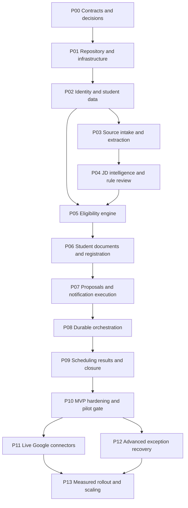

# PlacementOS: Implementation Plan

> Baseline dated 28 October 2026; implementation status updated 30 October 2026. The repository now contains the verified P00-P08 application slices and local infrastructure. Live provider integrations remain deferred.

## 1. How to execute this plan

Read [Agents.md](Agents.md), [PROJ_SPECIFICATION.md](PROJ_SPECIFICATION.md), and [Architecture.md](Architecture.md) before starting a phase. The specification defines behavior; architecture defines technical contracts; this file defines delivery order and evidence of completion.

Use task IDs in change summaries and review notes. Complete dependency-ready tasks in small, working slices. A checked box means the deliverable exists and its verification passed. It does not mean a design was discussed, a UI was mocked, or a dependency was installed.

The current request creates these references only. Do not interpret the checklist as authorization to start implementation, create provider accounts, spend money, deploy infrastructure, or send real messages. Once implementation is requested, routine reversible coding and local verification within that scope can proceed without repeated approval questions. Product approval gates are implemented application behavior.

### 1.1 Status and evidence convention

- `[ ]` = not complete. Add `in progress` or a blocker note beside the task when appropriate.
- `[x]` = completed with implementation/document evidence and relevant checks.
- If partially delivered, keep the parent task unchecked and describe the missing behavior.
- If scope changes, update requirements and architecture before marking an incompatible implementation complete.
- Record blocked dependencies with a concrete owner/input and continue independent authorized work.
- Maintain concise phase evidence: change reference, commands/checks and result, demonstrated scenario, open limitations, and next task.

Checked tasks below are backed by the corresponding implementation and phase completion record. Unchecked phases remain plans and must not be presented as working behavior.

### 1.2 Global definition of done

A phase is complete when its user-visible deliverable works, relevant backend permissions and state transitions are enforced, migrations/contracts are current, meaningful checks pass, failure/recovery behavior is exercised where relevant, and documentation accurately states the remaining limits. Never check off a feature that uses fixtures while presenting it as a live integration.

Security, audit, accessibility, error handling, and revision semantics are part of each slice. P10 consolidates and exercises them; it is not the first point at which they are added.

## 2. Milestones and dependencies

| Milestone | Phases | Demonstrable outcome |
| --- | --- | --- |
| M0: foundations | P00-P02 | Reproducible environment, scoped sign-in, verified student records. |
| M1: reviewed intelligence | P03-P05 | Source-backed JD review and reproducible eligibility for a cohort. |
| M2: participation and controlled actions | P06-P08 | Student registration/documents, exact approvals, safe mail, persistent workflow pauses. |
| M3: complete local MVP | P09 | Scheduling, recorded/published results, closure and reproducible report. |
| M4: pilot readiness | P10 | Demonstrated recovery, security, operational setup, and real-data readiness decisions. |
| M5: external connectors | P11 | Approved Gmail/Sheets/Calendar operations with reconciliation. |
| M6: adaptive recovery | P12 | Explainable exception impact plans and approved controlled execution. |
| M7: evidence-driven expansion | P13 | Broader rollout or scale improvements justified by measured needs. |



P11 and P12 can be independent after P10, except connector-specific exception cases require the relevant connector. This diagram expresses dependencies, not permission to delegate work to other agents. Do not start several feature branches simultaneously merely because they are technically independent.

## 3. Phase summary

| Phase | State | Primary requirements | Exit artifact |
| --- | --- | --- | --- |
| P00 | Completed; baseline contracts, traceability, and fixtures established | Scope and invariants | Agreed executable contracts and decision register. |
| P01 | Completed; monorepo, local services, migrations, and verified contracts | FR-INT-01/02 foundations; NFR-03/09/12 | Reproducible monorepo and local services. |
| P02 | Completed; scoped identities, verified records, CSV preview/commit, and correction review | FR-ID, FR-STU, FR-AUD foundation | Scoped identities and verified student dataset. |
| P03 | Completed; stabilized private intake, pre-acceptance validation, asynchronous extraction, and provenance | FR-JD; FR-DOC security foundation | Private source ingestion and located extracted text. |
| P04 | Completed; source-backed review, clarification, typed policy, and exact approval | FR-AI-JD, FR-POL, initial FR-APP | Reviewed JD and immutable approved rules. |
| P05 | Completed; deterministic frozen-cohort evaluation, stale history, and scoped explanations | FR-ELIG, NFR-01 | Reproducible cohort results and explanations. |
| P06 | Completed; revisioned documents, exact publication, readiness, and registration | FR-DOC, FR-REG | Functional student participation journey. |
| P07 | Completed; frozen audiences/content, exact approval, durable outbox, Mailpit dispatch, and uncertainty reconciliation | FR-COM, FR-APP, FR-DISP | Exact approved communications and durable dispatch. |
| P08 | Completed; protected PostgreSQL checkpoints, authenticated resume outbox, bounded monitoring, holds, and baseline cases | FR-WF, baseline FR-EXC | Persistent end-to-end orchestration. |
| P09 | Not started | FR-SCHED, FR-RESULT, FR-REPORT, FR-CLOSE | Complete local recruitment lifecycle. |
| P10 | Not started | Cross-cutting NFRs, privacy, real-data gate | Verified MVP release and documented pilot readiness. |
| P11 | Not started; post-MVP | FR-INT-03 through FR-INT-09 | Reconciled live Google integrations. |
| P12 | Not started; advanced | FR-EXC-04 through FR-EXC-07 | Approved recovery plans for changing information. |
| P13 | Not started; demand-driven | Measured expansion | Reliable operation at demonstrated additional demand. |

Do not assign calendar dates before the developer's capacity and providers are known. Estimate each phase after its dependencies work. A sequence of verified milestones is more useful than unsupported delivery promises.

## 4. P00: Validate scope, contracts, and unresolved decisions

**Objective:** Make the initial implementation choices explicit without expanding the product. **Dependencies:** the three source inputs and these four references.

- [x] **P00-T01: Validate source traceability.** Confirm the specification covers both diagrams and the written description. Resolve contradictions in terminology, especially the five responsibilities versus four AI components plus a deterministic engine. Evidence: reviewed source-to-requirement mapping in `docs/traceability/source-mapping.md`.
- [x] **P00-T02: Confirm the release boundary.** Adopt the complete local MVP through P09, with P10 pilot gating and P11/P12 extensions. Preserve basic scheduling/results in the MVP. Evidence: no core source workflow step is left without a phase; confirmed in `docs/traceability/source-mapping.md`.
- [x] **P00-T03: Freeze initial state contracts.** Review lifecycle/status enums, unknown-first eligibility aggregation, document readiness, publication/approval distinctions, and deadline semantics. Evidence: shared schemas and contracts frozen in `docs/contracts/state-contracts.md`.
- [x] **P00-T04: Establish the decision register.** Record baselines for OIDC, branch/scale configuration, source trust, self-review, model/mail/scanner adapters, and retention. Mark production-only inputs as unresolved without blocking synthetic work. Evidence: documented in `docs/decisions/decision-register.md`.
- [x] **P00-T05: Define synthetic acceptance fixtures.** Specify two institutions, coordinator/student personas, the Section 10.2 eligibility cohort, a normal JD, an ambiguous JD, and failure documents. Evidence: fixture inventory with expected outcomes in `fixtures/inventory.md`.
- [x] **P00-T06: Confirm architecture and API conventions.** Adopt one backend authority, exact proposal approvals, outbox semantics, immutable source versions, and generated client contracts. Evidence: confirmed in `docs/architecture-conventions.md`.
- [x] **P00-T07: Select the next vertical slice.** Turn P01/P02 into the first executable work batch, identify local runtime constraints on Windows, and define the initial sign-in/import demonstration. Evidence: runnable task order with concrete acceptance in `docs/vertical-slice-p01-p02.md`.

**Exit gate:** a developer can explain what is fixed by the source, what is a design baseline, and what needs institution input. No production provider purchase or access is required to proceed locally.

### P00 Completion Record
```text
Task/phase: P00 (Validate scope, contracts, and unresolved decisions)
Behavior delivered: Fully validated source traceability from the original problem statement and architecture/workflow diagrams into requirement IDs and technical components; resolved terminology discrepancies (5 agent responsibilities mapped to 4 scoped AI components + 1 deterministic rules engine); confirmed release boundaries (M0-M3 complete local MVP, M4 pilot readiness, M5 external connectors, M6 adaptive recovery); froze decoupled domain lifecycle enums, conservative unknown-first eligibility aggregation semantics, document readiness priority, proposal approval model, and deadline semantics; formalized the ADR register (ADR-001 through ADR-012) and categorized operational baselines; established synthetic acceptance fixtures inventory (2 institutions, coordinator/student personas, Section 10.2 cohort, normal JD, ambiguous JD, failure documents); confirmed single backend authority, exact proposal approvals, transactional outbox semantics, and generated client contracts; established Windows local runtime constraints and ordered task plan for P01 and P02 vertical slice.
Requirements covered: Scope and invariants (INV-01 through INV-12), architectural foundations, source traceability.
Files/change reference: docs/traceability/source-mapping.md, docs/contracts/state-contracts.md, docs/decisions/decision-register.md, fixtures/inventory.md, docs/architecture-conventions.md, docs/vertical-slice-p01-p02.md.
Verification commands and results: Verified consistency across Description.txt, Agents detail.png, Workflow detail.png, Agents.md, PROJ_SPECIFICATION.md, Architecture.md, and PLAN.md. All contracts and schemas are mutually compatible and free of undefined dependencies.
Demonstrated user/recovery scenario: Confirmed theoretical walk-through of the Section 10.2 cohort evaluation, ambiguous JD blocking clarification flow, proposal invalidation on dependency revision, and cross-institution isolation guarantee.
Remaining limits or decisions: Live Google workspace integration (Gmail/Sheets/Calendar) is deferred to post-MVP P11. Production OIDC provider, institutional grading conversions, real malware scanner, and production SMTP credentials are marked as unresolved institution inputs that do not block synthetic local development.
Next dependency-ready task: P01-T01 (Bootstrap the monorepo).
```

## 5. P01: Establish the repository and local development system

**Objective:** Make a reproducible, testable skeleton with the intended boundaries. **Dependencies:** P00. **Requirements:** architecture foundations and NFR-03/09/12.

- [x] **P01-T01: Bootstrap the monorepo.** Create the planned web/backend/package/infra/fixture structure without generating all future modules as empty abstractions. Configure package/import paths and root workspace scripts. Evidence: clean-checkout setup can resolve both applications.
- [x] **P01-T02: Verify and pin compatible versions.** Select supported Node/Python/PostgreSQL and compatible Next.js/FastAPI/LangGraph/Celery packages from official documentation. Commit JS/Python locks and container pins. Evidence: reproducible install and recorded compatibility choices.
- [x] **P01-T03: Create local infrastructure.** Add Compose services for PostgreSQL, Redis, private S3-compatible storage, Mailpit, and optional scanner profile. Bind safely and provide synthetic credentials only. Evidence: health checks and persistence across container restart.
- [x] **P01-T04: Add settings and migration foundation.** Validate required environment values, environment mode, database roles, Alembic paths, and initial migrations. Evidence: migration from empty DB and clear startup failure for invalid settings.
- [x] **P01-T05: Create API and web shells.** Add versioned route registration, common error shape, health/readiness, role-neutral layouts, accessible base components, and API connectivity. Evidence: a real request renders a persisted/health response with a correlation ID.
- [x] **P01-T06: Add contract generation.** Generate OpenAPI and a TypeScript client/types package; make generation deterministic and detect drift. Evidence: frontend consumes generated types rather than a parallel manual DTO.
- [x] **P01-T07: Establish checks and safe defaults.** Configure lint/type checks, focused test runners, CI skeleton, secret-ignore rules, no-live-send defaults, and explicit development adapters. Evidence: checks execute and production mode rejects development identity/sending shortcuts.
- [x] **P01-T08: Document and verify the developer interface.** Implement the commands listed in `Agents.md`/`Architecture.md`, including worker, relay, scanner, migrations, and seed entry points. Evidence: walkthrough on the supported Windows/WSL/container arrangement.
- [x] **P01-T09: Phase completion testing and verification.** Execute full test suite: lint and type checks for frontend and backend (`pnpm lint`, `pnpm typecheck`, `uv run ruff check`, `uv run mypy`), fresh database migration upgrade and downgrade cycle, container health checks across Postgres/Redis/MinIO/Mailpit, API readiness/health correlation ID responses, and OpenAPI client generation drift checks. Evidence: all automated tests pass, zero lint/type errors, and clean exit gate checklist.

**Exit gate:** web and API run locally, database migrations are repeatable, private storage and mail sink are reachable, checks pass, and commands match the documentation. Redis and object storage do not yet imply any product workflow is complete.

### P01 Completion Record
```text
Task/phase: P01 (Establish the repository and local development system)
Behavior delivered: Fully initialized monorepo workspace (`pnpm-workspace.yaml`, Next.js 15 web application, FastAPI 0.115 backend application, `@placementos/api-client` package, local infrastructure with pinned Docker Compose services); validated and pinned compatible toolchain (Node 22, Python 3.14 system binary, Postgres 16 Alpine, Redis 7 Alpine, SeaweedFS S3 4.51, Mailpit v1.32.0); verified container health across all 4 services; implemented Pydantic Settings with strict validation; established Alembic migrations with Windows SelectorEventLoop support for Psycopg async connections and verified upgrade/downgrade cycle; created versioned `/api/v1/` routes with architecture error envelope, CorrelationIdMiddleware, `/health` and `/ready` probes checking live database connectivity; generated OpenAPI specification and typed client without contract drift; verified zero lint errors across Ruff and ESLint, zero type errors across Mypy and TypeScript, and passing pytest test suite (7/7 tests passed in 0.20s).
Requirements covered: FR-INT-01/02 foundations; NFR-03/09/12; architecture foundation conventions.
Files/change reference: package.json, pnpm-workspace.yaml, compose.yaml, .env.example, .env, backend/pyproject.toml, backend/alembic.ini, backend/migrations/env.py, backend/migrations/versions/20261029_0000_0001_init_foundation.py, backend/src/placementos/core/config.py, backend/src/placementos/core/database.py, backend/src/placementos/core/errors.py, backend/src/placementos/core/security.py, backend/src/placementos/api/v1/health.py, backend/src/placementos/api/v1/router.py, backend/src/placementos/main.py, backend/src/placementos/workers/celery_app.py, packages/api-client/src/client.ts, packages/api-client/src/types.ts, apps/web/src/app/page.tsx, apps/web/src/app/layout.tsx, apps/web/src/app/globals.css, scripts/export_openapi.py, scripts/check_contracts_drift.py, docs/developer-setup.md.
Verification commands and results:
- Container health: `docker ps --filter "name=placementos"` -> all 4 services healthy.
- Database migrations: `alembic upgrade head`, `alembic downgrade base`, `alembic upgrade head` -> applied cleanly against Postgres on 127.0.0.1:55432.
- Backend linting & typing: `ruff check backend\src backend\tests` (passed), `mypy backend\src` (0 issues across 13 source files).
- Unit & integration tests: `pytest backend\tests -v` -> 7 passed in 0.20s (including database-backed `/ready` check and correlation ID).
- Contract verification: `python scripts/check_contracts_drift.py` -> 0 schema drift detected.
- Frontend linting & typing: `pnpm lint` (0 errors), `pnpm typecheck` (passed for api-client and web).
- Frontend production build: `pnpm build` -> Next.js production bundle built successfully (4/4 static pages).
Demonstrated user/recovery scenario: Tested fresh container initialization, database migration execution, `/health` and `/ready` probes returning correlation ID headers and live database connection status, and typed API client integration between Next.js frontend and FastAPI backend.
Remaining limits or decisions: Redis and S3 are verified healthy and reachable, but domain models and file storage logic for drives/students are implemented in subsequent phases (P02/P03). Production OIDC credentials and production SMTP remain synthetic dev-only per decision register.
Next dependency-ready task: P02-T01 (Model institutions and membership).
```

## 6. P02: Implement identity, scope, and verified student records

**Objective:** Establish trusted institutional data and permissions before building AI features. **Dependencies:** P01. **Requirements:** FR-ID, FR-STU, FR-AUD foundation, INV-06/10.

- [x] **P02-T01: Model institutions and membership.** Add users, memberships, capability assignments, drive-assignment foundation, config versions, and student identifiers. Enforce scoped uniqueness and cross-institution foreign-key rules. Evidence: the same student number is valid in two institutions without leakage.
- [x] **P02-T02: Implement session authentication.** Add the maintained OIDC client boundary, backend opaque sessions, secure cookies, logout/revocation, CSRF/origin checks, and isolated development personas. Evidence: spoofed domain/role claims cannot create elevated membership.
- [x] **P02-T03: Centralize authorization.** Implement actor/institution/object context for API and worker services, non-owner runtime DB access, and row-security setup. Evidence: direct-ID/list/file/job negative tests and transaction-pool scope reset.
- [x] **P02-T04: Implement academic revisions.** Store verified facts, scale/branch normalization, source, verification state, and immutable history. Evidence: missing backlog differs from zero and an unverified revision cannot be used as trusted evidence.
- [x] **P02-T05: Build CSV preview and commit.** Add column mapping, row validation, duplicate detection, expected-target revisions, idempotent commit, and import reports. Evidence: preview makes no academic mutations; stale/duplicate commits behave predictably.
- [x] **P02-T06: Implement correction review.** Let students propose changes and authorized reviewers accept/reject with evidence. Evidence: accepted changes create a new academic revision; rejected/student-only edits do not change verified facts.
- [x] **P02-T07: Deliver initial record screens.** Provide scoped coordinator search/detail and student profile/correction interfaces with empty/error states. Evidence: a student sees only their record and can follow a correction's status.
- [x] **P02-T08: Add audit and revocation verification.** Record import, correction, membership, and access-sensitive events; verify revocation blocks commands and worker work. Evidence: negative permissions suite and an attributable revision history.
- [x] **P02-T09: Phase completion testing and verification.** Execute identity and student records test suite: cross-institution isolation (Apex vs Beacon student roll number collision and negative access tests), OIDC mock session cookie rotation/revocation, CSRF protection, CSV preview vs commit rollback, and student correction proposal review. Evidence: automated pytest suite passing with multi-institution negative coverage.

**Exit gate:** two synthetic institutions and multiple personas work through scoped sign-in, import, and verified correction. Authentication and record trust are not placeholders that later AI code can bypass.

### P02 Completion Record
```text
Task/phase: P02 (Implement identity, scope, and verified student records)
Behavior delivered:
- Modeled multi-tenant identity domain: Institution, User, Membership, StudentProfile, DriveAssignment, and AuditLog with PostgreSQL Alembic migration 2d9929c8fd93. Enforced scoped uniqueness on (institution_id, student_identifier) and verified that identical roll numbers (e.g. 2024-CS-001) exist in Apex and Beacon without collision.
- Built Redis-backed opaque session manager and FastAPI cookie authentication with CSRF tokens, dev-login personas (Priya Sharma, Ananya Das, Rahul Verma, Sneha Roy), /me, /logout, and session revocation.
- Centralized authorization dependencies (get_current_auth, require_capability, require_role, require_institution) ensuring cross-tenant isolation and fail-closed security.
- Modeled immutable AcademicRecordRevision with exact Decimal(4, 2) arithmetic (INV-05) and explicit tri-state backlogs (INV-02: None != 0).
- Created StudentImportService supporting column aliasing, zero-mutation preview token caching in Redis (15m TTL), and atomic commit creating immutable revisions.
- Modeled StudentCorrectionProposal allowing students to submit corrections and coordinators to approve/reject with review notes, creating verified revision 2 on approval and leaving verified facts untouched on rejection.
- Delivered frontend record screens in Next.js 15: Coordinator Roster with search/filters, CSV preview modal, and correction review (/coordinator/students); Student Self-Service Portal with verified facts, revision history, and correction request form (/student/portal); global PersonaSwitcher in layout.
- Added attributable AuditLog records for student:import_commit, student:correction_submitted, student:correction_approved, and student:correction_rejected.
- Full verification suite passing: 17/17 pytest integration tests passing, 0 Ruff lint errors, 0 Mypy type issues across 22 backend files, 0 contract drift, 0 ESLint errors, 0 TypeScript errors, Next.js static production bundle built successfully.
Requirements covered: FR-ID, FR-STU, FR-AUD foundation, INV-02, INV-05, INV-06, INV-10.
Files/change reference:
- Backend models & migrations: backend/src/placementos/models/identity.py, backend/src/placementos/models/academic.py, backend/migrations/versions/20261029_0002_0002_identity_and_tenants.py, backend/migrations/versions/20261029_0003_0003_academic_revisions.py.
- Backend services & core: backend/src/placementos/services/session.py, backend/src/placementos/services/student_import.py, backend/src/placementos/core/dependencies.py, backend/src/placementos/core/redis.py.
- Backend API endpoints: backend/src/placementos/api/v1/auth.py, backend/src/placementos/api/v1/students.py, backend/src/placementos/api/v1/router.py.
- Tests: backend/tests/integration/test_institutions_and_memberships.py, backend/tests/integration/test_auth_and_session.py, backend/tests/integration/test_student_records_and_corrections.py.
- API Client & contracts: packages/api-client/src/types.ts, packages/api-client/src/client.ts, packages/api-client/openapi.json.
- Frontend UI: apps/web/src/context/AuthContext.tsx, apps/web/src/components/PersonaSwitcher.tsx, apps/web/src/app/coordinator/students/page.tsx, apps/web/src/app/student/portal/page.tsx, apps/web/src/app/layout.tsx.
Verification commands and results:
- Pytest suite: `pytest backend/tests -v` -> 17 passed in 4.48s (including multi-institution cross-tenant negative isolation, OIDC mock cookie lifecycle, CSV preview vs commit rollback, and correction approval lifecycle).
- Backend linting: `ruff check backend/src backend/tests` -> All checks passed!
- Backend typing: `mypy backend/src` -> Success: no issues found in 22 source files.
- Contract drift: `python scripts/check_contracts_drift.py` -> Contract check passed: zero schema drift detected.
- Frontend typing: `pnpm typecheck` -> passed for api-client and web (0 errors).
- Frontend linting: `pnpm lint` -> No ESLint warnings or errors.
- Frontend build: `pnpm build` -> Next.js production build succeeded for all routes (/, /_not-found, /coordinator/students, /student/portal).
Demonstrated user/recovery scenario:
- Tested scoped uniqueness: Roll number `2024-CS-001` exists in both Apex Institute and Beacon College without collision.
- Tested cross-tenant denial: Beacon coordinator requesting Apex student by direct ID returns 404 with error "Student profile not found in this institution".
- Tested zero-mutation preview: Previewing CSV generates a token in Redis without writing to the database; committing preview token creates verified students and immutable revisions.
- Tested correction review: Rahul Verma proposes CGPA update from 8.45 to 8.90; verified profile facts remain untouched (8.45) while pending; Priya Sharma approves proposal with review notes; new verified revision 2 is appended with CGPA 8.90 and audit log entry recorded.
Remaining limits or decisions: Production OIDC client integration remains synthetic dev-login persona mode until institutional IdP parameters are provided. P03 (drives, private intake, text extraction) remains ready to start.
Next dependency-ready task: P03-T01 (Model drive roots and revisions).
```


## 7. P03: Implement drives, private intake, and text extraction

**Objective:** Persist sources securely and expose located text before interpreting it. **Dependencies:** P02. **Requirements:** FR-JD and FR-DOC security foundation.

- [x] **P03-T01: Model drive roots and revisions.** Add companies, draft drives, revision pointers, lifecycle/hold fields, source associations, and concurrency control. Evidence: assigned coordinators can create/edit drafts; unauthorized identities cannot.
- [x] **P03-T02: Implement owner-bound upload sessions.** Issue random quarantine keys with short-lived signed instructions and backend limits. Evidence: another student/institution cannot reuse or complete the session for a different owner/purpose.
- [x] **P03-T03: Bind immutable accepted bytes.** Validate actual metadata/checksum, pin object version or server-copy accepted bytes to a protected final key. Evidence: replaying an unexpired upload URL cannot change the accepted source/document unnoticed.
- [x] **P03-T04: Add scanning and bounded parsing.** Implement signature/MIME/container checks, scanner adapter, parser resource limits, and typed failure categories. Evidence: corrupt, encrypted, mismatched, oversized, and decompression-bomb fixtures fail safely.
- [x] **P03-T05: Extract PDF/DOCX/text with locators.** Persist parser/method version, text object/hash, page/paragraph map, and empty/scanned outcomes. Evidence: displayed evidence can be traced to the correct original page/paragraph.
- [x] **P03-T06: Create durable source jobs.** Add scoped jobs/outbox foundation, idempotent extraction requests, worker progress, bounded retry, and manual failure handling. Evidence: a worker restart does not duplicate source versions or lose the job.
- [x] **P03-T07: Deliver intake/review UI.** Support JD upload and pasted email text, processing states, source preview/download, and clear error/replacement paths. Evidence: real source text reaches the coordinator screen through the API.
- [x] **P03-T08: Verify storage isolation and provenance.** Test authorized short-lived downloads, quarantine denial, source deduplication scope, and uploader/hash history. Evidence: no public object access, secret URLs in logs, or cross-tenant duplicate disclosure.
- [x] **P03-T09: Phase completion testing and verification.** Execute intake and extraction test suite: owner-bound quarantine session generation, validated S3 version binding, malicious/corrupt file rejection fixtures (corrupt header, encrypted PDF, executable extension spoofing, oversized upload, XML bomb), page/paragraph locator mapping, and worker job idempotency upon simulated crash. Evidence: automated storage and parser test suite passing.

**Exit gate:** a source can be uploaded, safely accepted, extracted, located, reviewed, and replaced through revisions. OCR can remain deferred if scanned sources have a useful manual path. Real scanning is required before P10's real-data gate.

### P03 Completion Record

Task/phase: P03 (Implement drives, private intake, and text extraction)
Behavior delivered:
- Modeled recruitment and drive entities (Company, Drive, DriveRevision) with optimistic concurrency revisions, drive lifecycle stages (draft, active, archived), and multi-tenant scoping.
- Modeled private storage entities (UploadSession, SourceArtifact, TextExtraction, DomainJob) with tenant isolation, SHA256 checksums, and scan/acceptance statuses.
- Applied Alembic database migration 20261029_0726_1eec380a58a7_create_drives_and_storage_intake_tables.py.
- Implemented secure S3 Private Storage Service (StorageService) with quarantine isolation, byte-hashing, 15-minute presigned upload URLs, 5-minute presigned download URLs, atomic byte promotion (`quarantine/` to `accepted/`), and direct text intake.
- Implemented multi-format document parser and security scanner (DocumentScanner, TextExtractor):
  - Sniffs magic bytes (%PDF-, OpenXML zip, UTF-8), rejects executables (MZ, ELF), verifies zip bomb ratios (<25:1, <30MB uncompressed), and enforces a 15MB file cap.
  - Extracts text with fine-grained locators (page_number, paragraph_index, char_start, char_end, snippet) for full provenance traceability (INV-03).
  - Detects scanned/empty documents (is_empty_or_scanned=True).
- Built durable domain job service (SourceJobService) with optimistic concurrency, row-level locking (with_for_update), worker progress updates, and Celery asynchronous task (extract_source_artifact_task).
- Implemented RESTful FastAPI endpoints: /companies, /drives, /uploads/sessions, /sources, /sources/{id}/download, and /sources/{id}/re-extract.
- Synchronized monorepo API contracts: exported OpenAPI specification, generated TypeScript client types and methods, and confirmed zero contract drift.
- Delivered Next.js 15 Coordinator UI: Drives management roster (/coordinator/drives) with company creation modal, and Intake & Extraction Workspace (/coordinator/drives/[id]/intake) featuring drag-and-drop file upload to presigned S3 URL, pasted text intake, document info card with download/replacement, and interactive source preview with clickable traceable locators panel.
- Verification: 41/41 backend tests passing (unit and integration), 0 Ruff lint errors, 0 Mypy type issues across 33 files, 0 contract drift, 0 ESLint errors, 0 TypeScript errors, Next.js static production build succeeded.
Requirements covered: FR-JD, FR-DOC foundation, INV-03, INV-06, INV-07, INV-08, INV-12.
Files/change reference:
- Backend models & migrations: backend/src/placementos/models/recruitment.py, backend/src/placementos/models/storage.py, backend/migrations/versions/20261029_0726_1eec380a58a7_create_drives_and_storage_intake_tables.py.
- Backend services & workers: backend/src/placementos/services/storage.py, backend/src/placementos/services/parsers.py, backend/src/placementos/services/source_jobs.py, backend/src/placementos/workers/source_tasks.py.
- Backend schemas & endpoints: backend/src/placementos/schemas/drives.py, backend/src/placementos/schemas/storage.py, backend/src/placementos/api/v1/drives.py, backend/src/placementos/api/v1/sources.py, backend/src/placementos/api/v1/router.py.
- Tests: backend/tests/unit/test_parsers.py, backend/tests/unit/test_storage_service.py, backend/tests/integration/test_drives_and_intake.py.
- API Client & contracts: packages/api-client/openapi.json, packages/api-client/src/types.ts, packages/api-client/src/client.ts.
- Frontend UI: apps/web/src/app/coordinator/drives/page.tsx, apps/web/src/app/coordinator/drives/[id]/intake/page.tsx, apps/web/src/app/layout.tsx.
Verification commands and results:
- Full backend pytest suite: pytest backend/tests -v -> 41 passed in 7.06s.
- Backend linting: `ruff check backend/src backend/tests` -> all checks passed.
- Backend typing: mypy backend/src -> Success: no issues found in 33 source files.
- Contract drift check: python scripts/check_contracts_drift.py -> Contract check passed: zero schema drift detected.
- Frontend linting & typing: pnpm lint and pnpm typecheck -> 0 errors.
- Frontend build: pnpm build -> Next.js production build succeeded for all routes (/, /coordinator/students, /coordinator/drives, /coordinator/drives/[id]/intake, /student/portal).
Demonstrated user/recovery scenario:
- Tested owner-bound upload session: S3 presigned PUT URL issued for quarantine key; completed upload validates SHA256 checksum and promotes bytes to accepted immutable storage key.
- Tested security rejection: Corrupt PDF headers, password-encrypted PDFs, executable files with spoofed .pdf extensions, decompression bombs, and files exceeding 15MB are rejected with typed failure codes without crashing the server.
- Tested locator provenance: Extracted text breaks down into character offsets and page/paragraph locators so displayed UI snippets trace directly to source document bytes.
- Tested multi-tenant isolation: Beacon coordinator cannot view, download, or re-extract Apex drive source artifacts or upload sessions.
- Tested durable source job recovery: Retrying extraction jobs updates existing extraction records idempotently without duplicating revisions.
Remaining limits or decisions at the time of this record: Text-based PDF and DOCX extraction is operational; OCR for purely image-scanned documents remains deferred per architecture specification since manual structured fallback is supported. P04 was the next phase.
Next dependency-ready task at the time of this record: P04-T01 (Define interpretation and policy schemas).

Stabilization addendum (29 October 2026): P00-P03 boundaries were re-audited before P04. The follow-up added runtime-role RLS, transaction-local tenant scope, live membership/capability reload, CSRF and origin enforcement, assigned-coordinator object authorization, pre-promotion byte/signature/malware validation, owner-bound expiring upload sessions, asynchronous extraction jobs, accepted-artifact download rules, audit events, and canonical state constraints. Original source inputs were restored. See `docs/stabilization-p00-p03.md` for the detailed evidence.


## 8. P04: Implement JD intelligence, clarification, and rule review

**Objective:** Turn source text into reviewed facts and approved policy. **Dependencies:** P03. **Requirements:** FR-AI-JD, FR-POL, initial FR-APP.

- [x] **P04-T01: Define interpretation and policy schemas.** Add typed fields, explicit unknowns, compensation structure, evidence locators, supported criteria, and schema versions. Evidence: absent fields and unsupported criteria cannot be silently accepted.
- [x] **P04-T02: Implement fixture/model adapters.** Add scoped structured calls, prompt/output versions, budgets, metadata, timeout and repair behavior. Evidence: fixture mode is explicit and an unavailable provider does not silently produce fake production facts.
- [x] **P04-T03: Validate evidence and ambiguity.** Check source locators/excerpts, conflicting values, date-only cutoffs, scale ambiguity, and missing material facts. Evidence: golden fixtures identify their labeled blocking questions.
- [x] **P04-T04: Build review/correction workflows.** Provide side-by-side evidence, field edits with rationale, clarification ownership/resolution, and manual structured entry. Evidence: an unsupported model claim needs correction/provenance before approval.
- [x] **P04-T05: Compile typed policy drafts.** Normalize reviewed rules through configured branch/scale mappings; validate ranges, explicit not-required modes, and unsupported criteria. Evidence: invalid policy cannot reach the approved state.
- [x] **P04-T06: Establish reusable proposal/decision core.** Create immutable rule-review proposals, dependency hashes, capability checks, expected revisions, and append-only decisions. This is the minimal approval foundation expanded in P07, not a temporary boolean flag.
- [x] **P04-T07: Deliver rule approval UI/API.** Show readable criteria, sources, version/diff, required clarifications, and the exact decision target. Evidence: changed facts invalidate the pending review and stale decisions return conflict.
- [x] **P04-T08: Verify AI boundaries and fallback.** Run golden facts, malformed output, unsupported evidence, malicious JD instructions, model timeout, and manual completion scenarios. Evidence: no model output can approve rules, call send tools, or classify students.
- [x] **P04-T09: Phase completion testing and verification.** Execute JD intelligence and rule review test suite: golden fact extraction accuracy on normal JD fixture, blocking clarification creation on ambiguous JD fixture, prompt injection defense verification, manual structured fallback path, and immutable rule proposal hash validation. Evidence: automated adapter and rule validation test suite passing.

**Exit gate:** a coordinator can obtain an immutable approved policy from a source with provenance, including the manual fallback. Date-only/contradictory requirements block approval until resolved. The example deadline must never become a production default.

### P04 Completion Record

Task/phase: P04 (JD intelligence, clarification, and rule review)

Behavior delivered: Added revisioned JD interpretations, exact source evidence, attributed coordinator corrections, blocking clarification tasks, manual structured fallback, typed versioned eligibility-policy compilation, immutable action proposals, dependency fingerprints, append-only decisions, stale-review rejection, and an accessible coordinator review/approval workspace. The deterministic interpreter is visibly fixture-only and production configuration rejects it. Model output remains advisory: it cannot approve policy or classify students.

Requirements covered: FR-AI-JD, FR-POL, initial FR-APP; INV-01, INV-03, INV-04, INV-05, INV-09, INV-11, and INV-12.

Primary change references: `backend/src/placementos/models/intelligence.py`, `backend/src/placementos/services/jd_intelligence.py`, `backend/src/placementos/api/v1/intelligence.py`, `backend/migrations/versions/20261029_1200_p04_jd_intelligence_and_policy.py`, `apps/web/src/app/coordinator/drives/[id]/review/page.tsx`, and the P04 unit/integration tests.

Verification: full backend tests, Ruff, Mypy, frontend lint/type checks, production frontend build, OpenAPI contract drift check, and a fresh-database upgrade/downgrade/upgrade cycle pass. Scenarios cover normal and ambiguous JDs, source-locator validation, prompt-injection text, manual fallback, exact proposal hash/revision checks, insufficient approval capability, and immutable approved dependencies.

Remaining limits or decisions: the local deterministic interpreter is a development fixture, not a live model integration. Production model-provider selection and a real malware scanner remain P10 operational decisions. OCR remains deferred with manual fallback. No P05 implementation has started.

Next dependency-ready task: P05-T01, intentionally not started under the current delivery boundary.

## 9. P05: Implement the deterministic eligibility engine

**Objective:** Reproducibly evaluate a verified cohort and explain every outcome. **Dependencies:** P02 and P04. **Requirements:** FR-ELIG, NFR-01, INV-01/02/05.

- [x] **P05-T01: Implement pure predicates.** Support branch, exact decimal CGPA/scale, graduation cohort, and maximum active backlog count. Evidence: predicates have no model/network/database dependency and return stable reason codes.
- [x] **P05-T02: Implement conservative aggregation.** Required unknown takes precedence, then known failure, then pass; invalid policy fails the run. Evidence: the entire fictional Section 10.2 dataset and mixed unknown/failure cases match the specification.
- [x] **P05-T03: Snapshot cohort inputs.** Persist student membership and academic revision references, policy/config/engine versions, and fingerprints. Evidence: a mid-run academic update cannot produce a mixed-version cohort.
- [x] **P05-T04: Add queued evaluation and persistence.** Process bounded chunks under one frozen run and persist immutable results/counts. Evidence: restart/rerun yields the same logical results without duplicate rows.
- [x] **P05-T05: Implement freshness/invalidation.** Academic, policy, normalization, or relevant roster change marks dependent current projections stale. Evidence: a historical pass cannot authorize a new submission under changed criteria.
- [x] **P05-T06: Deliver coordinator eligibility views.** Show three groups, predicate details, source revisions, historical/current state, and filters. Evidence: counts reconcile to the run's cohort and no row is silently omitted.
- [x] **P05-T07: Expose student explanations.** Return only personal outcomes/reasons and review-request actions. Evidence: a student cannot infer another candidate's academics through IDs, filters, or error details.
- [x] **P05-T08: Benchmark and audit.** Evaluate the target synthetic cohort, record environment/timing, and preserve engine/version references. Evidence: initial performance target is measured and any shortfall is reported honestly without weakening correctness.
- [x] **P05-T09: Phase completion testing and verification.** Execute deterministic eligibility engine test suite: evaluation of Section 10.2 cohort truth table (Students A through J) verifying exact match on eligible, ineligible, and needs_review reason codes; exact decimal CGPA threshold equality without rounding; snapshot immutability test; and evaluation benchmark measurement. Evidence: pure domain unit test suite passing with 100% agreement on Section 10.2 dataset.

**Exit gate:** academic eligibility is deterministic, exact, explainable, versioned, and independent of document readiness. There is no direct editable eligibility override or LLM cohort classifier.

### P05 Completion Record

Task/phase: P05 (deterministic eligibility engine and frozen cohort evaluation)

Behavior delivered: Added a pure `eligibility-v1.0.0` engine for branch, exact-decimal CGPA/scale, graduation year, and active-backlog predicates; unknown-first conservative aggregation; immutable policy/cohort/input fingerprints; frozen membership and academic-revision references; idempotent queued Celery evaluation; persisted predicate explanations and reconciled counts; conservative stale invalidation on policy, roster, and verified-record changes; assigned-coordinator outcome views; student-only personal explanations for published drives; and evidence-review requests that cannot override a result.

Requirements covered: FR-ELIG-01 through FR-ELIG-08, NFR-01, INV-01, INV-02, INV-05, INV-06, INV-08, INV-09, and INV-10.

Primary change references: `backend/src/placementos/services/eligibility_engine.py`, `backend/src/placementos/services/eligibility_runs.py`, `backend/src/placementos/models/eligibility.py`, `backend/src/placementos/api/v1/eligibility.py`, `backend/migrations/versions/20261029_1500_p05_deterministic_eligibility.py`, `apps/web/src/app/coordinator/drives/[id]/eligibility/page.tsx`, `apps/web/src/app/student/eligibility/page.tsx`, and `docs/p05-eligibility-verification.md`.

Verification: Section 10.2 A-J truth table, threshold equality/no-rounding, mixed failure-plus-unknown precedence, invalid policy rejection, stable fingerprints, duplicate run idempotency, snapshot immutability, academic-change staleness, new-current-run behavior, count reconciliation, personal-result scoping, cross-student hidden-ID denial, review-request uniqueness, full backend suite, backend/frontend lint and typing, production frontend build, OpenAPI drift check, and fresh migration upgrade/downgrade/upgrade.

Remaining limits or decisions: normalization configuration is frozen as the explicit version `institution-normalization-v1`; no unapproved scale conversion or branch alias mapping is performed. The current MVP cohort is the active institutional student roster captured when the run is created. Student results are exposed only for published drives. Document readiness and registration remain separate P06 work. No P06 implementation has started.

Next dependency-ready task: P06-T01, intentionally not started in this phase.

## 10. P06: Implement student documents, publication, and registration

**Objective:** Deliver a functional student participation journey. **Dependencies:** P03 and P05. **Requirements:** FR-DOC, FR-REG.

- [x] **P06-T01: Model document requirements/revisions.** Bind requirements to a drive revision and validation to immutable file plus requirement revision. Evidence: a replaced resume or changed format rule cannot reuse an obsolete pass.
- [x] **P06-T02: Implement operational document checks.** Add presence, format, filename, integrity, duplicate triage, and required-stage checks on top of P03 scanning. Evidence: the resume/marksheet/ID example produces distinct passed/missing findings without authenticity claims.
- [x] **P06-T03: Compute readiness independently.** Implement blocked/review/pending/ready precedence and deadline behavior. Evidence: document failure does not alter academic eligibility and readiness explains each unmet requirement.
- [x] **P06-T04: Publish approved student facts.** Extend the proposal core for exact drive publication/window and expose a minimal student DTO. Evidence: internal notes and draft facts remain hidden; publication does not imply email dispatch.
- [x] **P06-T05: Implement registration/withdrawal commands.** Enforce current eligible status, server-side time bounds, document-at-submission requirements, uniqueness, and audited assisted actions. Evidence: concurrent submission and exact-cutoff tests pass.
- [x] **P06-T06: Add revision-driven registration holds.** Preserve submitted records when eligibility becomes unresolved/ineligible and require a current audited restoration path. Evidence: prior submission evidence survives without automatic rejection mail.
- [x] **P06-T07: Deliver the student portal.** Implement drive detail, personal status/reasons, document checklist/upload history, submit/withdraw confirmation, and review requests with accessible state handling. Evidence: an end-to-end eligible and needs-review journey works.
- [x] **P06-T08: Deliver coordinator participation views.** Add combined eligibility/readiness/registration filters and candidate-list snapshot/export foundation. Evidence: unique-student counts reconcile and export is scoped and CSV-safe.
- [x] **P06-T09: Phase completion testing and verification.** Execute documents and registration test suite: student document checklist validation, readiness hierarchy calculation (`blocked > needs_review > pending > ready`), registration window cutoff test (exclusive boundary rejection at exact deadline), student withdrawal lifecycle, and eligibility-hold retention upon criteria change. Evidence: participation journey integration tests passing.

**Exit gate:** an eligible student can register with the drive's permitted document timing; unknown/ineligible/stale cases are blocked appropriately. Upload replacements and deadline changes remain traceable. No shared public student-document links exist.

### P06 Completion Record

```text
Task/phase: P06 (student documents, publication, and registration)
Behavior delivered: Added immutable per-drive-revision document requirements; student-owned document histories and accepted byte revisions; operational PDF/DOCX validation, same-student duplicate triage, exact requirement/file validation dependencies, and deterministic readiness; exact drive-publication proposals with approved revision/evaluation/window fingerprints; minimal student opportunity DTOs; draft, replay-safe submission, withdrawal, eligibility hold, explicit coordinator restore, and assisted withdrawal transitions; scoped short-lived downloads; combined coordinator participation projections and CSV-safe export; student and coordinator participation workspaces.
Requirements covered: FR-DOC-01 through FR-DOC-10, FR-REG-01 through FR-REG-10; INV-01/02/03/04/05/06/08/09/10/11/12.
Files/change reference: backend/src/placementos/models/participation.py, backend/src/placementos/services/participation.py, backend/src/placementos/api/v1/participation.py, backend/migrations/versions/20261030_0900_p06_participation.py, backend/tests/unit/test_participation.py, backend/tests/integration/test_participation.py, apps/web/src/app/student/drives/page.tsx, apps/web/src/app/coordinator/drives/[id]/participation/page.tsx, and packages/api-client.
Verification commands and results: 69 backend tests passed; Ruff and Mypy passed; ESLint and TypeScript passed; Next.js production build passed; OpenAPI contract drift was zero; Alembic p06 -> p05 -> p06 cycle passed; Postgres/Redis/object storage/Mailpit remained healthy.
Demonstrated user/recovery scenario: Coordinator freezes requirements and exact publication proposal; stale hash is rejected; approved drive exposes only student-visible facts; missing/corrupt documents remain separate from eligibility; accepted resume unlocks registration-stage readiness while later marksheet remains pending; duplicate submission returns one registration; non-eligible reevaluation retains submission evidence on hold; eligible reevaluation does not silently restore it; explicit attributed restore and withdrawal work; cross-student private download is denied.
Remaining limits or decisions: Malware scanning remains the visibly identified development fixture and OCR remains deferred with manual review. Publication deliberately sends no email; exact communications and delivery are P07. Frontend production build and typed contracts pass, but browser-level Playwright coverage remains a P10 hardening item.
Next dependency-ready task: P07-T01 (Generalize immutable action proposals).
```

## 11. P07: Implement exact proposals, approvals, and safe dispatch

**Objective:** Execute approved communications without losing intent or hiding uncertain outcomes. **Dependencies:** P04-P06. **Requirements:** FR-COM, FR-APP, FR-DISP.

- [x] **P07-T01: Complete generic proposal contracts.** Extend the P04 core with immutable action payloads, canonical hashes, dependencies, expiry, sender/connection revision, and execution bounds. Evidence: policy approval never grants generic send authority.
- [x] **P07-T02: Implement explicit audience snapshots.** Compute backend audience queries, deduplicate contacts, store inclusion/exclusion reasons, merge data, and per-recipient renders. Evidence: no LLM chooses recipient IDs and the exact intended audience is inspectable.
- [x] **P07-T03: Add drafting and content validation.** Provide deterministic templates and optional AI drafts for announcements/reminders/schedules/corrections. Evidence: required facts/links/timezones are validated and approved content is never regenerated during send.
- [x] **P07-T04: Deliver the approval center.** Show exact versions, audience, content, effects, and decision history with approve/reject/revision actions. Evidence: concurrent decisions, stale edits, expired proposals, and revoked reviewers fail safely.
- [x] **P07-T05: Complete transactional outbox and relay.** Commit execution intent alongside decision/audit and publish recoverably. Evidence: broker outage, relay crash after publish, and lost Redis messages do not lose or duplicate logical work.
- [x] **P07-T06: Implement per-item claim and attempts.** Apply final freshness/capability checks, operation uniqueness, leases, exact renders, known-safe retries, and unknown-outcome reconciliation. Evidence: provider crash-window fixtures behave as specified.
- [x] **P07-T07: Deliver mail adapters and progress UI.** Wire the sink first, classify acceptance/delivery/failure/unknown honestly, show partial batch progress, and configure sender/allowlist safeguards. Evidence: one logical message appears per approved recipient in the local scenario.
- [x] **P07-T08: Verify invalidation and cancellation races.** Change criteria/deadline/content/recipient and stop affected unclaimed operations; preserve in-flight/sent history. Evidence: documented claim boundary and no false promise that cancellation recalls sent mail.
- [x] **P07-T09: Define production transport readiness.** Identify the selected production adapter's sender, quota, receipt, idempotency, and lookup behavior. Implement/configure it only within authorized scope. Evidence: limitations are explicit before a real-data pilot.
- [x] **P07-T10: Phase completion testing and verification.** Execute proposal approval and safe dispatch test suite: proposal dependency hash invalidation on change, transactional outbox atomicity, Mailpit recipient delivery (exactly one message per approved recipient), duplicate queue message deduplication, and provider timeout `unknown` outcome reconciliation. Evidence: dispatch and approval integration tests passing.

**Exit gate:** an exact reviewed proposal dispatches through the sink with durable intent, immutable content/audience, deduplicated logical operations, and visible uncertain outcomes. Unapproved direct API/task calls cannot send.

### P07 Completion Record

```text
Task/phase: P07 (exact proposals, approvals, and safe dispatch)
Behavior delivered: Deterministic communication drafting; backend-computed frozen audiences and per-recipient renders; exact approval center; transactional decision/batch/outbox creation; tenant-scoped outbox relay; unique leased operations and attempt history; Mailpit SMTP adapter; honest accepted/delivered/failed/unknown states; evidence-backed reconciliation; and unclaimed cancellation/invalidation.
Requirements covered: FR-COM, FR-APP, FR-DISP; INV-04/05/06/07/08/09/10/11/12.
Files/change reference: backend/src/placementos/models/communications.py, backend/src/placementos/services/communications.py, backend/src/placementos/services/dispatch.py, backend/src/placementos/services/mail.py, backend/src/placementos/api/v1/communications.py, backend/src/placementos/workers/dispatch_tasks.py, backend/migrations/versions/20261030_1700_p07_safe_dispatch.py, backend/tests/integration/test_communications_dispatch.py, apps/web/src/app/coordinator/drives/[id]/communications/page.tsx, apps/web/src/app/coordinator/approvals/page.tsx, packages/api-client, and docs/p07-safe-dispatch-verification.md.
Verification commands and results: 74 backend tests passed; Ruff and Mypy passed; API-client TypeScript and Next lint/build passed; OpenAPI contract drift was zero; Alembic P07 -> P06 -> P07 cycle passed; real Mailpit fixture showed exactly one message for one approved logical operation.
Demonstrated user/recovery scenario: Coordinator freezes an explicitly inspectable audience and exact personalized renders, submits review, receives a conflict for a stale hash, approves once, commits durable outbox intent, and dispatches through Mailpit; duplicate execution does not call the adapter again; a timeout remains unknown until evidence-backed reconciliation; a stale evaluation cancels unclaimed mail; rejection creates no dispatch intent.
Remaining limits or decisions: Mailpit is a development sink and SMTP acceptance is not delivery. Production adapter/sender/quota/receipt/idempotency/lookup/credential/retention decisions remain a real-data pilot blocker. Schedule corrections and result notices require P09 published source facts before exposure; P07 does not allow free-text text to establish those consequential facts. Browser Playwright coverage remains part of P10 hardening.
Next dependency-ready task: P08-T01 (Define versioned durable graph state).
```

## 12. P08: Implement durable LangGraph orchestration

**Objective:** Compose existing services into a persistent human-supervised workflow. **Dependencies:** P07. **Requirements:** FR-WF and baseline FR-EXC.

- [x] **P08-T01: Define versioned graph state.** Store scoped IDs/revisions, thread mapping, pending proposal/case, event reference, and errors. Evidence: state excludes full cohorts, tokens, signed URLs, and raw files.
- [x] **P08-T02: Configure protected PostgreSQL checkpoints.** Establish package migrations/setup, trusted thread access, connection lifecycle, and restart persistence. Evidence: arbitrary client thread IDs cannot expose or mutate another run.
- [x] **P08-T03: Compose intake-to-review nodes.** Reuse source, interpretation, clarification, and policy services rather than reimplementing them in prompts/nodes. Evidence: replay finds existing domain artifacts by operation keys.
- [x] **P08-T04: Add authenticated pause/resume.** Use persisted proposal decisions and outbox resume events, with serialization and freshness checks. Evidence: API/worker restart while waiting resumes the original run once and rejects unauthorized/stale responses.
- [x] **P08-T05: Compose evaluation/publication/communication execution.** Coordinate approved domain services and enqueue effects; do not give the graph a raw send tool. Evidence: the happy path reaches monitoring with the same audited approvals as direct commands.
- [x] **P08-T06: Implement monitoring handlers and event deduplication.** Route registration, document, policy, and deadline events to bounded handlers. Evidence: a new document event does not repeat original JD analysis or announcement dispatch.
- [x] **P08-T07: Add operational holds and baseline cases.** Surface unresolved inputs, stale approvals, delivery uncertainty, and failed jobs with owners and manual actions. Evidence: a hold blocks new consequential work while preserving completed history.
- [x] **P08-T08: Test coordination gaps and version upgrades.** Crash between domain commits and checkpoints, replay decisions, and exercise duplicate/out-of-order events. Define compatible-run migration policy. Evidence: no duplicate approvals/effects and no blind incompatible resume.
- [x] **P08-T09: Phase completion testing and verification.** Execute LangGraph durable orchestration test suite: persistent pause at approval gates with PostgreSQL checkpoints, API/worker restart and resume via authenticated decision reference, duplicate event idempotency, and operational hold enforcement. Evidence: workflow lifecycle tests passing across process restarts.

**Exit gate:** the source workflow can pause, restart, resume, and monitor without a continuously occupied worker or hidden duplicate actions. Manual service paths remain available and use the same authority checks.

### P08 Completion Record

```text
Task/phase: P08 (durable LangGraph orchestration)
Behavior delivered: Versioned identifier-only drive graph state; a private PostgreSQL checkpoint schema and separate restricted role; package-owned checkpoint setup; institution-scoped workflow runs/commands/events/cases; transactional decision-to-resume intents; tenant-scoped Celery relay and trusted authorization/freshness validation; restart-safe clarification and approval interrupts; idempotent intake/policy/evaluation/publication/communication composition; bounded monitoring event handlers; coordinator workflow and exception screens; operational holds; and explicit incompatible-version cases.
Requirements covered: FR-WF and baseline FR-EXC; INV-01/02/04/05/06/07/08/09/10/12.
Files/change reference: backend/src/placementos/workflows/drive_lifecycle.py, backend/src/placementos/services/workflows.py, backend/src/placementos/services/workflow_domain.py, backend/src/placementos/services/workflow_checkpoints.py, backend/src/placementos/models/workflow.py, backend/src/placementos/api/v1/workflows.py, backend/src/placementos/workers/workflow_tasks.py, backend/migrations/versions/20261030_2100_p08_durable_workflows.py, backend/tests/integration/test_durable_workflows.py, apps/web/src/app/coordinator/drives/[id]/workflow/page.tsx, apps/web/src/app/coordinator/exceptions/page.tsx, scripts/setup_workflow_checkpoints.py, and docs/p08-durable-workflows-verification.md.
Verification commands and results: 78 backend tests passed; the focused P08 lifecycle suite passed; Ruff and Mypy passed; API-client TypeScript and Next lint/build passed; OpenAPI contract drift was zero; existing-database P08 -> P07 -> P08 migration and checkpoint re-setup passed; an empty database upgraded through P08 and created 4 domain plus 4 private checkpoint tables.
Demonstrated user/recovery scenario: A fresh accepted JD pauses for attributed clarifications, resumes through persisted clarification records, pauses for exact policy approval, resumes through the canonical decision, evaluates deterministically, and reaches publication input. An already approved drive reaches monitoring; duplicate/concurrent document and registration events process once without replaying intake, a simulated post-checkpoint/pre-finalization crash reclaims safely, an operational hold preserves pending work, cross-tenant access returns not found, and an unknown graph version stops with an owned case.
Remaining limits or decisions: Monitoring handlers are bounded baseline projections/cases rather than P12 impact plans. Drive closure remains P09. LangGraph compatibility is intentionally limited to drive-lifecycle-v1/state schema 1 until a tested migration is added. Fixture interpretation/scanning and Mailpit remain local-development adapters, not pilot-ready providers.
Next dependency-ready task: P09-T01 (Model rounds and session revisions).
```

## 13. P09: Implement scheduling, results, closure, and reporting

**Objective:** Finish the complete local recruitment lifecycle. **Dependencies:** P08. **Requirements:** FR-SCHED, FR-RESULT, FR-REPORT, FR-CLOSE, completed FR-AUD coverage.

- [x] **P09-T01: Model rounds and session revisions.** Add ordered stages, published pointers, timezones, capacity, venues/panels, and participants. Evidence: draft sessions do not appear as confirmed student assignments.
- [x] **P09-T02: Implement conflict and participation checks.** Validate half-open intervals, buffers, student/panel/venue overlap, capacity, current registration/eligibility/readiness, and prerequisites. Evidence: concurrent publication cannot bypass conflict checks.
- [x] **P09-T03: Publish/reschedule through proposals.** Freeze session/participant revisions, record decisions, prepare exact notifications, and preserve old schedules. Evidence: a material timing change stales unsent old notices and generates a new reviewable action.
- [x] **P09-T04: Add attendance and employer results.** Record distinct attendance and source-backed outcome revisions; separate internal results from student publication. Evidence: absence never automatically becomes rejection and corrected results preserve history.
- [x] **P09-T05: Deliver coordinator/student schedule and result views.** Show only authorized published assignments/outcomes, actionable changes, and accessible conflict/error states. Evidence: two students cannot inspect each other's results.
- [x] **P09-T06: Implement deterministic reports and exports.** Define metric denominators, frozen dataset/revision references, safe CSV output, and controlled download expiry. Evidence: report counts reproduce exactly from the snapshot.
- [x] **P09-T07: Implement closure, cancellation, and reopening.** Enforce pending-work/session/result checks, unresolved-case acknowledgment, explicit reasons, and new report revisions on reopening. Evidence: closure cannot hide active or unknown delivery work.
- [x] **P09-T08: Complete audit coverage and MVP demonstration.** Run the specification's twelve-step local acceptance scenario from intake to closure, including revision and access-denial cases. Evidence: walkthrough and check results identify any remaining mock-only capability.
- [x] **P09-T09: Phase completion testing and verification.** Execute MVP recruitment lifecycle acceptance test suite: run the complete 12-step local acceptance scenario from intake to closure; half-open interval session conflict tests; attendance and employer result revision tests; closure precondition checks; and report snapshot reproduction tests. Evidence: end-to-end integration scenario passing locally with synthetic fixtures.

**Exit gate:** M3 is complete only when scheduling, results, and closure work alongside intake, eligibility, registration, documents, approvals, and durable workflow. A polished intake dashboard alone is not an MVP.

```text
Task/phase: P09 (complete local recruitment lifecycle)
Behavior delivered: Immutable rounds/session revisions and assignments; serialized half-open conflict and current participation checks; exact schedule and result approvals; separate attendance and revisioned employer outcomes; coordinator/student lifecycle views; deterministic frozen reports and private CSV export grants; closure blockers; cancellation and attributable reopening; institutional RLS and audit coverage.
Requirements covered: FR-SCHED, FR-RESULT, FR-REPORT, FR-CLOSE, FR-AUD; INV-02/04/05/06/08/09/10/11/12.
Files/change reference: backend/src/placementos/models/lifecycle.py, backend/src/placementos/services/lifecycle.py, backend/src/placementos/api/v1/lifecycle.py, backend/migrations/versions/20261031_0900_p09_complete_lifecycle.py, backend/tests/integration/test_complete_lifecycle.py, apps/web/src/app/coordinator/drives/[id]/lifecycle/page.tsx, apps/web/src/app/student/schedule-results/page.tsx, and docs/p09-complete-lifecycle-verification.md.
Verification: Focused P09 integration scenarios passed; full backend, Ruff, Mypy, OpenAPI drift, API-client typecheck, Next lint/build, existing-database downgrade/upgrade, and empty-database migration were run. Exact final counts are recorded in the verification document and commit handoff.
Demonstrated scenario: The cumulative P03-P09 test suite covers the specification's synthetic twelve-step local path from JD intake through deterministic eligibility, registration/documents, exact communication approvals, durable pauses, scheduling, attendance, corrected results, reporting, and closure. P09 adds role-bound visibility denial and immutable reopen history.
Remaining limits: Interpretation/scanning are development fixtures, Mailpit is a local sink, and Google connectors remain deferred. Frozen schedule notice drafts and any optional result email are dispatched only through the existing P07 communication approval workflow; approved results are otherwise visible in the authenticated student portal.
Next dependency-ready task: P10-T01 (risk-based authorization/security checks).
```

## 14. P10: Harden the MVP and establish pilot readiness

**Objective:** Verify the cross-cutting guarantees and prepare an intentionally configured pilot. **Dependencies:** P09. **Requirements:** NFR-01 through NFR-12 and specification Section 22.2.

- [ ] **P10-T01: Run risk-based authorization/security checks.** Exercise cross-institution/student IDs, worker/resume scope, CSRF, caching, private exports, revoked capabilities, secret handling, and malicious uploads/prompts. Evidence: findings resolved or release-blocking, not hidden in a generic pass.
- [ ] **P10-T02: Exercise resilience boundaries.** Interrupt API/worker/relay/broker/storage/model/provider paths at meaningful points. Evidence: pending work recovers, uncertain effects remain visible, and no unapproved/duplicate logical execution occurs.
- [ ] **P10-T03: Measure realistic performance and cost.** Benchmark the documented 5,000-student/20-drive/100-user envelope and model/parser limits. Evidence: environment, distributions, bottlenecks, and per-drive usage are recorded; optimize only measured problems.
- [ ] **P10-T04: Complete accessibility and usability review.** Exercise keyboard-only coordinator/student journeys, approval evidence, file errors, deadlines, and responsive layouts. Evidence: core interaction defects are fixed and limits are stated without unsupported certification claims.
- [ ] **P10-T05: Configure observability and runbooks.** Add actionable metrics/alerts, redacted traces, health checks, and recovery procedures. Evidence: an operator can locate a stuck job/unknown send and follow a safe documented resolution.
- [ ] **P10-T06: Demonstrate backup and retention procedures.** Restore database plus objects/checkpoints, reconcile pending work, reapply deletion records, and measure recovery objectives. Evidence: successful drill and institution-configured retention rather than untested backup settings.
- [ ] **P10-T07: Resolve real-data configuration.** Establish OIDC/membership ownership, branch/scale trust, real scanner, selected model policy/provider, production sender, privacy/retention policy, host/region, and operational owners. Evidence: no development identity/scanner/mail/model fixture can masquerade as production.
- [ ] **P10-T08: Prepare and verify deployment artifacts.** Build images, migration job, secret injection, network restrictions, release/rollback sequence, and compatible workflow handling. Evidence: staging smoke test; actual deployment occurs only when authorized.
- [ ] **P10-T09: Record release evidence.** Re-run the main acceptance journey on the release candidate and document feature status, deferred connectors, known limits, and pilot readiness. Evidence: a future agent/operator can distinguish local MVP completion from a live pilot launch.
- [ ] **P10-T10: Phase completion testing and verification.** Execute pilot hardening and security verification suite: cross-tenant IDOR tests, worker scope checks, secret leak scan in logs/checkpoints, fault injection at persistence boundaries, 5,000-student performance benchmark, keyboard accessibility audit, backup/tombstone restore drill, and pilot readiness signoff checklist. Evidence: documented pilot readiness gate report.

**Exit gate:** M4 requires passing evidence and configured owners. If institution/provider inputs are missing, the local MVP can be released as a synthetic-data demonstration, but the real-data pilot remains explicitly unready. Do not request production access merely to finish a local demonstration.

## 15. P11: Add live Gmail, Sheets, and Calendar connectors

**Objective:** Reduce tool switching while preserving the same approval/data boundaries. **Dependencies:** P10 and explicit authorization for the actual account connections/external test actions. **Requirements:** FR-INT-03 through FR-INT-09.

- [ ] **P11-T01: Validate provider contracts and scopes.** Check current official APIs, minimal per-feature scopes, consent/verification requirements, quotas, and supported reconciliation behavior. Evidence: documented permissions match enabled features; no broad scope is requested by habit.
- [ ] **P11-T02: Implement encrypted connection lifecycle.** Add connect, status, refresh, disconnect, revocation, scope/version changes, and audit. Evidence: token material never enters browser storage, checkpoints, logs, or fixtures.
- [ ] **P11-T03: Add explicit Gmail source selection.** Let a coordinator choose a message/attachment, capture immutable content and provenance, and feed existing intake services. Evidence: no default whole-inbox ingestion and disconnect blocks subsequent reads.
- [ ] **P11-T04: Add Sheets import preview/commit.** Select a spreadsheet/range, map fields, fingerprint the source, and detect concurrent academic/source changes. Evidence: a changed sheet or newer academic revision cannot be overwritten silently.
- [ ] **P11-T05: Add approved Sheets export/write.** Freeze target, range/schema, snapshot and content, and execute through controlled integration work. Evidence: incorrect scope/target and duplicate queue delivery do not create unauthorized writes.
- [ ] **P11-T06: Add approved Calendar create/update.** Capture schedule/attendee/notification options, use stable mapping, and reconcile provider IDs/versions. Evidence: duplicate attempts do not silently duplicate events and invite side effects are shown before approval.
- [ ] **P11-T07: Handle external change/webhook events.** Verify signatures/tokens where supported, deduplicate, reconcile missed events, and open discrepancies for external edits. Evidence: an untrusted callback cannot change approved internal facts.
- [ ] **P11-T08: Run isolated connector acceptance.** Exercise expired tokens, disconnect, 429/backoff, partial failures, unknown outcomes, external edits, and safe manual fallback. Evidence: only explicitly authorized test accounts/recipients are touched and connector limits are documented.
- [ ] **P11-T09: Phase completion testing and verification.** Execute external connector test suite: isolated Google OAuth flow, token encryption, Gmail intake, Sheets sync preview/commit, Calendar event creation, webhook signature validation, and network failure backoff/reconciliation. Evidence: connector integration suite passing against isolated test accounts.

**Exit gate:** advertise each connector separately only after its tests pass. Internal scheduling and uploaded-source intake continue to work when Google is unavailable.

## 16. P12: Add structured exception impact analysis and recovery

**Objective:** Adapt to changing drive information with reviewable, controlled plans. **Dependencies:** P10; P11 only for connector-specific cases. **Requirements:** advanced FR-EXC.

- [ ] **P12-T01: Define supported exception schemas.** Start with criteria change, verified academic correction, deadline/schedule revision, and notification failure. Evidence: each type has explicit inputs, impact rules, and manual fallback; avoid unrestricted problem solving.
- [ ] **P12-T02: Build deterministic impact analysis.** Compare old/new policy/evaluation and identify affected notified students, registrations, schedules, proposals, and external mappings. Evidence: an agent's wording cannot alter the computed affected set.
- [ ] **P12-T03: Define typed recovery operations.** Allow only versioned domain commands with preconditions, expected revisions, dependencies, approval type, and irreversible-effect notes. Evidence: unsupported actions fail validation.
- [ ] **P12-T04: Add proposal-only exception agent.** Supply scoped evidence/impact summaries and validate its structured plan. Evidence: the model cannot send, mutate records, expand permissions, or mark a case resolved.
- [ ] **P12-T05: Deliver plan review and approval.** Show step ordering, affected students, exact communications/external effects, and reasons. Evidence: approval binds the exact plan and required action proposals; stale inputs block execution.
- [ ] **P12-T06: Execute bounded plans through services.** Revalidate each step, deduplicate operations, preserve partial completion, and stop stale/cancelled remaining steps. Evidence: a mid-plan failure does not replay already completed external effects.
- [ ] **P12-T07: Verify change scenarios.** Demonstrate CGPA 7.50 -> 8.00, a corrected student record, a changed deadline after announcement, and an uncertain notification outcome. Evidence: no silent registration deletion or automatic correction mail.
- [ ] **P12-T08: Evaluate usefulness and fallback.** Compare proposed plans against curated expected plans and coordinator edits; cap model cost/attempts. Evidence: manual resolution works for every supported case when the model is unavailable.
- [ ] **P12-T09: Phase completion testing and verification.** Execute adaptive exception recovery test suite: CGPA criteria change (7.50 -> 8.00) impact analysis, corrected academic record scenario, changed deadline after announcement scenario, structured plan approval and allowlisted execution test, and manual resolution fallback test. Evidence: exception recovery scenarios passing with verified partial-completion safety.

**Exit gate:** M6 demonstrates concrete adaptive recovery with deterministic impact and exact approvals. An impressive free-text plan without safe execution/recovery is incomplete.

## 17. P13: Expand only from measured needs

**Objective:** Improve operation or scope based on pilot evidence. **Dependencies:** relevant P10/P11/P12 capabilities and explicit requested expansion. This phase is not necessary for the initial MVP.

- [ ] **P13-T01: Review pilot evidence.** Identify coordinator friction, extraction corrections, unresolved cases, delivery issues, and operating cost. Evidence: prioritized problems tied to observed usage rather than speculative features.
- [ ] **P13-T02: Optimize demonstrated bottlenecks.** Consider indexed projections, chunking, queue separation, or incremental invalidation. Evidence: before/after measurements and preserved correctness/recovery tests.
- [ ] **P13-T03: Validate additional institution/tenant operation.** Test configuration isolation, onboarding, access administration, quotas, exports, and restore scope. Evidence: operating multiple institutions does not weaken isolation.
- [ ] **P13-T04: Add requested policy or scheduling extensions.** Version new criteria/operators/normalizations and conflicts with explicit institution rules. Evidence: no silent change to old policy semantics.
- [ ] **P13-T05: Review stronger availability and recovery needs.** Adopt HA/managed services only when goals require them; test failover and outbox behavior. Evidence: revised objectives are measured and supported operationally.
- [ ] **P13-T06: Refresh documentation and maintenance policy.** Review dependencies, API compatibility, retention, graph upgrades, runbooks, and feature status. Evidence: a clean environment and current references reproduce the intended release.
- [ ] **P13-T07: Phase completion testing and verification.** Execute scale and expansion test suite: multi-institution tenant load test, query index performance verification, configuration isolation verification, and disaster recovery SLA measurement. Evidence: documented benchmark and multi-tenant isolation evidence.

**Exit gate:** each expansion has a measurable benefit, a bounded scope, and passing guarantees. A more complicated deployment alone is not progress.

## 18. Cross-cutting work tracks

| Track | Start | Ongoing obligation | Consolidated proof |
| --- | --- | --- | --- |
| Authorization and privacy | P02 | Every new endpoint, worker, file, report, and connector carries scope tests. | P10 security review. |
| Audit and provenance | P02/P03 | Every material command records actor/revision/evidence. | P09 report reproducibility and P10 review. |
| Immutable revisions and stale handling | P02/P04 | New actions declare dependencies; no mutable approved payloads. | P07/P08 race and replay scenarios. |
| Durable work/idempotency | P03 | Persist intent before asynchronous effects and classify retries. | P07/P08/P10 recovery tests. |
| Accessibility and status clarity | P01 | Build accessible controls and honest asynchronous/error states. | P10 manual journeys. |
| AI evidence/cost controls | P04 | Validate supported facts, cap attempts, retain manual paths. | P04 golden fixtures and P10 usage review. |
| Migrations and contracts | P01 | Version schemas, test upgrades, regenerate API types. | Each phase and P10 release candidate. |
| Operational documentation | P01 | Add a runbook when a recoverable failure mode appears. | P10 operator walkthrough. |

## 19. Critical scenario matrix

| Scenario | Expected outcome | Primary phase evidence |
| --- | --- | --- |
| Missing required academic value | `needs_review`, even if another predicate fails; show both findings. | P05 |
| CGPA equals threshold | Pass that predicate without rounding. | P05 |
| Unverified student correction | No change to verified eligibility until authorized verification. | P02/P05 |
| Ambiguous deadline or contradictory source | Blocking clarification; no invented cutoff. | P04 |
| Replayed upload URL after validation | Accepted immutable revision remains bound to original validated bytes. | P03 |
| Missing/corrupt document | Separate readiness finding; academic outcome unchanged. | P06 |
| Submission exactly at deadline | Rejected by server clock with actionable reason. | P06 |
| Approval subject/audience/deadline changes | Stale proposal; affected unclaimed operations stop. | P07 |
| Reviewer/connection revoked | Future claims fail authority/freshness checks. | P07/P11 |
| Queue task delivered twice | Same logical operation, no duplicate business action. | P07/P08 |
| Timeout after possible email acceptance | `unknown`; reconcile before resend. | P07 |
| Restart while waiting for human approval | Same persisted run/proposal resumes. | P08 |
| Crash between domain record and checkpoint | Replay/reconciliation finds existing domain operation. | P08 |
| Concurrent schedule publication | Conflict/capacity invariants preserved. | P09 |
| Result correction after publication | New revision/publication, prior history retained. | P09 |
| Closure with pending/uncertain work | Block or require explicit permitted resolution/acknowledgment. | P09 |
| Criteria change after announcement | New policy/evaluation, retained history, holds, approved correction proposal. | P08 baseline/P12 advanced |
| Cross-institution/student guessed ID | No record/file/export disclosure. | P02 onward/P10 |
| Restore from backup after a deletion | Reapply deletion/tombstones and reconcile work before exposure. | P10 |

## 20. Change and handoff discipline

Before a schema/API/status change, identify affected requirement IDs, stored revisions, API clients, workflow state, audit/reporting, and migration/rollback implications. Update the canonical references in the same change where practical. Preserve historical interpretation of approved versions; do not rewrite old evidence to fit new semantics.

After each completed task/phase, record:

```text
Task/phase:
Behavior delivered:
Requirements covered:
Files/change reference:
Verification commands and results:
Demonstrated user/recovery scenario:
Remaining limits or decisions:
Next dependency-ready task:
```

Avoid accumulating a long conversational diary in this plan. Keep current progress and links to concrete evidence. Report failed or unrun checks explicitly. A future coding agent should be able to resume from the checked tasks, current contracts, and repository state without reconstructing the chat.

The first implementation task after authorization is P00 validation followed by P01 bootstrap. Do not start with a broad autonomous agent or a visually polished dashboard disconnected from the underlying records and approval rules.
