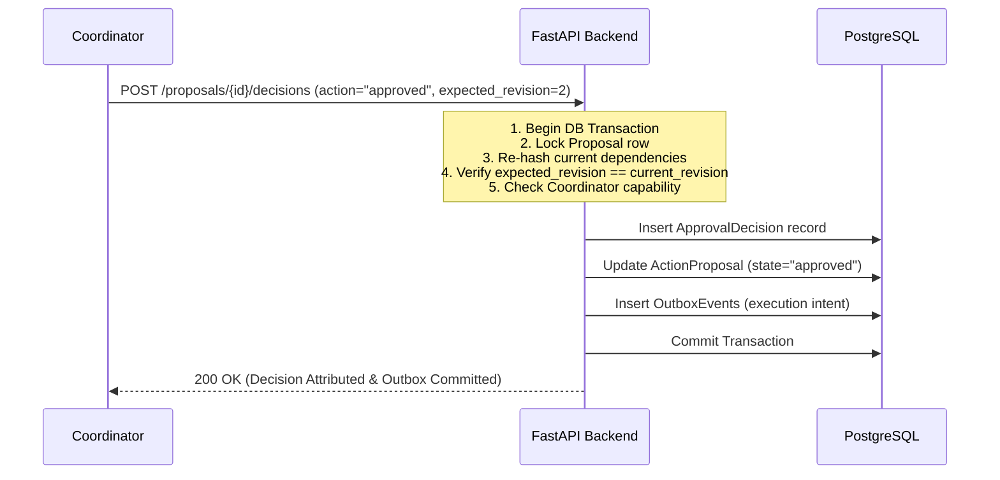

# PlacementOS: Architecture and API Conventions

> Phase P00 Deliverable: P00-T06  
> Date: 29 October 2026  
> Status: Confirmed Baseline Specifications

---

## 1. Single Backend Authority Principle

PlacementOS strictly enforces that **FastAPI domain services are the single authority** for:
- Identity, session management, and capability authorization.
- Academic eligibility calculation and snapshot invalidation.
- File quarantine verification and document readiness evaluation.
- Proposal creation, approval decision verification, and outbox execution.
- Workflow run state transitions and coordination.

The Next.js web application (`apps/web`) acts solely as a client presentation layer. It does not open database connections, evaluate business rules, or make direct third-party provider calls.

---

## 2. API Design Conventions

### 2.1 Route Structure & Versioning
- All business APIs are prefixed with `/api/v1/`.
- Authentication endpoints are routed under `/auth/` (`/auth/login`, `/auth/callback`, `/auth/logout`, `/auth/session`).
- Public reverse proxy routes both Next.js frontend and FastAPI backend behind a single origin (e.g. `http://localhost:3000` in dev), avoiding cross-origin credential issues.

### 2.2 Standard Error Envelope
All error responses adhere strictly to the following JSON structure:
```json
{
  "error": {
    "code": "PROPOSAL_STALE",
    "message": "The registration deadline was revised. Please review the updated proposal.",
    "correlation_id": "c7a8b92d-e134-4b55-9a8f-2849e7fa1203",
    "details": {
      "resource_type": "action_proposal",
      "proposal_id": "prop-8821",
      "current_revision": 4,
      "changed_dependencies": ["drive_revision"]
    }
  }
}
```

#### HTTP Status Code Mapping:
- `400 Bad Request / 422 Unprocessable Entity`: Input validation failure (malformed payload or domain invalidity).
- `401 Unauthorized`: Missing, expired, or invalid session cookie.
- `403 Forbidden`: Authenticated actor lacks required capability or target is outside actor's institution scope.
- `404 Not Found`: Target resource does not exist or is hidden by tenant scope (`INV-06`).
- `409 Conflict`: Concurrency conflict, stale expected revision, or duplicate unique operation.
- `412 Precondition Failed`: Conditional header (`If-Match`) mismatch.
- `429 Too Many Requests`: Rate or quota limit exceeded.
- `503 Service Unavailable`: Downstream critical dependency unavailable (e.g. database offline).

### 2.3 Generated Client Contracts
- FastAPI automatically exports an `openapi.json` contract reflecting all Pydantic request/response schemas.
- The `packages/api-client` package compiles this schema into a fully typed TypeScript SDK using deterministic code generation.
- The frontend strictly imports from `@placementos/api-client`. Manual duplicate TypeScript interfaces for backend DTOs are forbidden.

---

## 3. Exact Proposal Approvals & Canonical Hashing

To enforce Invariant `INV-04`, any consequential action (approving a policy, publishing a drive, dispatching emails, publishing schedules or results) must follow the **Action Proposal Pattern**:



### Proposal Canonical Envelope:
```json
{
  "proposal_id": "prop-4491",
  "institution_id": "inst-apex-01",
  "action_type": "dispatch_announcement",
  "revision": 2,
  "canonical_hash": "e3b0c44298fc1c149afbf4c8996fb92427ae41e4649b934ca495991b7852b855",
  "dependencies": {
    "drive_revision": 3,
    "policy_version": 2,
    "evaluation_run": "eval-7712",
    "recipient_snapshot": "snap-9901"
  },
  "payload": {
    "template_id": "tpl-drive-announce",
    "subject": "Nexora Technologies Recruitment Drive Announcement",
    "recipient_count": 84
  }
}
```

---

## 4. Transactional Outbox Pattern & Idempotency

### 4.1 Transactional Guarantee
Side effects are never executed directly within an HTTP request. 
Instead:
1. The domain mutation, approval decision, audit event, and `outbox_events` records are written in **a single PostgreSQL transaction**.
2. An Outbox Relay worker queries committed `outbox_events` and enqueues tasks to Celery/Redis.
3. Dispatch workers claim individual outbox operations, check freshness immediately prior to execution, and invoke provider adapters.

### 4.2 Deduplication & Idempotency Keys
- Every external operation carries an immutable logical key:
  $$\text{OperationKey} = \text{hash}(\text{institution\_id}, \text{proposal\_id}, \text{recipient\_id}, \text{action\_kind})$$
- The database enforces a unique constraint on `OperationKey`.
- Redelivered queue messages or concurrent worker attempts are recognized by the uniqueness constraint and gracefully resolved without duplicate side effects (`INV-08`).

---

## 5. Temporal, Decimal, & Pagination Standards

- **Timestamps:** ISO-8601 UTC with offset `Z` (e.g. `2026-11-05T18:29:59.000Z`).
- **Decimals:** Academic metrics (CGPA, CTC) are serialized as string representations of exact decimals (e.g. `"7.50"`, `"14.50"`) to avoid floating-point inaccuracies.
- **Pagination:** Cursor-based pagination using base64-encoded opaque cursor tokens with deterministic sort keys:
  ```json
  {
    "items": [...],
    "page_info": {
      "has_next_page": true,
      "end_cursor": "eyJpZCI6ICJzdHUtMDA1In0="
    }
  }
  ```
