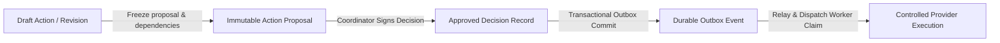

# PlacementOS: State Contracts, Lifecycle Enums, and Semantics

> Phase P00 Deliverable: P00-T03  
> Date: 29 October 2026  
> Status: Frozen Baseline for Implementation

---

## 1. Domain Lifecycle and Status Enums

To prevent semantic conflation across business aggregates (e.g., confusing document readiness with academic eligibility), all domain state machines are decoupled and strictly enumerated.

```
┌────────────────────────────────────────────────────────────────────────┐
│                        DECOUPLED STATE MACHINES                        │
├───────────────────┬───────────────────┬────────────────────────────────┤
│ Drive Lifecycle   │ Policy Version    │ Action Proposal                │
│ ├─ draft          │ ├─ draft          │ ├─ draft                       │
│ ├─ published      │ ├─ in_review      │ ├─ pending_approval            │
│ ├─ reg_closed     │ ├─ approved       │ ├─ approved                    │
│ ├─ in_progress    │ ├─ superseded     │ ├─ rejected                    │
│ ├─ completed      │ └─ rejected       │ ├─ stale                       │
│ ├─ archived       │                   │ ├─ expired                     │
│ └─ cancelled      │                   │ ├─ cancelled                   │
│                   │                   │ ├─ executing                   │
│                   │                   │ ├─ partially_executed          │
│                   │                   │ ├─ executed                    │
│                   │                   │ └─ failed                      │
├───────────────────┼───────────────────┼────────────────────────────────┤
│ Academic Result   │ Document State    │ Registration State             │
│ ├─ eligible       │ ├─ pending        │ ├─ draft                       │
│ ├─ ineligible     │ ├─ validating     │ ├─ submitted                   │
│ └─ needs_review   │ ├─ passed         │ ├─ withdrawn                   │
│                   │ ├─ failed         │ ├─ eligibility_hold            │
│                   │ ├─ needs_review   │ └─ cancelled                   │
│                   │ └─ quarantined    │                                │
└───────────────────┴───────────────────┴────────────────────────────────┘
```

### 1.1 Enumeration Reference Table

| Aggregate | Enumerated Values | Terminal / Immutable States | Transition Restrictions |
| :--- | :--- | :--- | :--- |
| **`DriveLifecycle`** | `draft`, `published`, `registration_closed`, `in_progress`, `completed`, `archived`, `cancelled` | `completed`, `archived`, `cancelled` | Cannot reach `completed` with active unclaimed outbox or unresolved critical exceptions. Reopening creates a new revision. |
| **`WorkflowRunStatus`**| `queued`, `running`, `waiting_clarification`, `waiting_rule_approval`, `waiting_action_approval`, `monitoring`, `failed_retryable`, `failed_terminal`, `completed`, `cancelled` | `completed`, `failed_terminal`, `cancelled` | Resuming from `waiting_*` requires authenticated domain event with matching proposal/decision hash. |
| **`PolicyVersionStatus`**| `draft`, `in_review`, `approved`, `superseded`, `rejected` | `approved`, `superseded`, `rejected` | `approved` is strictly insert-only and immutable. Modifying criteria creates a new version. |
| **`ProposalState`** | `draft`, `pending_approval`, `approved`, `rejected`, `stale`, `expired`, `cancelled`, `executing`, `partially_executed`, `executed`, `failed` | `rejected`, `stale`, `expired`, `cancelled`, `executed`, `failed` | Changed dependencies automatically transition `pending_approval` -> `stale`. |
| **`ApprovalDecisionType`**| `approved`, `rejected`, `revision_requested` | All decisions are append-only historical records | Stale proposal rejects decision with HTTP 409 Conflict. |
| **`EligibilityOutcome`**| `eligible`, `ineligible`, `needs_review` | Evaluated snapshot results are immutable | Direct manual edits prohibited; resolved via academic record correction or policy revision. |
| **`DocumentValidationStatus`**| `pending`, `validating`, `passed`, `failed`, `needs_review`, `quarantined`, `superseded` | `passed`, `failed`, `quarantined`, `superseded` | `quarantined` files fail security/malware checks and cannot be previewed or downloaded. |
| **`DocumentReadiness`**| `ready`, `pending`, `blocked`, `needs_review` | Derived dynamically or cached with fingerprint | Priority order: `blocked` > `needs_review` > `pending` > `ready`. |
| **`RegistrationState`**| `draft`, `submitted`, `withdrawn`, `eligibility_hold`, `cancelled` | `withdrawn`, `cancelled` | Ineligibility post-submission transitions registration to `eligibility_hold`, never silent deletion. |
| **`NotificationItemStatus`**| `pending`, `claimed`, `provider_accepted`, `delivered`, `failed_retryable`, `failed_permanent`, `unknown`, `cancelled` | `delivered`, `failed_permanent`, `cancelled` | Timeout after potential provider transmission transitions to `unknown`, requiring explicit reconciliation. |
| **`SessionStatus`** | `draft`, `published`, `completed`, `cancelled` | `completed`, `cancelled` | Publication requires conflict resolution across venue, panel, and participants. |
| **`ExceptionCaseStatus`**| `open`, `triaged`, `plan_proposed`, `waiting_approval`, `executing`, `resolved`, `dismissed` | `resolved`, `dismissed` | Execution occurs only through allowlisted backend commands. |

---

## 2. Conservative Eligibility Aggregation Semantics

### 2.1 The Baseline Predicates
The engine evaluates four pure predicates for each student $s$:
1. $B(s)$: Branch match $\in \text{allowed\_branches}$
2. $C(s)$: Normalized CGPA $\ge \text{minimum\_cgpa}$ (exact decimal comparison, no binary float rounding)
3. $G(s)$: Graduation year $\in \text{graduation\_cohorts}$
4. $N(s)$: Active backlogs $\le \text{max\_active\_backlogs}$

Each predicate evaluates to a tri-state: `True`, `False`, or `Unknown`.
A predicate is `Unknown` if evidence is missing (e.g., null backlog count), unverified, contradictory, or on an unmapped grading scale.

### 2.2 Aggregation Logic (Unknown-First Precedence)
```python
def aggregate_eligibility(predicate_results: dict[str, PredicateFinding]) -> EligibilityOutcome:
    # Rule 1: Any required unknown forces review
    if any(p.outcome == TriState.UNKNOWN for p in predicate_results.values() if p.is_required):
        return EligibilityOutcome.NEEDS_REVIEW
    
    # Rule 2: Any required failure forces ineligibility
    if any(p.outcome == TriState.FALSE for p in predicate_results.values() if p.is_required):
        return EligibilityOutcome.INELIGIBLE
    
    # Rule 3: All required predicates satisfied
    return EligibilityOutcome.ELIGIBLE
```

### 2.3 Aggregation Truth Table

| Branch $B(s)$ | CGPA $C(s)$ | Grad Year $G(s)$ | Backlog $N(s)$ | Overall Outcome | Explanation / Reason Display |
| :---: | :---: | :---: | :---: | :---: | :--- |
| `True` | `True` | `True` | `True` | **`eligible`** | Satisfies all required criteria. |
| `True` | `False` | `True` | `True` | **`ineligible`** | `CGPA_BELOW_MINIMUM` |
| `False` | `True` | `True` | `True` | **`ineligible`** | `BRANCH_NOT_ALLOWED` |
| `True` | `True` | `True` | `False` | **`ineligible`** | `ACTIVE_BACKLOGS_EXCEED_LIMIT` |
| `True` | `True` | `True` | **`Unknown`** | **`needs_review`** | `REQUIRED_VALUE_MISSING: active_backlogs` |
| `False` | `True` | `True` | **`Unknown`** | **`needs_review`** | Shows both `BRANCH_NOT_ALLOWED` and `REQUIRED_VALUE_MISSING: active_backlogs` |
| `True` | `False` | `True` | **`Unknown`** | **`needs_review`** | Shows both `CGPA_BELOW_MINIMUM` and `REQUIRED_VALUE_MISSING: active_backlogs` |

> **Critical Invariant (`INV-02`):** When both a known failure and an unknown value occur, the overall status is **`needs_review`** to protect against faulty rejections caused by corrupted or incomplete profile records.

---

## 3. Document Readiness Hierarchy

Document readiness represents the operational readiness of a student's required submissions for a drive. It is calculated independently from academic eligibility.

### 3.1 Precedence Calculation
Given a drive requirement revision and a student's accepted document revisions:
1. **`blocked`**: If any required document has `DocumentValidationStatus == failed` (e.g. corrupt PDF, wrong MIME), or if a document required by the current stage is overdue.
2. **`needs_review`**: If not blocked, but any required document check is flagged with `needs_review` (e.g. scanned image with unreadable text, potential mismatch).
3. **`pending`**: If not blocked or under review, but one or more required documents have not yet been submitted (`missing`) and the deadline has not passed.
4. **`ready`**: Every required document has an accepted current revision that passed all validation checks (`passed`).

---

## 4. Distinction Between Publication, Approval, and Execution

To avoid accidental side effects, three distinct operational phases are maintained:



1. **Drafting:** Creating or editing a drive, schedule, or communication template. No external visibility or effects.
2. **Proposal:** An immutable snapshot of the intended action payload, audience query snapshot, and exact dependency fingerprints.
3. **Approval:** An append-only record signed by an authorized coordinator binding to the proposal's SHA-256 fingerprint.
4. **Publication:** Making approved drive facts or approved schedule sessions visible to students in their portal. Does not send emails.
5. **Execution:** Claiming individual outbox records and calling external adapters (e.g. Mailpit, SMTP, Calendar).

---

## 5. Deadline and Temporal Semantics

- **Timezone Awareness:** All timestamps in database records and API requests/responses must be formatted in UTC ISO-8601 (`timestamptz`). Detailed endpoints return the configured institution IANA timezone (e.g. `Asia/Kolkata`) for presentation.
- **Server Clock Authority:** All cutoffs are evaluated by the backend database/server clock. Client countdown timers are purely cosmetic.
- **Half-Open Intervals:** 
  - Time windows are defined as $[\text{opens\_at}, \text{deadline\_at})$.
  - Opening is inclusive; cutoff is exclusive: $\text{opens\_at} \le \text{now} < \text{deadline\_at}$.
  - A submission attempt at exactly `23:59:59.000` when the deadline is `23:59:59.000` is rejected with `REGISTRATION_WINDOW_CLOSED`.
- **Date-Only Ambiguity:** If an extracted source mentions a date only (e.g. "Deadline: 5th Nov 2026"), the system **never** invents `23:59:59` or `17:00:00`. It marks the field as requiring human clarification until an authorized coordinator explicitly confirms the cutoff time and timezone.
